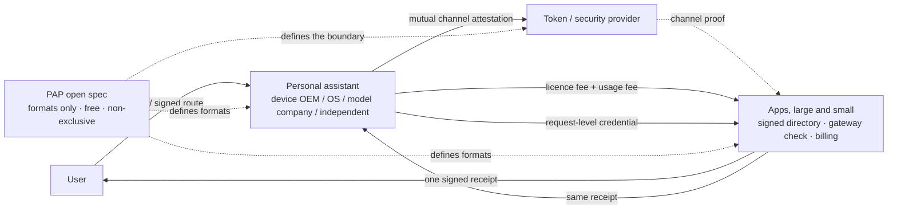

# PAP — Personal Agent Protocol / 个人智能助理开放接口协议

[English](en.md) · [简体中文](zh-CN.md) · [한국어](ko.md) · [日本語](ja.md) · [Deutsch](de.md)

---

> **EN** — When every device maker, OS and model provider builds its own personal-assistant ecosystem, it is cheaper to standardise the *format* of "an assistant calls an app" once than to make every app re-integrate with every assistant. PAP is a free, non-exclusive suggestion for the interface formats and decision rules at that layer. Open does not mean free of charge: the spec is free, while an app's exposed interface is a paid service whose fees double as a call-control mechanism.
>
> **中文** — 当每个终端厂商、操作系统和模型公司都在做自己的私人助理生态时，与其让每个 APP 为每种助理重复适配，不如把「助理调用 APP」的格式统一一次。PAP 是对这一层接口格式与判定规则的免费、非排他建议。开放不等于不收费：规范免费，APP 开放的接口是收费服务，而收费同时承担控制调用次数与流量的作用。

| | |
| --- | --- |
| **Status / 状态** | Just an idea and a suggestion — not a standard, not official / 只是一个想法与建议，不是标准、不代表任何机构 |
| **Date / 日期** | November 2026 / 2026 年 11 月 |
| **Licensing / 许可** | Free, non-exclusive, no patent claims / 免费公开、非排他、不主张专利 |
| **Maintainer / 维护者** | xiaoyangstudent / 小洋同学 |

---

## Read in your language / 选择语言阅读

| File / 文件 | Language / 语言 |
| --- | --- |
| [`en.md`](en.md) | English |
| [`zh-CN.md`](zh-CN.md) | 简体中文 |
| [`ko.md`](ko.md) | 한국어 |
| [`ja.md`](ja.md) | 日本語 |
| [`de.md`](de.md) | Deutsch |

Each file is a complete, standalone read — pick whichever language is easiest for you. / 每份都可独立完整阅读，挑顺手的语言即可。

---

## Diagrams / 图表

Each language edition contains three GitHub-rendered Mermaid diagrams: the party relationship map, the sequence of one call, and the four gates through which charging becomes call control. Here is a compact overview / 每份语言版本都含三张 GitHub 原生渲染的 Mermaid 图：参与方关系总图、一次调用的时序、收费如何变成四道闸。下面是精简总览：

---

## The argument in five points / 五个要点

1. **Capability is no longer the bottleneck; the rule layer is.** / 瓶颈已不是能力，而是规则层。
2. **Fragmentation is multiplicative**: `M × N` bilateral adaptations become `M + N` implementations under a shared format. / 碎片化成本是乘法的：`M × N` 套对接在统一格式下变成 `M + N` 套实现。
3. **A thin spec, not a new platform**: formats and decision rules only, no registry, no pricing, no funds, no new root of trust. / 是薄规范而非新平台：只定格式与判定，不做目录服务、不定价、不碰资金、不建新信任根。
4. **Open ≠ free**: charging acts as admission control, marginal cost and hard quota against runaway or abusive agents. / 开放≠免费：收费承担准入筛选、边际成本与配额硬闸三重调控作用。
5. **Four parties gain at different stages** — consumers, assistant operators, large and small apps, and token / security providers — from new value rather than redistribution. / 消费者、助理运营方、大厂与小厂 APP、令牌厂商在同一条增量价值链的不同环节获益，不是零和再分配。

---

## Document map / 章节索引

| § | Topic / 主题 |
| --- | --- |
| 0 | Summary / 摘要 |
| 1 | The fragmentation problem and the `M × N` cost / 碎片化问题与适配成本 |
| 2 | What PAP is and is not; four principles / 定义、边界与四项原则 |
| 3 | Seven specification objects / 七项规范对象 |
| 4 | One call, end to end / 一次调用的完整链路 |
| 5 | **Open ≠ free: charging as call control / 开放≠免费：收费即调用调控** |
| 6 | Gains for every party, including large and small apps / 各方收益（含大厂与小厂 APP） |
| 7 | 2026 evidence / 2026 年事实 |
| 8 | Shared spec vs private ecosystems / 统一协议与私有生态对比 |
| 9 | Risks and honest boundaries / 风险与诚实边界 |
| 10 | Roadmap (P0–P4) / 路线图 |
| 11 | How to participate / 参与方式 |
| 12 | Glossary / 术语 |
| 13 | Sources and verification / 资料来源与核查 |

---

## Contributing / 参与

The most useful contributions are, in order / 最有价值的贡献依次为：

- **Find holes** in the decision chain, credential lifecycles or receipt fields — especially anything permitting a call without a valid user authorisation. / 挑出判定链、凭证生命周期与回执字段的漏洞，尤其是任何允许「无授权依据调用」的情形。
- **Add conformance tests** that turn the P0 formats into a minimal offline test suite. / 把 P0 格式做成可离线运行的最小一致性测试。
- **Build a reference implementation**: signed directory → gateway decision → signed receipt. / 做参考实现：签名目录 → 网关判定 → 签名回执。
- **Challenge §5**: how licence and usage fees can control volume without becoming an entry barrier for small apps. / 挑战第 5 章：收费如何既调控流量、又不变成小厂的准入壁垒。
- **Contribute public facts**, particularly data that supports or refutes the fragmentation-cost claim. / 补充可支持或反驳「碎片化成本」的公开数据。

Please use Issues for technical critique and Discussions for broader questions. / 技术性意见请用 Issues，开放性讨论请用 Discussions。

---

## Disclaimer / 声明

This is just an idea. Nothing here commits any company, institution or standards body, and the mechanisms described are not deployed standards. Public facts and proposed mechanisms are distinguished in each document; vendor-published figures are marked as unaudited. No contact details are included in these files — reach the maintainer through the repository.

这只是个想法，不约束任何企业、机构或标准组织，所述机制并非已实施标准。各文档均区分「公开事实」与「建议机制」，厂商自行公布的数据已标注未经独立审计。文件中不含任何联系方式，请通过仓库进行交流。

---

**An idea for PAP · November 2026**
**关于 PAP 的一点想法 · 2026 年 11 月**
