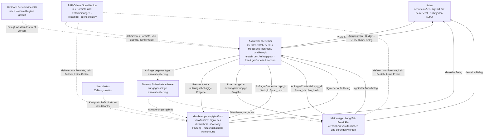
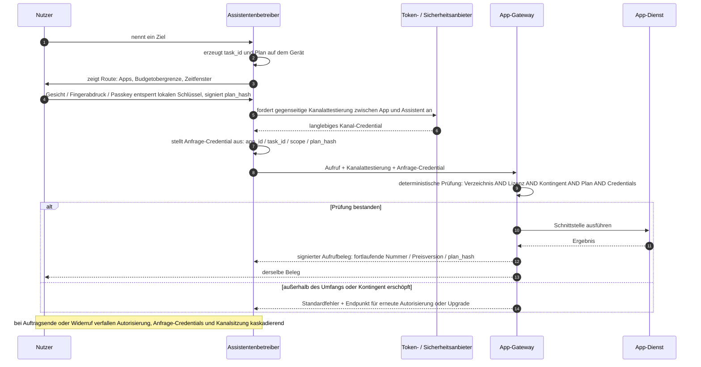
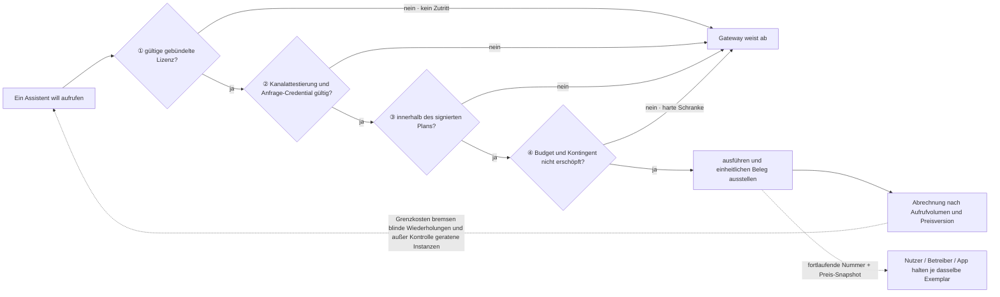

# PAP: Eine Idee für ein gemeinsames Schnittstellenprotokoll für persönliche KI-Assistenten

> **In einem Satz:** Wenn jeder Gerätehersteller, jedes Betriebssystem und jeder Modellanbieter ein eigenes Ökosystem für persönliche Assistenten aufbaut, ist es günstiger, das *Format* von „ein Assistent ruft eine App auf“ einmal zu standardisieren, als jede App für jeden Assistenten neu anzubinden.

| | |
| --- | --- |
| **Bezeichnung** | PAP — Personal Agent Protocol |
| **Status** | **Nur eine Idee und ein Vorschlag**; kein Standard, nicht offiziell, keiner Institution zugeordnet |
| **Art** | Die Idee ist aufgeschrieben, damit Interessierte sie aufgreifen, umschreiben oder diskutieren können |
| **Datum** | November 2026 |
| **Lizenzhaltung** | Kostenfrei veröffentlicht, nicht exklusiv, keine Patentansprüche; **Beibehaltung des Namens nicht erforderlich** |

> ⚠️ Der Text unterscheidet **öffentlich dokumentierte Branchen- und Regulierungsfakten des Jahres 2026** von **Mechanismen, die PAP vorschlägt**. Betreiberregistrierung, gebündelte kommerzielle Lizenz, Kanalattestierung, signierte Aufgabenpläne und Aufrufbelege sind Entwürfe, keine bereits eingeführten Standards, und geben nicht die Position eines Unternehmens, einer Institution oder einer Normungsorganisation wieder.
> 📄 Weitere Sprachen: [简体中文](zh-CN.md) · [English](en.md) · [한국어](ko.md) · [日本語](ja.md)

---

## 0. Zusammenfassung

1. **Der Engpass ist nicht mehr die Fähigkeit.** Systemnahe Agenten können 2026 bereits mehrstufige Aufgaben planen und ausführen. Es fehlt die **Regelebene**: Schnittstellenverzeichnis, Autorisierung, Verbrauchsmessung und Haftung.
2. **Fragmentierung kostet multiplikativ.** Bei `M` Assistenten-Ökosystemen und `N` Apps erfordern private, ökosystemspezifische Anbindungen `M × N` bilaterale Adaptierungen; ein gemeinsames Format reduziert dies auf `M + N` Implementierungen. Apps tragen Doppelentwicklung, Betreiber wiederholte Verhandlungen, Nutzer inkonsistente Erfahrung und unklare Verantwortung.
3. **Die Lösung ist eine dünne Spezifikation, keine neue Plattform.** PAP definiert ausschließlich Formate und Entscheidungsregeln. Es betreibt kein System, setzt keine Preise, nimmt keine Provision, hält keine Gelder und errichtet keine neue Vertrauenswurzel.
4. **Offen bedeutet nicht kostenlos.** Die Spezifikation ist frei, aber **die von einer App bereitgestellte Schnittstelle ist eine kostenpflichtige Leistung**: eine gebündelte kommerzielle Lizenz zuzüglich nutzungsabhängiger Aufrufentgelte. Abrechnung ist nicht nur Erlös, sondern ein **Mechanismus zur Aufrufkontrolle**, der über Zutritt, Grenzkosten und harte Kontingente außer Kontrolle geratene oder missbräuchliche Agenten bremst.
5. **Vier Akteure entwickeln sich gemeinsam**: Konsumenten, Assistentenbetreiber, App-Anbieter (große und kleine profitieren unterschiedlich) sowie Token- und Sicherheitsanbieter schöpfen Wert auf **unterschiedlichen Stufen derselben neuen Wertschöpfungskette**. Es handelt sich nicht um eine Umverteilung bestehender Erlöse.

---

## 1. Das Problem: Ökosysteme spalten sich entlang der Anbietergrenzen

### 1.1 „Assistentenbetreiber" ist eine offene Kategorie

PAP bindet sich bewusst an keinen Akteur:

| Typ | Typische Ausprägung |
| --- | --- |
| Gerätehersteller | Systemnahe Assistenten auf Smartphones, PCs, Tablets, Fahrzeugen und Wearables |
| Betriebssystemanbieter | Der Assistent als Systemlaufzeit statt als App |
| Modell- / KI-Unternehmen | Universelle Assistenten und eigenständige Agentenprodukte um ein Modell herum |
| Internetplattformen | Aus einer Super-App heraus gewachsene Assistenten |
| Vertikale und Open-Source-Assistenten | Domänenspezifische oder gemeinschaftlich gepflegte Instanzen |

**PAP setzt keinen Betreiber voraus, vergibt keinen Exklusivsitz und benennt keinen Initiator.** Die Koexistenz mehrerer Ökosysteme ist die Voraussetzung, nicht das zu beseitigende Problem — gerade sie lässt jedoch die folgende Rechnung wirksam werden.

### 1.2 Die Anbindungsrechnung

Angenommen, sechs etablierte Assistenten-Ökosysteme wollen ihren Nutzern jeweils 200 häufig genutzte Apps zugänglich machen:

| Ansatz | Zahl der zu bauenden / zu verhandelnden Anbindungen | Wer trägt sie |
| --- | --- | --- |
| Private Protokolle je Ökosystem | `6 × 200 = 1200` | 200 Apps bauen je 6 Varianten; 6 Betreiber verhandeln je 200 Mal |
| Gemeinsames Format | `6 + 200 = 206` | Jede App implementiert einmal, jeder Betreiber einmal |

Die Realität ist schlechter als die Formel: Eine App sieht sich nicht sechs *Protokollen*, sondern sechs verschiedenen **Autorisierungsmodellen, Credential-Formaten, Zählkonventionen, Haftungsklauseln und Geschäftsprozessen** gegenüber. Technische Adapter sind der kleinere Teil; Verhandlung und Compliance dominieren. Und mit der Zahl der Ökosysteme wächst der Aufwand weiter multiplikativ — aus sechs können im nächsten Jahr zehn werden.

### 1.3 Drei Kosten

- **App-Seite: Doppelarbeit und die Sorge vor „Verrohrung".** Wird aus *der Nutzer öffnet eine App* ein *Agent ruft eine App auf*, werden Einstiegspunkte, Empfehlungsflächen und Werbeeindrücke umgangen. Ohne messbare Gegenleistung und durchsetzbare Grenzen ist die rationale Reaktion, **gar nicht zu öffnen** oder nur wenige Betreiber zuzulassen.
- **Betreiberseite: bilaterale Verhandlungen erreichen den Long Tail nicht.** Kopf-Apps lassen sich einzeln verhandeln; Long-Tail-Dienste besitzen keinen Verhandlungswert, damit bleibt die nutzbare Reichweite des Assistenten bei „ein paar Dutzend".
- **Nutzerseite: zerrissene Erfahrung, unbeherrschbare Sicherheit.** Wechsel von Gerät oder Assistent setzt Autorisierungen, Präferenzen, Gedächtnis und Abrechnung zurück. Welche Apps ein Auftrag berührte, was er kostete und wer Daten sah, lässt sich weder vollständig sagen noch belegen.

### 1.4 Die Lücke wird bereits öffentlich benannt

| Datum | Öffentlicher Fakt | Signalwirkung |
| --- | --- | --- |
| 2026/10/8 | Die IETF chartert die Arbeitsgruppe **agentproto** für ein gemeinsames Basisprotokoll zur agentischen Dialogsteuerung und eine Referenzarchitektur und nennt A2A sowie MCP als bestehende Protokolle der Anwendungsschicht | Formale Normungsgremien halten eine gemeinsame Basis für erforderlich |
| 2026/10/1 | Airbnb-CEO Brian Chesky erklärt zu Berechtigungen und Vertrauen von Agenten: „no consumer platform has yet settled those rules across every app", und fordert eine neue Plattformschicht | Die Branche räumt die offene Berechtigungs- und Vertrauensebene öffentlich ein |
| 2026/8/2 | Zentrale Bestimmungen des **EU AI Act** werden anwendbar, das AI Office erhält Durchsetzungsbefugnisse für GPAI, Transparenzpflichten nach Artikel 50 treten in Kraft | Nachvollziehbarkeit und Transparenz werden zur Rechtspflicht, nicht zur Designoption |
| 2026/4–8 | A2A v1.0 erscheint im März und wechselt am 17. August gemeinsam mit MCP in die Agentic AI Foundation (AAIF); am 22. Oktober umfasst AAIF zehn Projekte | Standards sammeln sich in neutralen Trägerschaften |
| 2026/5–8 | Android **AppFunctions** (ab Android 16, Apps verhalten sich wie On-Device-MCP-Server; Gemini im Mai in privater Vorschau, im August über 40 populäre Apps ausführbar) besteht neben Apple **App Intents** und Samsungs „conversational device agent" Bixby | Geräteseitige Agenten-Anbindungen divergieren statt zu konvergieren |

Dasselbe Signal wiederholt sich: **Die Fähigkeit ist da, die Regelebene ist leer.** Wird sie von jedem Anbieter separat gefüllt, erhärtet das Ergebnis zu mehreren untereinander inkompatiblen Ökosystemen.

### 1.5 Das `M` in der Rechnung hat bereits Namen

Der „Assistentenbetreiber" aus §1.1 ist keine hypothetische Kategorie. Mehrere Anbieter besitzen bereits eine vollständige Kette — Geräte, einen systemnahen Assistenten, einen Vertriebskanal, ein Konto- und Zahlsystem sowie geräteseitige Sicherheit — und erweitern sie jeweils zu Assistenten, die innerhalb fremder Apps handeln. Sie sind das `M` aus §1.2. Alle folgenden Fakten sind öffentlich und stammen aus 2025-2026; keines dieser Unternehmen hat PAP unterstützt.

| Ökosystem | Was die Kette heute enthält | Richtung 2025-2026 | Was ein gemeinsames Format ergänzt |
| --- | --- | --- | --- |
| **Samsung** | Galaxy-Smartphones, -Tablets, -Uhren, -Fernseher und -Hausgeräte; One UI; SmartThings; Galaxy Store; Samsung Wallet; Samsung Account; Knox / Knox Vault | Die im Februar 2026 angekündigte One-UI-8.5-Bixby-Beta wird zum „conversational device agent" und liefert über Perplexity aktuelle Web-Antworten in DE, IN, KR, PL, UK und US; die Galaxy S26 ergänzt Now Nudge, Now Brief, eine Personal Data Engine und appweise KEEP-Isolierung; Samsung und Google zeigen eine Gemini-basierte agentische Android-Erfahrung mit der S26 als erster Plattform (frühe Google-Labs-Vorschau) | Ein Geräteagent, der auch kommerzielle Dienste Dritter mit einer Lizenz, einem Budget und einem Beleg erreicht |
| **Apple** | iPhone, iPad, Mac, Watch, Vision Pro; App Store; Apple Pay; iCloud; Apple Silicon | Die WWDC26 (Juni 2026) baut Apple Intelligence um Siri AI neu auf; am 3. November 2026 öffnet eine Entwicklervorschau Siri AI über App Intents für alle Apps — mit persönlichem Kontext, Bildschirmwahrnehmung und „Skills" für mehrere Aktionen (nur Entwicklervorschau, noch nicht für Kunden ausgeliefert; in der EU derzeit nicht für iOS, iPadOS und watchOS verfügbar) | App Intents beantwortet „was kann diese App", nicht „unter welcher Lizenz, zu welchem Preis, mit wessen Autorisierung und mit welchem Beleg" |
| **Google / Android** | Android, Play, Google Wallet, Gemini; **AppFunctions** ab Android 16 (Apps verhalten sich wie On-Device-MCP-Server) | Gemini im Mai 2026 in privater Vorschau; im August über 40 populäre Apps über AppFunctions ausführbar (Anbieterangabe) | Ein Verzeichnis- und Lizenzformat, das ein anderer Betreiber implementieren kann, ohne jede App neu zu verhandeln |
| **Microsoft** | Windows, Microsoft 365, Microsoft Store, Entra ID, Azure, Copilot | Auf der Build 2026: Agent Connectors sind MCP-Server in der Windows On-Device Registry, der Agent Workspace (Vorschau) gibt jedem Agenten ein eigenes Konto und bereichsbezogene Autorisierung, Windows 365 for Agents ist allgemein verfügbar; „Hybrid Intelligence" (Oktober 2026) ergänzt lokalen Kontext, lokale Aktionen (stets mit Zustimmung) und lokale Modelle | Microsofts eigene Sicherheitsgrundsätze verlangen, dass Nutzer jede Abfrage und jede Aktion freigeben; PAP macht aus dieser Freigabe ein portables, prüfbares Objekt auf Auftragsebene statt einer OS-lokalen Einstellung |
| **Amazon** | Echo, Fire TV, Fire-Tablets, Alexa-App und Alexa.com; Prime; Amazon-Handel und -Zahlung | Amazon gibt an, dass Alexa+ allen US-Kunden zur Verfügung steht (bei Prime enthalten, sonst 19,99 $/Monat) — über Alexa-fähige Geräte, Alexa.com und die Alexa-App, mit agentischen Bestellungen, Restaurantreservierungen, Fahrten und Terminen für Handwerksdienste; die CES-2026-Berichterstattung nannte Erweiterungen auf Autos und Wearables | Jeder Partner ist eine bilaterale Anbindung; ein gemeinsames Format würde Long-Tail-Dienste ohne eine weitere Verhandlungsrunde erreichbar machen |
| **Deutsche Telekom / Perplexity** (Europa) | T-Phone- / T-Tablet-Geräte, Magenta AI, Mobilfunkabrechnung und Vertrieb in zehn europäischen Märkten | Das Perplexity-gestützte AI-Phone startete am 14. August 2025; das Magenta-AI-Factsheet zum MWC 2026 beschreibt die Vision einer „app-less future", in der Assistent und Comet-Browser Abläufe über Dienste und Plattformen hinweg orchestrieren (etwa vom Chat bis zur Kasse) | Die deutlichste öffentliche Aussage, dass der Einstiegspunkt von den Apps zum Assistenten wandert — genau dieser Wandel braucht eine Regel für den kommerziellen Zugang |

Sechs Ketten, sechs Antworten auf dieselbe Frage: **Wenn nicht der Nutzer, sondern der Assistent eine App öffnet — nach welcher Regel geschieht dieser Aufruf?** Keiner von ihnen veröffentlicht ein gemeinsames Format für Schnittstellenverzeichnisse, kommerzielle Lizenzen, Autorisierung auf Auftragsebene und Aufrufbelege. Sind alle sechs erfolgreich, steht eine App vor sechs getrennten Verzeichnissen, Credential-Formaten, Zählkonventionen und Haftungsklauseln — aus der `M × N`-Rechnung in §1.2 wird eine echte Rechnung. Das bestätigt zugleich §1.1: Netzbetreiber, Händler und OS-Anbieter stehen längst in derselben Betreiberkategorie wie Gerätehersteller, deshalb nennt PAP zu Recht keinen Initiator.

Die Quellenklassen zu diesem Abschnitt stehen in §13; als Anbieterangabe gekennzeichnete Zahlen und als Berichterstattung gekennzeichnete Erweiterungen dienen nicht als Grundlage normativer Aussagen. Beta-, Vorschau- und Visionselemente können sich ändern.

---

## 2. Was PAP ist und was nicht

### 2.1 Definition

> PAP ist eine **öffentliche, frei implementierbare, nicht exklusive** Spezifikation von Schnittstellenformaten für den Aufruf freigegebener Schnittstellen einer Drittanbieter-App durch einen persönlichen KI-Assistenten: Dienstverzeichnis, kommerzielle Lizenz, Kanalattestierung, Auftragsautorisierung, Credential-Lebenszyklen und Aufrufbelege.

Es leistet genau eines: ein bilaterales Verhalten in ein **Format zu übersetzen, das beide Seiten unabhängig implementieren, offline prüfen und austauschen können**.

### 2.2 Ist / ist nicht

| PAP ist | PAP ist nicht |
| --- | --- |
| Eine Spezifikation, die jedermann kostenfrei lesen und umsetzen darf | Eine Plattform, ein SaaS, ein Betreiber |
| Formate und Entscheidungsregeln (shall / should / shall not) | Eine Preisliste, eine Clearingstelle, eine Zahlungsschiene |
| Eine lokal implementierbare, austauschbare Fähigkeit | Ein zentrales Register, eine Zertifizierungsstelle, ein Ledger |
| Mindestanforderungen für risikoreiche Schnittstellen | Eine neue Vertrauenswurzel oder ein einheitliches Identitätszentrum |
| Prüfbare Schranken für *wer, in wessen Auftrag, in welchem Umfang aufruft* | Der Aussteller der Nutzerautorisierung |
| Frei umschreibbar, teilbar, umbenennbar | Etwas, das Erlaubnis, Gebühren oder einen Sitz verlangt |

### 2.3 Vier Grundsätze

1. **Protokoll und Geschäft sind getrennt** — die Spezifikation ist kostenfrei; keine Lizenzgebühr auf die Spezifikation, keine Umsatzbeteiligung. Geschäftsbedingungen vereinbaren App und Betreiber.
2. **Offene Spezifikationsebene, verantwortliche Betriebsebene** — jedermann darf die Spezifikation implementieren; wer tatsächlich Nutzern einen Assistenten bereitstellt, sollte nach dem jeweiligen Regime eine identifizierbare, haftbare Rechtspersönlichkeit besitzen. Beides ersetzt einander nicht.
3. **Teilnahme ist freiwillig** — keine App wird zur Öffnung verpflichtet, kein Betreiber zum Kauf einer Lizenz.
4. **Die letzte Autorisierung bleibt beim Nutzer** — kommerzielle Lizenz, Kanalattestierung und Nutzerautorisierung sind drei verschiedene Dinge; keines ersetzt die anderen.

> PAP wiederholt keine bestehende Arbeit. Werkzeug- und Datenzugriff, Agent-zu-Agent-Koordination, allgemeine Autorisierungsrahmen und Zahlungsautorisierungsprotokolle verfügen jeweils bereits über Spezifikationen. PAP füllt die **Lücke dazwischen**: Schnittstellenverzeichnis, Lizenzierung, Verbrauchsmessung und Haftungsgrenze zwischen Assistentenbetreiber und kommerziellem Drittdienst.

---

## 3. Was die Spezifikation enthält

| # | Gegenstand | Was definiert wird | Was gelöst wird |
| --- | --- | --- | --- |
| 1 | **Signiertes Dienstverzeichnis** | Maschinenlesbare, versionierte und signierte Liste von Schnittstellen-IDs, Fähigkeitsbeschreibungen, Ratenbegrenzungen, Risikostufen und Preisplanversionen | Legt exakt fest, was im Paket enthalten ist; beseitigt nachträglichen Streit |
| 2 | **Gebündelte kommerzielle Lizenz** | Ein Betreiber lizenziert die freigegebenen Schnittstellen einer App als Ganzes; Format für Umfang, Gültigkeit, Kontingent und Widerruf-Endpunkt | Macht aus einer Lizenz ein vom Gateway prüfbares Objekt |
| 3 | **Kanalattestierung** | Ein Token-/Sicherheitsanbieter etabliert die gegenseitige Authentisierung eines sicheren Kanals zwischen App und Assistent und belegt „welche legitime Instanz welches Betreibers" | Verhindert Fälschung, außer Kontrolle geratene Instanzen und Man-in-the-Middle |
| 4 | **Auftrag und Plan** | `task_id`, Liste von Apps und Schnittstellen, Budgetobergrenze, Zeitfenster, Ausweichrouten, `plan_hash`, Version | Gegenstand der Nutzerautorisierung ist *die Route*, nicht jeder Klick |
| 5 | **Anfragebezogenes Credential und Lebenszyklus** | Jede Anfrage trägt `app_id + task_id + scope + plan_hash`; Token-, Autorisierungs- und Auftragslebenszyklen sind **verschachtelt und kaskadierend unwirksam** | Ein eigener Schlüssel je App; mit Auftragsende verfällt alles |
| 6 | **Einheitlicher Aufrufbeleg für drei Parteien** | `task_id / interface_id / fortlaufende Nummer / Zeitstempel / Preisversion / plan_hash / App-Signatur` | Nutzer, Betreiber und App halten denselben Beleg; Abgleich entfällt |
| 7 | **Mindestlinie für risikoreiche Schnittstellen** | Zahlungen, Überweisungen, Änderung von Kontosicherheitsdaten, Löschung: Bestätigung im Einzelfall, eigenständiges Credential, widerrufbar, Auditspur | Die Untergrenze kann nicht durch Produktstufe oder Geschäftsvereinbarung abgesenkt werden |

Zwei leicht übersehene, aber entscheidende Festlegungen:

- **100 % Autorisierungsabdeckung**: Jeder Aufruf muss einer gültigen Nutzerautorisierung zugeordnet sein; Aufrufe ohne Grundlage weist das Gateway ab. Das bedeutet **nicht** eine Gesichtsprüfung pro Aufruf. Hinter „Organisiere eine Japanreise" können hunderte Abfragen stehen; der Nutzer authentisiert die Route einmal stark, Abfragen innerhalb der Route laufen still. Erneute Bestätigung ist nur bei Routenänderung, Überschreitung von Budget oder Zeitfenster sowie bei risikoreichen Aktionen nötig.
- **Biometrie verlässt das Gerät nicht**: Gesicht, Fingerabdruck, Passkey und PIN entsperren denselben lokalen Signaturschlüssel. Biometrische Daten dienen ausschließlich der lokalen Entsperrung und werden nie als Credential an eine App übermittelt.

Ein brauchbarer Anker aus 2026: A2A v1.0 führte signierte Agent Cards ein, die belegen, *welcher Agent vorliegt* — aber **Identität ist keine Berechtigung (Identity is not permission)**. Der Identitätsnachweis entscheidet nicht, was nach dem Handshake berührt werden darf. Genau deshalb hält PAP Kanalattestierung, kommerzielle Lizenz und Nutzerautorisierung als drei unabhängige Objekte.

---

### 3.1 Beziehungsdiagramm der Akteure



---

## 4. Ablauf eines einzelnen Aufrufs

1. Der Nutzer nennt ein Ziel; der Assistent erzeugt auf dem Gerät `task_id` und Plan und behält einen lokalen Eintrag.
2. Der Assistent zeigt die Route (beteiligte Apps, Budgetobergrenze, Zeitfenster); der Nutzer entsperrt per Gesicht, Fingerabdruck oder Passkey den lokalen Schlüssel und signiert `plan_hash`.
3. Der Assistent prüft das signierte Verzeichnis der App: Schnittstelle vorhanden, Lizenz gültig, Kontingent nicht erschöpft.
4. Der Token-/Sicherheitsanbieter schließt die gegenseitige Kanalattestierung zwischen App und Assistent ab (langlebiges Kanal-Credential).
5. Der Assistent stellt für die Ziel-App ein **anfragebezogenes Credential** aus (`app_id / task_id / scope / plan_hash`); verschiedene Apps erhalten innerhalb eines Auftrags voneinander unabhängige, nicht übertragbare Credentials.
6. Das App-Gateway trifft eine deterministische Entscheidung:

```
interface_id IN published_directory
  AND operator_licence_valid
  AND quota_not_exhausted
  AND request WITHIN signed_plan
  AND channel_attestation_valid AND request_credential_valid
→ ausführen; sonst Standardfehler mit maschinenlesbarem Endpunkt für Upgrade / erneute Autorisierung
```

7. Die App stellt einen **Aufrufbeleg** aus; dasselbe Exemplar geht an alle drei Parteien. Der Nutzer sieht Aufrufzahl des Auftrags, Restbudget und berührte Schnittstellen; der Betreiber sieht Kosten je App; die App sieht Volumen der Instanz und den fälligen Betrag.
8. Auftragsende / Widerruf durch den Nutzer / Ablauf des Zeitfensters → Autorisierung, anfragebezogene Credentials und Kanalsitzung werden entsprechend der Verschachtelung **kaskadierend unwirksam**.

Die **fortlaufende Nummer** macht Lücken sofort sichtbar; der **Preisversions-Snapshot** fixiert den Preis zum Aufrufzeitpunkt. Das lokale Exemplar des Nutzers ist exportier- und übertragbar und lässt sich per `task_id` mit einem Vorgang widerrufen. Bei einer Überberechnungsbeschwerde muss niemand um Protokolle gebeten werden.

---

### 4.1 Ein Aufruf als Sequenz



---

## 5. Offen ≠ kostenlos: Abrechnung als Aufrufkontrolle

Dies ist der am häufigsten missverstandene Teil von PAP. „Offenes Protokoll" wird oft als „auch Aufrufe sind gratis" gelesen — und genau diese Lesart verhindert den Start des Ökosystems.

### 5.1 Zunächst drei Dinge trennen

| | Kostenpflichtig? | Entscheidet | Rolle von PAP |
| --- | --- | --- | --- |
| **Die Spezifikation** (Formate, Regeln, Schemata) | **Kostenfrei** — jedermann darf lesen, implementieren, betreiben | Offene Gemeinschaft / Normungsgremium | Veröffentlicht Formate und Konformitätstests; keine Lizenzgebühr, keine Provision |
| **Die von einer App bereitgestellte Schnittstellenleistung** | **Kostenpflichtig** — gebündelte kommerzielle Lizenz plus nutzungsabhängige Aufrufentgelte | App und Betreiber bilateral | Definiert **Format und Entscheidungsregeln** für Verzeichnis, Lizenz und Beleg; setzt keinen Preis |
| **Was der Nutzer dem Assistenten zahlt** | Vom Betreiber festgelegt | Assistentenbetreiber | Nicht Gegenstand |

„Offen" beschreibt also **Zutritts- und Implementierungsrechte**: jedermann darf ohne Genehmigung oder gekauften Sitz einen Assistenten bauen, eine App-Schnittstelle bereitstellen oder Tokendienste anbieten. Es hat nie bedeutet, dass Apps ihre Schnittstellen verschenken. Dies ist derselbe Grundsatz wie §2.3, keine Ausnahme davon.

### 5.2 Warum vollständig kostenlose Aufrufe gefährlich sind

Sind Aufrufe kosten- und reibungsfrei, folgen vier Ergebnisse:

- **Außer Kontrolle geratene Instanzen lassen sich nicht drosseln**: ein schlecht geplanter oder übernommener Assistent kann in kürzester Zeit massenhaft Abfragen absetzen; die Kosten trägt vollständig die App.
- **Missbrauch ist von normaler Nutzung nicht unterscheidbar**: bei Grenzkosten null gibt es zwischen legitimen Auftragsaufrufen und getarntem Scraping keinen ökonomischen Unterschied, sodass der App nur die pauschale Sperre bleibt.
- **Last wird unplanbar**: Apps können „Agentenverkehr" nicht kapazitiv planen und reagieren rational mit Verengung oder Ablehnung.
- **Haftung lässt sich nicht bepreisen**: Eine Lizenz ist zugleich kommerzieller Vertrag und Nachweis darüber, *wer für diese Aufrufe verantwortlich ist*. Ohne Lizenz verschwindet der Verantwortliche.

Die kontraintuitive Kette lautet: **kostenlose Aufrufe → Apps wagen nicht zu öffnen → kein Ökosystem entsteht überhaupt.** Abrechnung ist keine Beschränkung der Offenheit, sondern ihre Nachhaltigkeitsbedingung.

### 5.3 Vier Steuerungswirkungen der Abrechnung

| Mechanismus | Wirkung | Konkretes Ergebnis |
| --- | --- | --- |
| **Lizenzentgelt (Zutritt)** | Filtert nicht haftbare Akteure | Nur identifizierte Betreiber, die Bedingungen zeichnen und Verantwortung übernehmen, erhalten Schlüssel; Missbrauch ist widerrufbar |
| **Nutzungsentgelt (Grenzkosten)** | Jeder Aufruf kostet | Betreiber investieren in Planung, Deduplizierung, Caching und Wiederverwendung statt blinder Wiederholungen; „eine Suche" und „eine Bestellung" können unterschiedlich bepreist werden |
| **Kontingent / Budget (harte Schranke)** | Das Nutzerbudget wird unmittelbar zur Aufrufobergrenze | Das Gateway weist Überschreitungen ab; aus einem ökonomischen Problem wird deterministische technische Kontrolle |
| **Beleg (Verbrauchsmessung)** | Einheitliche Quelle, fortlaufend, Preisversion fixiert | Aufrufzahlen und Verkehr sind prüf- und belegbar; Abrechnungsstreit entfällt, derselbe Satz ist Auditgrundlage |

Diese vier bilden zusammen mit Attestierung und Plan-Signatur ein System: **Das Token regelt *ob verbunden werden darf*, die Autorisierung *ob der Nutzer zugestimmt hat*, Abrechnung und Kontingente *wie viele Aufrufe in welchem Umfang*.** Damit ist auch die ursprüngliche Sicherheitsfrage beantwortet: Einen persönlichen Assistenten am unkontrollierten oder beliebigen Schnittstellenaufruf zu hindern, gelingt nicht mit einem Schloss allein — es braucht Kosten und Kontingente als zwei weitere Schranken.

### 5.4 Was PAP in Bezug auf Geld tut und lässt

**Tut**: Verzeichnisfelder (einschließlich Preisversion), Format des Lizenzobjekts, Belegfelder und fortlaufende Nummerierung, Standardfehler für Kontingenterschöpfung und Umfangsüberschreitung, Konformitätstests.

**Lässt**: Preise festlegen, Clearing betreiben, Gelder halten, Provisionen nehmen, ein Geschäftsmodell vorschreiben. Der Kaufpreis fließt weiterhin direkt an den Händler; Gelder und Zahlungsautorisierung verbleiben nach geltenden Regeln bei lizenzierten Zahlungsinstituten.

Dies ist nicht neu erfunden: **x402** hat HTTP 402 als Abrechnung pro Aufruf wiederbelebt und wird seit Juli 2026 von der x402 Foundation unter dem Dach der Linux Foundation getragen. **MPP** (Stripe / Tempo) und **AP2**-Mandate (Google, am 28. April 2026 mit über 60 Startpartnern an die FIDO Alliance übergeben) adressieren jeweils Teile derselben Frage; **Visa TAP** (gemeinsam mit Cloudflare, 14. Oktober 2025) existiert eigens zur Unterscheidung legitimer Agenten von Scrapern. Unbestimmt bleibt die **kommerzielle Zugriffsebene über diesen Schienen**: wer welche kommerzielle Schnittstelle, mit welcher Lizenz, welcher Messung und welcher Haftung aufrufen darf. PAP definiert das Format dieser Ebene, nicht die für die Abrechnung genutzte Schiene.

> In einem Satz: **PAP macht Abrechnung entscheidbar, prüfbar und widerrufbar — die Abrechnung selbst bleibt jedoch stets eine Angelegenheit zweier kommerzieller Parteien.**

---

### 5.5 Vier Schranken: wie Abrechnung zur Kontrolle wird



---

## 6. Was jeder Akteur gewinnt

### 6.1 Konsumenten

- Ein Ziel einmal nennen, Abschluss über Apps hinweg ohne Wechsel zwischen einem Dutzend Oberflächen.
- **Autorisierung haftet an der Route**: eine Bestätigung deckt die gesamte Route; nur Routenänderung, Budgetüberschreitung und risikoreiche Aktionen fragen erneut.
- **Vollständig sichtbar und belegbar**: lokale Aufzeichnung von Aufrufzahlen, Schnittstellen und Budgetverbrauch; exportier- und übertragbare Belege mit Ein-Klick-Widerruf per `task_id`.
- Klare Privatsphärengrenze: Biometrie bleibt auf dem Gerät; Kanalattestierung belegt eine Instanz, ersetzt jedoch nie die Zustimmung.
- Autorisierungen und Präferenzen sind mitnehmbar statt an ein Ökosystem gebunden.

### 6.2 Assistentenbetreiber (Gerätehersteller, OS-Anbieter, Modellunternehmen, unabhängige Assistenten)

- **Von 1200 auf 206 Anbindungen**: einmal implementieren, alle Apps mit konformem Verzeichnis erreichen; Long-Tail-Dienste werden „per Verzeichnis nutzbar" statt „per Verhandlung verfügbar".
- **Produktstufen bleiben eigene Entscheidung**: eine Basisstufe ohne Zahlungsschnittstelle, eine höhere Stufe mit mehr Fähigkeiten — Stufen sind eine Konsumentenproduktentscheidung, für die App unsichtbar und unerheblich, die nur Schnittstellen-IDs und Aufrufzahlen sieht.
- Planbare Lizenz- und Nutzungskosten, Budgets als harte Schranken, keine unerklärlichen Rechnungen.
- Bestehende Vermögenswerte — systemnahe Position, installierte Basis, geräteseitige Sicherheit, Kontensysteme — erhalten erstmals einen einheitlichen Weg zur Monetarisierung.
- **Für die Ökosystemketten in §1.5 ist das eine Ergänzung, kein Zugeständnis**: Samsung behält Knox und SmartThings, Apple App Store und Apple Pay, Microsoft Entra ID, Amazon Prime — eine gemeinsame Spezifikation ersetzt allein die bilaterale Verhandlung je Assistenten, nicht die Vermögenswerte, die jede Kette wertvoll machen.
- Eine offene Spezifikation bedeutet **keine Genehmigung abzuwarten und keinen Sitz zu kaufen**; wer zuerst lauffähig implementiert, wird zur faktischen Referenz.

### 6.3 Große Apps / Kopfplattformen

- **Einmal implementieren** statt je Assistenten-Ökosystem eine eigene Kette aus Autorisierung, Credentials, Messung und Haftung zu pflegen.
- **Umgeleitete Einstiegspunkte erhalten einen Preis**: Lizenz- und Nutzungsentgelte machen Agentenverkehr zu messbarem neuem Erlös statt zu verlorenen Empfehlungs- und Werbeflächen; CPS-artige Rückvergütungen bleiben optional ergänzbar.
- **Öffnen wird vertretbar**: identifizierbarer Betreiber, widerrufbare Lizenz, harte Kontingente und einheitliche Belege verwandeln „Schnittstellen freigeben" von einem Sicherheits- und Compliance-Risiko in ein kontrolliertes Geschäft.
- Volle Preis-, Raten-, Veröffentlichungs- und Ablehnungsrechte bleiben erhalten; PAP verlangt keine Geschäftsgeheimnisse, nur ein maschinenlesbares, versioniertes, prüfbares Verzeichnis.
- Planbare Last und bepreisbarer Missbrauch ermöglichen erstmals Kapazitätsplanung.

### 6.4 Kleine Apps / Long-Tail-Entwickler

Dieser Akteur wird am häufigsten unterschätzt und zeigt am besten, warum eine gemeinsame Spezifikation privaten Ökosystemen überlegen ist:

- **Einmal anbinden, alle konformen Assistenten erreichen.** In privaten Ökosystemen gelangt eine kleine App auf keine Verhandlungsliste; ein gemeinsames Verzeichnis macht Entdeckung durch Long-Tail-Nachfrage überhaupt erst möglich.
- **Start mit nahezu keinem Engineering-Aufwand**: ein signiertes maschinenlesbares Verzeichnis veröffentlichen und einen Drittanbieter-Adapter autorisieren — kein Systemumbau vor Verkehr, der noch nicht existiert.
- **Verkehr ist die Gegenleistung**: Aufrufe und abgeschlossene Transaktionen werden nach Volumen oder Ergebnis abgerechnet, ohne vorab Akquisitionskosten.
- **Eine Grundlage für die Preisbildung**: öffentlicher Preisplan plus einheitlicher Beleg lässt kleine Apps auf derselben Messgrundlage verhandeln wie große, statt jedem Betreiber allein gegenüberzustehen.
- Risiko: Der gebündelte Preis kann vom größeren Betreiber bestimmt werden. **Dies ist eine Frage kommerzieller Verhandlung, kein protokollseitig lösbares Problem** — der Text markiert sie, statt sie scheinbar zu beseitigen.

### 6.5 Token- / Sicherheitsanbieter

- Eine enge, eindeutige Rolle: **ausschließlich gegenseitige Authentisierung des sicheren Kanals zwischen App und Assistent**, Nachweis über legitime Instanz und Kanalintegrität.
- Keine Geschäftsweiterleitung, keine Fachdaten, keine Gelder, keine Inhalte der Nutzerautorisierung, keine Stufengestaltung — je enger die Rolle, desto leichter für alle Seiten akzeptabel.
- Attestierung und Aufrufbelege hinterlassen naturgemäß denselben Faktsatz für Abrechnung, Audit und Risikosteuerung; mehrere Anbieter können koexistieren und konkurrieren, wodurch kein einzelner Kontrollpunkt entsteht.
- **Ausdrücklich nicht**: nicht zum Autorisierungssubjekt werden, keine Gelder berühren, nicht entscheiden, wer wen aufrufen darf. Die letzte Zahlungsautorisierung bleibt beim Nutzer und bei lizenzierten Zahlungsinstituten.

### 6.6 Regulierung und Branche

- Identifizierbare Subjekte, nachvollziehbares Verhalten, zuordenbare Haftung — im Einklang mit „vertrauenswürdige Subjekte, kontrollierbares Verhalten, rückverfolgbare Verantwortung".
- Belegbare Autorisierungen und Aufrufe senken die Kosten der Streitbeilegung.
- Eine offene, nicht exklusive Formatspezifikation reduziert Doppelbau und Ökosystemschranken.

### 6.7 Gewinnmatrix

| Akteur | Hauptgewinn | Hauptpflicht / Kosten |
| --- | --- | --- |
| Konsument | Bequemlichkeit, Sichtbarkeit, Widerrufbarkeit, Übertragbarkeit | Eine Routenbestätigung |
| Assistentenbetreiber | Adaptionsaufwand von Multiplikation auf Addition, Monetarisierung von Fähigkeit | Lizenzerwerb, Verantwortung für Echtheit der Nutzerautorisierung |
| Große App | Einmalige Implementierung, neuer Erlös, Öffnung vertretbar | Signiertes Verzeichnis veröffentlichen, Messung akzeptieren |
| Kleine App | Einmalige Anbindung, Long-Tail-Entdeckung, nutzungsbasierte Abrechnung | Verzeichnispflege, weiterhin schwache Verhandlungsmacht |
| Tokenanbieter | Eine klar abgegrenzte neue Dienstkategorie | Die drei Grenzen strikt einhalten |
| Regulierung / Branche | Nachvollziehbarkeit, Verantwortbarkeit, weniger Doppelbau | Stufung und Compliance-Details erforderlich |

### 6.8 Gewinne stammen aus neuem Wert, nicht aus Umverteilung

Das macht die gleichzeitige Ausrichtung vierer Akteure möglich. Der Wert entsteht überwiegend aus **appübergreifender Aufgabenautomatisierung, die es vorher nicht gab** — eine Reise, ein Vergleich, eine Besorgung über mehrere Apps erforderte früher dutzende manueller Schritte. Die vier Parteien werden auf vier **unterschiedlichen Stufen** vergütet (Effizienz, Einstiegspunkt, Diensteverteilung, Kanalsicherheit), nicht im Wettbewerb um denselben bestehenden Erlös.

Die Ausrichtung ist daher nicht automatisch. Vier Bedingungen müssen zugleich gelten:

1. **Gestufte, haftbare Subjekte**: starke Prüfung in hohen Risikostufen, aber keine einheitliche hohe Hürde, die unabhängige Entwickler und Open-Source-Assistenten ausschließt.
2. **Nichtdiskriminierung innerhalb einer Stufe**: keine Selbstbevorzugung bei gleichem Verzeichnis und Preisplan; die ausdrückliche App-Wahl des Nutzers hat harten Vorrang vor Betreibervoreinstellungen; Empfehlungsgründe hinterlassen einen auditierbaren Eintrag.
3. **100 % Autorisierungsabdeckung + einheitliche Belege**: kein Aufruf ohne Grundlage, keine Partei hält das einzige Journal.
4. **Die Spezifikation bleibt offen**: Formate müssen vollständig implementier-, spiegel- und austauschbar sein. Sobald ein Sitz erforderlich wird, versagen die ersten drei Bedingungen.

---

## 7. Die Faktenlage 2026

| Datum | Fakt | Bedeutung |
| --- | --- | --- |
| 2025/12 | Anthropic überträgt **MCP** an die **Agentic AI Foundation (AAIF)**, einen zweckgebundenen Fonds unter der Linux Foundation, mitbegründet von Block und OpenAI, unterstützt von Google, Microsoft, AWS, Cloudflare und Bloomberg; das Projekt meldet über 10.000 aktive Server und rund 97 Mio. SDK-Downloads pro Monat | Die Werkzeugzugriffsebene hat neutrale Trägerschaft gewählt und das M×N-Problem auf dieser Ebene gelöst |
| 2025/10/14 | **Visa TAP** startet gemeinsam mit Cloudflare zur Unterscheidung legitimer Agenten von Scrapern | Agentenverkehr braucht Identifizierung und Kontrolle, nicht nur offene Endpunkte |
| 2026/1 → 8 | Google kündigt auf der NRF 2026 **UCP** mit Shopify, Walmart, Target, Etsy, PayPal, Visa, Stripe und Amex an, Spezifikationsstand v2026-08-25; parallel läuft **ACP** (OpenAI / Stripe, Apache 2.0) | Kommerzielle Fähigkeitsprofile werden maschinenlesbar — und mehrere konkurrierende Spezifikationen erscheinen zugleich |
| 2026/3–4 | **A2A** v1.0 erscheint im März; die Linux Foundation meldet zum Einjahresmark im April über 150 unterstützende Organisationen | Agent-zu-Agent-Koordination wird standardisiert |
| 2026/4/28 | **AP2** (über 60 Startpartner) wird an die **FIDO Alliance** übergeben; nutzersignierte Mandate trennen „hat der Nutzer autorisiert" von „ist das Zahlungsmittel gültig" | Zustimmung wird zum manipulationsfesten signierten Objekt |
| 2026/5–8 | Android **AppFunctions** (ab Android 16, Apps verhalten sich wie On-Device-MCP-Server; Gemini im Mai in privater Vorschau, im August über 40 populäre Apps ausführbar) besteht neben Apple **App Intents** (im November 2026 per Entwicklervorschau zu Siri-AI-Mehrschritt-Skills erweitert) und Samsungs dialogorientiertem Bixby | Geräteseitige Anbindungen divergieren; eine App muss sich an jede anpassen |
| 2026/2 → 11 | Geräte-, OS-, Handels- und Netzbetreiber-Assistenten greifen gleichermaßen auf Dienste Dritter über: Samsungs One-UI-8.5-Bixby (Februar), Apples Siri-AI-Entwicklervorschau (3. November), Microsofts Agent Connectors und Agent Workspace (Build 2026), Amazon Alexa+ für alle US-Kunden (2026; CES-2026-Erweiterungen laut Berichterstattung) und die „app-less"-Vision von Deutsche Telekoms Magenta AI (MWC 2026) — siehe §1.5 | Die kommerzielle Zugangsebene wird Anbieter für Anbieter privat gefüllt, bevor ein gemeinsames Format existiert |
| 2026/7 | Die **x402 Foundation** nimmt unter der Linux Foundation den Betrieb auf; Stripe / Tempo **MPP** bietet eine parallele HTTP-402-Schiene | Abrechnung pro Aufruf ist bereits real vorhanden |
| 2026/8/2 | Zentrale Bestimmungen des **EU AI Act** werden anwendbar, das AI Office erhält GPAI-Durchsetzungsbefugnisse, Transparenzpflichten nach Artikel 50 treten in Kraft | Nachvollziehbarkeit und Transparenz sind Rechtspflichten, keine Designpräferenz |
| 2026/8/17 → 10/22 | A2A wechselt gemeinsam mit MCP in die AAIF; AAIF erreicht zehn gehostete Projekte | Standards sammeln sich in neutralen Trägerschaften statt bei einem Anbieter |
| 2026/10/8 | Die **IETF** chartert die Arbeitsgruppe **agentproto** für ein gemeinsames Basisprotokoll zur agentischen Dialogsteuerung und eine Referenzarchitektur | Die formale Normung einer gemeinsamen Basis hat begonnen |
| 2026/10/1 | Brian Chesky (Airbnb): „no consumer platform has yet settled those rules across every app" | Die offene Berechtigungs- und Vertrauensebene wird öffentlich eingeräumt |

**Zusammen gelesen**: geräteseitige Fähigkeit, Abrechnung pro Aufruf, signierte Zahlungsmandate, Agent-zu-Agent-Koordination, neutrale Trägerschaft und regulatorische Nachvollziehbarkeit sind vorhanden. Das einzige Segment ohne gemeinsame Regel ist **Assistent ↔ kommerzieller Drittdienst**: Dienstverzeichnis, kommerzielle Lizenz, Auftragsautorisierung, Aufrufmessung und Haftungsgrenze. Die Branche füllt es bereits mit bilateralen Verträgen und ökosystemspezifischen Adaptern. **Das ist das Normungsfenster**: jetzt ist das Füllen am günstigsten; nach Erhärtung privater Schnittstellen bleibt nur noch die Anpassung an bereits gesetzte Fakten.

Eine weitere Beobachtung: Schon die Zahl der Protokolle 2026 (MCP, A2A, AP2, UCP, ACP, x402, MPP, TAP) ist selbst eine Form von Fragmentierung. Sie lösen unterschiedliche Ebenen, lassen sich überwiegend gut kombinieren, und mehrere große Anbieter setzen zugleich auf mehr als eines. PAP konkurriert mit ihnen nicht — es argumentiert, dass **die kommerzielle Zugriffsebene darüber eine gemeinsame Form statt acht privater Formen** sein sollte.

---

## 8. Warum eine gemeinsame offene Spezifikation privaten Ökosystemen überlegen ist

| Dimension | Private Ökosysteme je Anbieter | Gemeinsame offene Spezifikation |
| --- | --- | --- |
| Adaptionsaufwand | `M × N`, wächst multiplikativ | `M + N`, einmal implementieren, mehrfach nutzen |
| Zugang kleiner Apps | Nur über eine Verhandlungsliste | Verzeichnis veröffentlichen und gefunden werden |
| Nutzerwechsel | Autorisierungen, Präferenzen, Gedächtnis bleiben zurück | Exportierbar, übertragbar, widerrufbar |
| Haftungszuordnung | Je Protokoll eigene Bedingungen | Ein Credential- und Belegkonvent |
| Abrechnungsstreit | Jede Seite eigene Protokolle | Einheitliche Quelle, fortlaufend, Preis-Snapshot |
| Innovationstempo | Long Tail wartet auf Auswahl | Long Tail bindet sich selbst an |

Ein kontraintuitiver, aber wichtiger Punkt: **Offenheit ist kein Zugeständnis des First Movers.** Ein vollständig spiegelbares Verzeichnis, exportierbare Nutzerautorisierung und nahezu null Grenzkosten für einen zweiten Assistenten machen Exklusivität sowohl unnötig als auch unrentabel. Was der First Mover gewinnt, ist die **faktische Referenzposition**: Verzeichnisformat, Belegfelder, Konformitätstests, Pilotdaten und ein Platz in späteren Normungsdiskussionen. Je früher der Ökosystembauer die Regel mitdefiniert, desto weniger muss er später fremde Regeln bedienen.

---

## 9. Risiken und ehrliche Grenzen

1. **Annahme ist ungewiss.** Dies ist nur eine Idee; sie verpflichtet kein Unternehmen und kein Normungsgremium. Wahrscheinlicher ist, dass mehrere Gedanken aufgenommen, umformuliert und ohne nachvollziehbare Herkunft auftauchen.
2. **Die Spezifikation regelt keine Preise.** Bündelpreise und Verteilungsstrukturen sind kommerzielle Verhandlung; PAP definiert nur Formate und Entscheidungen.
3. **Verhandlungsmacht kleiner Apps.** Ein Bündelpreis kann vom größeren Akteur bestimmt werden. Eine strukturelle Asymmetrie lässt sich nicht protokollseitig beseitigen.
4. **Stufen gehören den Betreibern.** PAP sichert nur die Mindestlinie für risikoreiche Schnittstellen und definiert nicht, was „Basis" oder „Fortgeschritten" enthält. Oberhalb der Linie ist freie Stufung erlaubt, doch „Zahlung ohne Bestätigung" darf in keiner Stufe erscheinen.
5. **Compliance überlagert sich.** Betreiberidentität, Pflichten für generative KI, personenbezogene Daten und grenzüberschreitende Übermittlung sowie Zahlungslizenzen stapeln sich; dafür ist ein eigenes Kapitel nötig, das dieser Text nicht vorgibt zu liefern.
6. **Grenzüberschreitende Subjekte.** Gegenseitige Anerkennung von Identität und Vertrauensrichtlinien sowie Regeln für ausländische Apps bleiben offen. Der Text bevorzugt die Entkopplung von Credential-Format und Vertrauensrichtlinie, wobei jede App akzeptierte Aussteller im Verzeichnis deklariert, statt eine neue globale Wurzel zu errichten.
7. **GUI-Kanäle.** Bildschirmautomatisierung kann eine Übergangsstufe unter Verzeichnis-/Adapteranbindung sein, darf aber keine Hintertür um kommerzielle Lizenz und Nutzerautorisierung werden.
8. **Kommerzielle Lizenz ≠ Nutzerautorisierung.** Dies wird am leichtesten verwischt. Betreiberidentität ist auf Rechtspersonenebene, ein Aufruf auf Instanzebene, Zustimmung auf Auftragsebene; die drei sind nicht austauschbar.
9. **Ein Protokoll löst keine wettbewerbsrechtlichen Fragen.** Exklusivität, Selbstbevorzugung und Marktmacht gehören in Regulierung und kommerzielle Verhandlung, nicht in eine Formatspezifikation.
10. **Kaltstart.** Der Text nimmt an, dass Betreiber mit installierter Basis und systemnaher Position zuerst reales Aufrufvolumen erzeugen, das anschließend Long-Tail-Apps anzieht. Das ist eine Branchenhypothese, kein gesichertes Ergebnis.

---

## 10. Fahrplan

| Phase | Inhalt | Zentrales System nötig? |
| --- | --- | --- |
| **P0** | Reine Textspezifikation: signiertes Dienstverzeichnis, Service Description, minimales Profil der gebündelten Lizenz, Aufrufbeleg-Schema, Fehlercodes, Konformitätstests | **Nein** — sofort ausformulierbar |
| **P1** | Compliance-Grenze und Haftungsaufteilung für Adapter und GUI-Kanäle | Nein |
| **P2** | Formate für Kanalattestierung und anfragebezogene Credentials, drei Lebenszyklen, kaskadierende Unwirksamkeit; Wiederverwendung bestehender PKI- und Identitätssysteme, keine neue Wurzel | Nein |
| **P3** | Abgleich- und Streitverfahren, Nichtdiskriminierungsklausel, Mindestlinie für risikoreiche Schnittstellen | Nein |
| **P4** | Vertikaler Pilot (Reise / Ticketing / lokale Dienste: ein Szenario, 3–5 Apps) zum Nachweis „eine Autorisierung → appübergreifende Ausführung → einheitliche Abrechnung für drei Parteien", danach Einreichung bei Normungsgremien | Pilotbetrieb durch Teilnehmer |

**P0 bis P3 sind reiner Text.** Zum Beginn ist keinerlei zentraler Online-Dienst erforderlich. Diese Dünnheit ist beabsichtigt: Nur eine Spezifikation, die fortschreiten kann, bevor jemand eine Plattform baut, wird nicht vom Kaltstart blockiert.

---

## 11. Mitwirkung

Diese Idee wird offen veröffentlicht. Jede Person, jedes Unternehmen und jedes Normungsgremium darf ihn **ohne Beibehaltung des Namens** übernehmen, umschreiben, teilen oder neu anstoßen. Die nützlichsten Beiträge:

- **Lücken finden**: In Issues auf Schwachstellen in Entscheidungskette, Lebenszyklen oder Belegfeldern hinweisen — insbesondere auf alles, was einen Aufruf ohne Autorisierungsgrundlage oder ein hängen gebliebenes Credential erlaubt.
- **Konformitätstests ergänzen**: Aus den P0-Formaten eine minimale offline lauffähige Testsuite machen; das ist mehr wert als weitere Argumentation.
- **Referenzimplementierung bauen**: Ein minimales Verzeichnis + Gateway-Entscheidung + Belegausstellung belegt unmittelbar, dass die Regeln ausführbar sind.
- **Fakten beisteuern**: öffentliche Daten zu regionaler Regulierung, Branche und Normungsarbeit, insbesondere alles, was die Behauptung der Fragmentierungskosten stützt oder widerlegt.
- **Das Abrechnungskapitel kritisieren**: Wie Lizenz- und Nutzungsentgelte als Zutritts- und Kontingentkontrolle wirken können, ohne zur Eintrittshürde für kleine Apps zu werden, ist der am stärksten zu prüfende Teil dieses Textes.

---

## 12. Begriffe

| Begriff | Bedeutung |
| --- | --- |
| **Persönlicher Assistent / Betreiber** | Das identifizierbare, haftbare Subjekt, das Nutzern einen systemnahen Agenten bereitstellt; Gerätehersteller sind eine Kategorie unter mehreren |
| **Dienstverzeichnis** | Von einer App veröffentlichte signierte, versionierte, maschinenlesbare Liste von Schnittstellen |
| **Gebündelte kommerzielle Lizenz** | Ein Betreiber lizenziert die freigegebenen Schnittstellen einer App als Ganzes; **welche Apps lizenziert werden, entscheidet der Betreiber** |
| **Kanalattestierung** | Gegenseitige Authentisierung eines sicheren Kanals zwischen App und Assistent durch einen Token-/Sicherheitsanbieter; ohne Fachdaten |
| **Plan** | Liste von Apps und Schnittstellen eines Auftrags, Budget, Zeitfenster, Ausweichrouten; das vom Nutzer signierte Objekt |
| **Anfragebezogenes Credential** | Kurzlebiges Credential je Aufruf, unabhängig für die Ziel-App ausgestellt |
| **Kaskadierende Unwirksamkeit** | Token-, Autorisierungs- und Auftragslebenszyklen sind verschachtelt; Endet eine Ebene, wird alles Darunter unwirksam |
| **Aufrufbeleg** | Vom App-Gateway ausgestellter signierter Mess- und Auditsatz, von allen drei Parteien in demselben Exemplar gehalten |
| **100 % Autorisierungsabdeckung** | Jeder Aufruf muss einer gültigen Nutzerautorisierung zugeordnet sein; nicht gleichbedeutend mit interaktiver Bestätigung je Aufruf |

---

## 13. Quellen und Prüfung

**Klasse A (offiziell / institutionell)**: Charta der IETF-Arbeitsgruppe agentproto (8. Oktober 2026); Ankündigungen von Linux Foundation / Agentic AI Foundation zu MCP, A2A und gehosteten Projekten; Umsetzungszeitplan des EU AI Act und FAQ des AI Act Service Desk (Anwendbarkeit zentraler Bestimmungen am 2. August 2026, Artikel 50, GPAI-Durchsetzungsbefugnisse); Unterlagen der FIDO Alliance zu AP2; Google-Entwicklerdokumentation zu AppFunctions und Android 16; Apple-App-Intents-Dokumentation; öffentliche Spezifikationsstände von Google / UCP. Anbieterunterlagen zu §1.5: Samsung Newsroom (One UI 8.5 Bixby, Februar 2026; Galaxy Unpacked 2026 / S26) und Samsung Developer; Apple Developer News (3. November 2026, Siri-AI-Entwicklervorschau) und WWDC26-Unterlagen; Microsoft Learn, Windows Experience Blog sowie die Ankündigungen von Build 2026 / Windows 365 for Agents zu Agent Connectors, On-Device Registry und Agent Workspace; die Produkt- und FAQ-Seiten von Amazon Alexa+; Deutsche Telekom Media Information (14. August 2025) und das Magenta-AI-Factsheet zum MWC 2026; Amazons eigene Ankündigung zur Alexa+-Verfügbarkeit (alle US-Kunden, Prime-Vorteil, 19,99 $/Monat, agentische Aufgaben); Samsungs Galaxy-S26-Kaufberater (angekündigt am 25. Februar 2026) und die Galaxy-Unpacked-2026-Zusammenfassung; der Windows-Experience-Blog-Beitrag „Building Windows for hybrid intelligence" (7. Oktober 2026).

**Klasse B (etablierte Berichterstattung)**: Berichte zu A2A v1.0 und über 150 unterstützenden Organisationen (Linux Foundation, April 2026); UCP-Ankündigung auf der NRF 2026 und Startpartner; Übersichten zur Agentic-Commerce-Protokolllandschaft; das Interview mit Brian Chesky vom Oktober 2026 zu Agenten-Betriebssystemen und ungeklärten Berechtigungsregeln; Berichterstattung zu Visa TAP (gemeinsam mit Cloudflare, 14. Oktober 2025). Die CES-2026-Berichterstattung über Alexa+-Erweiterungen auf Autos und Wearables gehört zu Klasse B; die Angabe von über 40 AppFunctions-Apps und weitere von Anbietern genannte Zahlen in §1.5 sind Klasse C und zeigen nur die Richtung.

**Klasse C (von Anbietern selbst veröffentlicht, nicht unabhängig geprüft)**: MCPs Angabe von über 10.000 aktiven Servern und rund 97 Mio. monatlichen SDK-Downloads; Transaktions- und Volumenzahlen zu x402; Angaben zur App-Abdeckung von Gemini / AppFunctions; die Zahl von über 60 AP2-Partnern. Sie illustrieren ausschließlich die Richtung und dienen nicht als technische Grundlage normativer Klauseln.

**Prüfdatum**: 7. November 2026. Es wurden keine nicht öffentlichen Informationen verwendet. Der Text gibt nicht die Position eines Unternehmens, einer Institution oder einer Normungsorganisation wieder; sämtliche Mechanismen sind Vorschläge, die Implementierung und Validierung erfordern.

**Marken und Billigung**: Unternehmens- und Produktnamen dienen ausschließlich der Beschreibung öffentlich dokumentierter Fakten; alle Marken gehören ihren jeweiligen Inhabern. Eine Billigung, Partnerschaft oder Zugehörigkeit wird nicht behauptet. Als Beta, Vorschau oder Vision bezeichnete Funktionen können sich ändern.

---

**Dazu**: Eine Idee zu PAP · November 2026
**Idee von**: xiaoyangstudent
**Lizenzhaltung**: kostenfrei veröffentlicht, nicht exklusiv, keine Patentansprüche; Übernahme, Umarbeitung und eigenständiger Neuanstoß willkommen.
**Mitwirkung**: über Issues / Discussions dieses Repositories.
