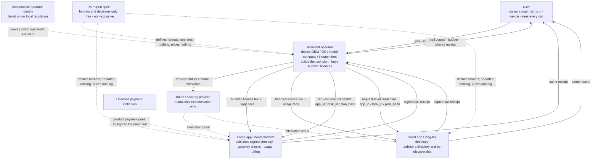
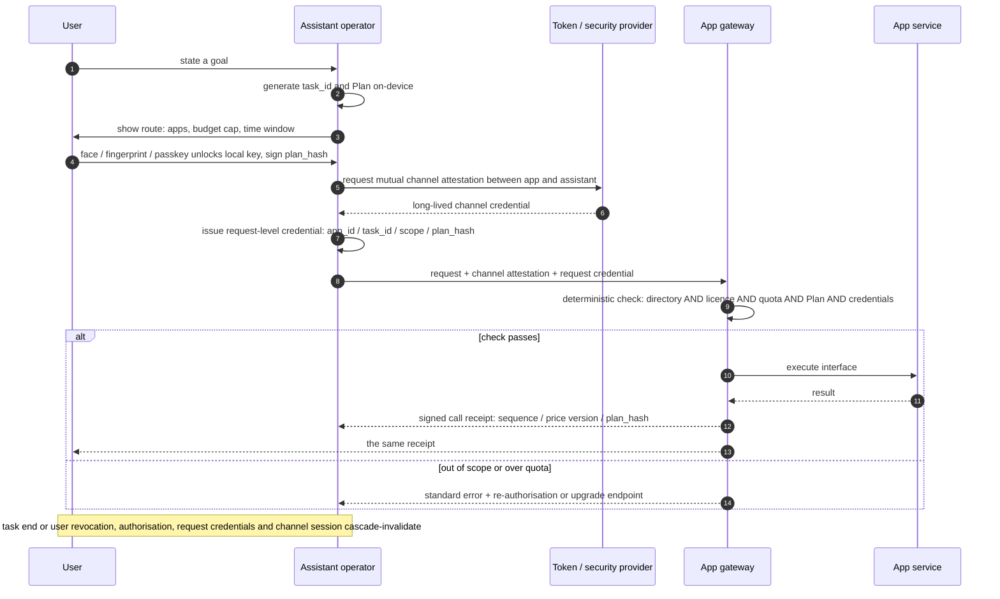
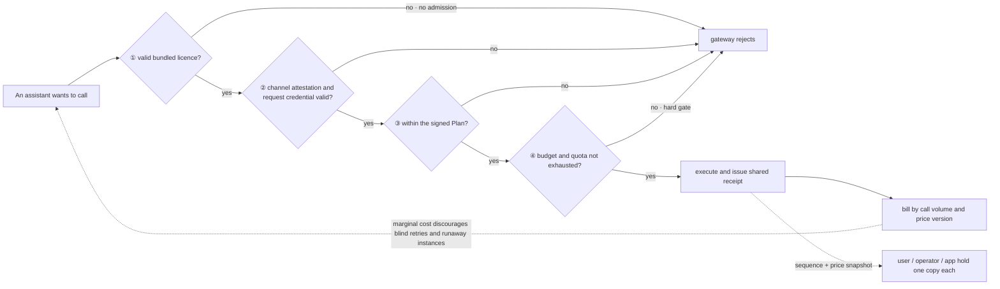

# PAP: An Idea for a Shared Interface Protocol for Personal AI Assistants

> **In one sentence:** when every device maker, operating system and model provider is building its own personal-assistant ecosystem, it is cheaper to standardise the *format* of "an assistant calls an app" once than to make every app re-integrate with every assistant.

| | |
| --- | --- |
| **Name** | PAP — Personal Agent Protocol |
| **Status** | **Just an idea and a suggestion**; not a standard, not official, not affiliated with any body |
| **Nature** | I wrote the idea down so anyone interested can adopt, rewrite or discuss it |
| **Date** | November 2026 |
| **Licensing stance** | Free, non-exclusive, no patent claims; **no need to keep the name** |

> ⚠️ Two kinds of content are distinguished here: **publicly documented 2026 industry and regulatory facts**, and **mechanisms that PAP proposes**. Operator registration, bundled licensing, channel attestation, signed task plans and call receipts are design proposals; they are not deployed standards and do not represent the position of any company, body or standards organisation.
> 📄 Other languages: [简体中文](zh-CN.md) · [한국어](ko.md) · [日本語](ja.md) · [Deutsch](de.md)

---

## 0. Summary

1. **The bottleneck is no longer capability.** System-level agents can already plan and execute multi-step tasks in 2026. What is missing is the rule layer: interface directories, authorisation, metering and liability.
2. **Fragmentation is multiplicative.** With `M` assistant ecosystems and `N` apps, private per-ecosystem integrations require `M × N` bilateral adaptations; a shared format reduces this to `M + N` implementations. Apps pay in duplicated engineering, assistant operators in repeated negotiations, and users in inconsistent experience and unclear accountability.
3. **The fix is a thin spec, not a new platform.** PAP defines formats and decision rules only. It operates no system, sets no prices, takes no cut, holds no funds and creates no new root of trust.
4. **Open does not mean free.** The specification is free to read and implement, but **an app's exposed interface is a paid service**: a bundled commercial licence plus usage-based call fees. Charging is not only revenue — it is a **call-control mechanism** that uses admission, marginal cost and hard quotas to restrain runaway or abusive agents.
5. **Four parties develop together**: consumers, assistant operators, app providers (large and small gain differently) and token / security providers each take value from a different stage of the same new value chain. This is not a zero-sum redistribution.

---

## 1. The problem: ecosystems are splitting along vendor boundaries

### 1.1 "Assistant operator" is an open category

PAP deliberately does not bind itself to one kind of provider:

| Type | Typical form |
| --- | --- |
| Device OEMs | System-level assistants shipped with phones, PCs, tablets, cars and wearables |
| OS vendors | The assistant as a system runtime rather than an app |
| Model / AI companies | General assistants and standalone agent products built around a model |
| Internet platforms | Assistants grown out of a super-app |
| Vertical and open-source assistants | Domain-specific or community-maintained instances |

**PAP presupposes no operator, grants no exclusive seat and names no launch party.** Multiple coexisting ecosystems are the premise, not the problem to be eliminated — but that coexistence is exactly what makes the arithmetic below bite.

### 1.2 The adaptation bill

Assume 6 mainstream assistant ecosystems, each wanting its users to reach 200 common apps:

| Approach | Integrations to build / negotiate | Who pays |
| --- | --- | --- |
| Private per-ecosystem protocols | `6 × 200 = 1200` | 200 apps build 6 each; 6 operators negotiate 200 times each |
| Shared format specification | `6 + 200 = 206` | Each app implements once; each operator implements once |

Reality is worse than the formula: an app does not face six *protocols*, it faces six different authorisation models, credential formats, metering conventions, liability clauses and commercial processes. Technical adapters are the small part; business and compliance negotiation dominates. And the cost keeps multiplying as ecosystem count grows — six today may be ten next year.

### 1.3 Three costs

- **Apps: duplicated work plus the "pipe-ification" problem.** When *a user opens an app* becomes *an agent calls an app*, entry points, recommendation surfaces and ad impressions are bypassed. Without measurable compensation and enforceable boundaries, the rational response is to not open at all — or to open only to a chosen few.
- **Assistant operators: bilateral deals never reach the long tail.** Head apps can be negotiated one by one; long-tail services have no negotiating value, so the assistant's useful coverage stalls at a few dozen apps.
- **Users: fragmented experience, ungovernable safety.** Switch a device or an assistant and authorisations, preferences, memory and billing all restart. Which apps a task touched, what it cost and who saw the data cannot be stated completely, let alone proven.

### 1.4 The gap is already being named publicly

| Date | Public fact | What it signals |
| --- | --- | --- |
| 2026/10/8 | The IETF charters the **agentproto** working group to define a common baseline agentic dialog management protocol and reference architecture, naming A2A and MCP as existing application-layer protocols | Formal standards bodies consider a common baseline necessary |
| 2026/10/1 | Airbnb CEO Brian Chesky states that "no consumer platform has yet settled those rules across every app" for agent permissions and trust, and that a new platform layer is needed | Industry explicitly says the permission/trust layer is still unsettled |
| 2026/8/2 | Core provisions of the **EU AI Act** apply; the AI Office gains GPAI enforcement powers and Article 50 transparency duties take effect | Traceability and transparency become legal obligations |
| 2026/4–8 | A2A v1.0 ships in March and moves into the Agentic AI Foundation (AAIF) on 17 August alongside MCP; AAIF hosts ten projects by 22 October | Standards are consolidating into neutral bodies |
| 2026 (May–Aug) | Android **AppFunctions** (Android 16+, apps behave like on-device MCP servers; Gemini integration in private preview in May, 40+ popular apps executable by August) coexists with Apple **App Intents** and Samsung's "conversational device agent" Bixby | Device-side agent hooks are diverging, not converging |

The same signal recurs: **capability is ready; the rule layer is empty.** If each vendor fills that layer separately, the result hardens into several mutually incompatible ecosystems.

### 1.5 The `M` in the formula already has names

The "assistant operator" in §1.1 is not hypothetical. Several vendors already own a full chain — devices, a system-level assistant, a distribution channel, an account and payment system, and on-device security — and each is extending that chain toward assistants that act inside other people's apps. They are the `M` in §1.2. Every fact below is public and dated 2025-2026; none of these companies has endorsed PAP.

| Ecosystem | What the chain already contains | 2025-2026 direction | What a shared format would add |
| --- | --- | --- | --- |
| **Samsung** | Galaxy phones, tablets, watches, TVs and appliances; One UI; SmartThings; Galaxy Store; Samsung Wallet; Samsung Account; Knox / Knox Vault | The One UI 8.5 Bixby beta announced in February 2026 turns Bixby into a "conversational device agent" with live web answers via Perplexity in DE, IN, KR, PL, UK and US; Galaxy S26 adds Now Nudge, Now Brief, a Personal Data Engine and per-app KEEP isolation; Samsung and Google preview a Gemini-powered agentic Android experience with the S26 as the first platform (early Google Labs preview) | A device agent that also reaches third-party commercial services under one licence, one budget and one receipt |
| **Apple** | iPhone, iPad, Mac, Watch, Vision Pro; App Store; Apple Pay; iCloud; Apple Silicon | WWDC26 (June 2026) rebuilt Apple Intelligence around Siri AI; on 3 November 2026 a developer preview opened Siri AI to all apps via App Intents — personal context, on-screen awareness and multi-action "skills" (developer preview only; not yet shipped to customers; currently unavailable in the EU on iOS, iPadOS and watchOS) | App Intents answers "what can this app do", not "under which licence, at what price, with whose authorisation and which receipt" |
| **Google / Android** | Android, Play, Google Wallet, Gemini; Android 16 **AppFunctions** (apps behave as on-device MCP servers) | Gemini private preview in May 2026; by August, 40+ popular apps executable through AppFunctions (vendor-reported figure) | A directory and licence format that another operator can implement without renegotiating every app |
| **Microsoft** | Windows, Microsoft 365, Microsoft Store, Entra ID, Azure, Copilot | Build 2026: agent connectors are MCP servers registered in the Windows On-Device Registry, agent workspace (preview) gives each agent its own account and scoped authorisation, and Windows 365 for Agents is generally available; the October 2026 "Hybrid Intelligence" release adds local context, local actions (always with permission) and local models | Microsoft's own security principles say users approve every query and action; PAP makes that approval a portable, verifiable task-level object instead of an OS-local setting |
| **Amazon** | Echo, Fire TV, Fire tablets, Alexa app and Alexa.com; Prime; Amazon retail and payments | Amazon states Alexa+ is available to all US customers — included with Prime, $19.99/month otherwise — across Alexa-enabled devices, Alexa.com and the Alexa app, with agentic takeout orders, restaurant reservations, ride bookings and home-service scheduling; CES 2026 reporting described car and wearable extensions | Each partner is a bilateral integration; a shared format would make long-tail services reachable without another round of deals |
| **Deutsche Telekom / Perplexity** (Europe) | T Phone / T Tablet devices, Magenta AI, carrier billing and distribution in ten European markets | The Perplexity-powered AI phone launched on 14 August 2025; the MWC 2026 Magenta AI factsheet describes an "app-less future" in which the assistant and the Comet browser orchestrate workflows across services and platforms (e.g. chat-to-checkout) | The clearest public statement that the entry point moves from apps to an assistant — the exact shift that needs a commercial access rule |

Six chains, six answers to the same question: **when the assistant, not the user, opens the app, under what rule does the call happen?** None of them publishes a common format for interface directories, commercial licences, task-level authorisation and call receipts. If all six succeed, an app faces six separate directories, credential formats, metering conventions and liability clauses — the `M × N` bill in §1.2 stops being a diagram and becomes an invoice. It also confirms §1.1: a carrier, a retailer and an OS vendor now sit in the same operator category as device makers, so PAP is right to name no launch party.

Source classes for this section are listed in §13; figures marked vendor-reported and extensions marked as reported are not used as the basis of any normative claim. Beta, preview and vision items may change.

---

## 2. What PAP is, and is not

### 2.1 Definition

> PAP is a **public, freely implementable, non-exclusive** interface-format specification governing how a personal AI assistant calls interfaces exposed by third-party apps: service directories, commercial licences, channel attestation, task authorisation, credential lifecycles and call receipts.

It does one thing: turns a bilateral behaviour into a **format both sides can implement and verify independently, offline and replaceably**.

### 2.2 Is / is not

| PAP is | PAP is not |
| --- | --- |
| A specification anyone may read and implement for free | A platform, a SaaS, an operating entity |
| Formats and decision rules (shall / should / shall not) | A price list, a clearing house, a payment rail |
| Local capability each side implements and can swap | A centralised registry, certification authority or ledger |
| Minimum baselines for high-risk interfaces | A new root of trust or a unified identity centre |
| Verifiable constraints on *who calls, on whose behalf, within what scope* | The issuer of user authorisation |
| Free to rewrite, split and rename | Something requiring permission, fees or a seat |

### 2.3 Four principles

1. **Protocol and commerce are separate** — the spec is free; no licence fee on the spec, no revenue share. Commercial terms are set between app and operator.
2. **Open spec layer, accountable operations layer** — anyone may implement the spec; an operator actually serving users should have an identifiable, accountable legal identity under its local regulatory regime. Neither substitutes for the other.
3. **Voluntary participation** — no app is required to open anything; no operator is required to buy any app's licence.
4. **The user retains final authorisation** — commercial licence, channel attestation and user authorisation are three distinct things; none can replace the others.

> PAP does not redo existing work. Tool and data access, agent-to-agent coordination, generic authorisation frameworks and payment authorisation each already have specifications. PAP fills the **gap between them**: the interface directory, licensing, metering and liability boundary between an assistant operator and a third-party commercial service.

---

## 3. What the specification contains

| # | Object | What it defines | What it solves |
| --- | --- | --- | --- |
| 1 | **Signed service directory** | Machine-readable, versioned, signed list of interface IDs, capability descriptions, rate limits, risk levels and price-schedule versions | States precisely what is in the bundle; removes post-hoc disputes |
| 2 | **Bundled commercial licence** | An operator licenses one app's exposed interface set as a whole; format for scope, validity, quota and revocation endpoint | Turns a commercial licence into something a gateway can evaluate |
| 3 | **Channel attestation** | A token / security provider establishes mutual secure-channel authentication between app and assistant, proving "which operator's which legitimate instance" | Blocks spoofing, runaway instances and man-in-the-middle |
| 4 | **Task and plan** | `task_id`, app and interface list, budget cap, time window, fallback routes, `plan_hash`, version | The object of user authorisation is *the route*, not every click |
| 5 | **Request-level credential and lifecycle** | Each request carries `app_id + task_id + scope + plan_hash`; token, authorisation and task lifecycles are **nested and cascade-invalidated** | Separate key per app; everything dies when the task ends |
| 6 | **Three-party single-source call receipt** | `task_id / interface_id / sequential number / timestamp / price version / plan_hash / app signature` | User, operator and app hold the same receipt; billing needs no reconciliation |
| 7 | **High-risk interface baseline** | Payments, transfers, account-security changes, deletion: per-action confirmation, independent credential, revocable, audit trail | The baseline cannot be lowered by a product tier or a commercial deal |

Two decisions are easy to miss and matter greatly:

- **100% authorisation coverage**: every call must attach to a valid user authorisation; calls without one are rejected at the gateway. This does **not** mean a face scan per call. "Arrange a trip to Japan" may involve a hundred lookups; the user signs the route once and in-route queries run silently. Re-confirmation is required only when the route changes, a budget or time window is exceeded, or a high-risk action occurs.
- **Biometrics never leave the device**: face, fingerprint, passkey and PIN all unlock the same local signing key. Biometric data is used only for local unlock and is never sent to an app as a credential.

A useful anchor from 2026: A2A v1.0 introduced signed Agent Cards that prove *which agent this is* — but identity is not permission. Proving an agent's identity does not decide what it may touch once the handshake ends. That separation is exactly why PAP keeps channel attestation, commercial licence and user authorisation as three independent objects.

---

### 3.1 Party relationship map



---

## 4. How one call works

1. The user states a goal; the assistant generates `task_id` and a Plan on-device and keeps a local record.
2. The assistant shows the route (apps involved, budget cap, time window); the user unlocks a local signing key via face, fingerprint or passkey and signs `plan_hash`.
3. The assistant checks the app's signed directory: interface present, licence valid, quota not exhausted.
4. The token / security provider completes mutual channel attestation between app and assistant (long-lived channel credential).
5. The assistant issues a **request-level credential** for the target app (`app_id / task_id / scope / plan_hash`); different apps in one task receive independent, non-transferable credentials.
6. The app gateway runs a deterministic decision:

```
interface_id IN published_directory
  AND operator_licence_valid
  AND quota_not_exhausted
  AND request WITHIN signed_plan
  AND channel_attestation_valid AND request_credential_valid
→ execute; otherwise return a standard error with a machine-readable upgrade / re-authorisation endpoint
```

7. The app issues a **call receipt**; the same receipt goes to all three parties. The user sees how many calls the task made, remaining budget and which interfaces were touched; the operator sees per-app cost; the app sees the instance's volume and the amount due.
8. Task end / user revocation / time-window expiry → authorisation, request credentials and channel session are **cascade-invalidated** according to the nesting.

The **sequential number** makes a missing record detectable; the **price-version snapshot** locks the price at the moment of the call. The user's local copy is exportable and portable, and supports one-click revocation by `task_id` — a user disputing overbilling does not need to ask anyone for logs.

---

### 4.1 One call, as a sequence



---

## 5. Open ≠ free: charging as a call-control mechanism

This is the most frequently misread part of PAP. "Open protocol" is often heard as "calls are free too" — and that reading is precisely what prevents the ecosystem from starting.

### 5.1 Three separate things

| | Charged? | Decided by | PAP's role |
| --- | --- | --- | --- |
| **The specification** (formats, rules, schemas) | **Free** — anyone may read, implement, deploy | Open community / standards body | Publishes formats and conformance tests; no licence fee, no cut |
| **An app's exposed interface service** | **Charged** — bundled commercial licence + usage-based call fees | App and operator, bilaterally | Defines the **format and decision rules** for directory, licence and receipt; sets no price |
| **What the user pays the assistant** | Set by the operator | Assistant operator | Not in scope |

"Open" therefore describes **access and implementation rights**: anyone may build an assistant, expose an app interface or provide token services without anyone's approval or a purchased seat. It never meant "apps give their interfaces away". This is the same protocol/commerce separation as §2.3, not an exception to it.

### 5.2 Why fully free calls are dangerous

If calls are zero-cost and frictionless, four outcomes follow:

- **Runaway instances cannot be throttled**: a badly planned or hijacked assistant can issue enormous query volume, with the entire cost falling on the app.
- **Abuse is indistinguishable from normal use**: at zero marginal cost, legitimate task calls and disguised scraping have no economic difference, so the app can only ban categorically.
- **Load becomes unpredictable**: apps cannot capacity-plan for "agent traffic", and the rational response is to tighten or refuse.
- **Liability cannot be priced**: a licence is both a commercial contract and the evidence of *who is responsible for these calls*. Without it, the accountable party disappears.

The counter-intuitive chain: **free calls → apps dare not open → no ecosystem exists at all.** Charging is not a limit on openness; it is a precondition for sustainable openness.

### 5.3 Four control effects of charging

| Mechanism | Effect | Concrete result |
| --- | --- | --- |
| **Licence fee (admission)** | Screens out unaccountable actors | Only identifiable operators that sign terms and accept liability obtain keys; abuse is revocable |
| **Usage fee (marginal cost)** | Every call has a cost | Operators invest in planning, deduplication, caching and result reuse instead of blind retries; "one search" and "one order" can be priced differently |
| **Quota / budget (hard gate)** | The user's budget translates directly into a call ceiling | The gateway rejects over-quota requests; an economic problem becomes deterministic technical control |
| **Receipt (metering)** | Single-source, sequential, price-versioned | Call counts and traffic are verifiable and provable; billing disputes collapse; the same record is the audit trail |

These work as one system with attestation and Plan signing: **the token governs *can this connect*, authorisation governs *did the user agree*, charging and quotas govern *how many calls and within what scope*.** This also answers the original safety concern — stopping a personal assistant from acting out of control or calling interfaces arbitrarily cannot rely on a lock alone; it needs cost and quota as two further gates.

### 5.4 What PAP does and does not do about money

**Does**: define directory fields (including price-version), the licence object format, receipt fields and sequential numbering, standard errors for quota exhaustion and scope overflow, and conformance tests.

**Does not**: set prices, clear payments, hold funds, take a cut, or require any app to adopt a business model. Product payment still goes to the merchant; funds and payment authorisation stay with licensed payment institutions under existing rules.

This is not invented from scratch: **x402** revived HTTP 402 as pay-per-call machine settlement and is stewarded by the x402 Foundation under the Linux Foundation since July 2026; **MPP** (Stripe / Tempo) and **AP2** mandates (Google, donated to the FIDO Alliance on 28 April 2026 with 60+ launch partners) each address part of the same problem; **Visa TAP** (with Cloudflare, 14 October 2025) exists specifically to distinguish legitimate agents from scrapers. What remains undefined is the **business-access layer above those rails**: who may call which commercial interface, on what licence, with what metering and liability. PAP defines the format of that layer, not the rail used to settle it.

> In one line: **PAP makes charging decidable, verifiable and revocable — but charging always remains a matter between two commercial parties.**

---

### 5.5 Four gates: how charging becomes control



---

## 6. What each party gains

### 6.1 Consumers

- State a goal once; complete it across apps without switching between a dozen screens.
- **Authorisation attaches to the route**: one confirmation covers the whole route; only route changes, budget overruns and high-risk actions ask again.
- **Fully visible and provable**: local record of call counts, interfaces and budget; exportable, portable receipts with one-click revocation by `task_id`.
- Clear privacy boundary: biometrics stay on-device; channel attestation proves an instance, never substitutes for consent.
- Authorisations and preferences can move with the user instead of locking them into one ecosystem.

### 6.2 Assistant operators (device OEMs, OS vendors, model companies, independent assistants)

- **From 1200 integrations to 206**: implement once, reach every app that publishes a conforming directory; long-tail services become "available by directory" rather than "negotiable by deal".
- **Product tiers are self-defined**: a basic tier with no payment interface, an advanced tier with more — tiers are a consumer product decision, invisible and irrelevant to the app, which only sees interface IDs and call volumes.
- Predictable licence and usage costs; budgets enforced as hard gates; no inexplicable bills.
- Existing assets — system-level position, installed base, on-device security, account systems — gain a unified route to monetisation.
- **For the ecosystem chains in §1.5 this is additive, not a concession**: Samsung keeps Knox and SmartThings, Apple keeps the App Store and Apple Pay, Microsoft keeps Entra ID, Amazon keeps Prime — a shared spec replaces only the per-assistant business negotiation, not the assets that make each chain valuable.
- An open spec means **no approval to wait for and no seat to buy**; whoever runs a working implementation first becomes the factual reference.

### 6.3 Large apps / head platforms

- **Implement once** instead of maintaining a separate authorisation, credential, metering and liability pipeline per assistant ecosystem.
- **Bypassed entry points now have a price**: licence fees plus usage fees turn agent traffic into measurable new revenue instead of lost recommendation and ad surfaces; CPS-style reverse commissions remain an optional add-on.
- **Safe to open**: identifiable operator, revocable licence, hard quotas and single-source receipts turn "exposing interfaces" from a security and compliance risk into a controlled business.
- Full pricing, rate-limiting, directory and refusal rights retained; PAP requires no trade secrets, only a machine-readable, versioned, verifiable directory.
- Predictable load and priceable abuse make capacity planning possible for the first time.

### 6.4 Small apps / long-tail developers

This party is most often underestimated, and best illustrates why a shared spec beats private ecosystems:

- **Integrate once, reach all conforming assistants.** In private ecosystems a small app never enters any operator's negotiation list; a shared directory makes discovery by long-tail demand possible at all.
- **Start with near-zero engineering**: publish a signed machine-readable directory and authorise a third-party adapter; no system rebuild ahead of traffic that does not yet exist.
- **Traffic is the compensation**: calls and completed transactions are billed by volume or outcome, without upfront acquisition spend.
- **A basis for pricing**: a public price schedule plus single-source receipts let a small app negotiate on the same metering basis as a large one, rather than facing each platform alone.
- Risk: a bundled price may be set by the larger operator. **This is a commercial negotiation issue, not something a protocol can fix** — the text flags it rather than pretending to resolve it.

### 6.5 Token / security providers

- A narrow, unambiguous role: **mutual secure-channel authentication between app and assistant only**, proving whose legitimate instance is connecting and that the channel is intact.
- No business routing, business data, funds, user-authorisation content or product-tier logic — the narrower the role, the easier for all sides to accept.
- Attestation and call receipts naturally leave a shared factual trail for billing, audit and risk control; multiple providers can coexist and compete, so no single point of control emerges.
- **Explicitly out of scope**: never becoming the authorisation subject, never handling funds, never deciding who may call whom. Final payment authorisation remains with the user and licensed payment institutions.

### 6.6 Regulators and the industry

- Identifiable subjects, traceable behaviour, assignable liability — aligned with "trustworthy subjects, controllable behaviour, traceable responsibility".
- Authorisation and call evidence that is provable lowers dispute-handling cost.
- An open, non-exclusive format specification reduces duplicated construction and ecosystem walls.

### 6.7 Gain matrix

| Party | Main gain | Main obligation / cost |
| --- | --- | --- |
| Consumer | Convenience, visibility, revocability, portability | One route confirmation |
| Assistant operator | Adaptation cost drops from multiplication to addition; capability monetisation | Buys licences; liable for authenticity of user authorisation |
| Large app | Single implementation, new revenue, safe to open | Publishes signed directory; accepts metering |
| Small app | Single integration, long-tail discovery, usage billing | Maintains directory; still weak bargaining power |
| Token provider | A clearly bounded new service category | Must keep to the three boundaries |
| Regulator / industry | Traceability, accountability, less duplication | Needs tiering and compliance detail |

### 6.8 Gains come from new value, not redistribution

This is what makes four-party alignment possible. The value comes mainly from **cross-platform task automation that did not exist before** — a trip, a comparison, a cross-app errand that previously required dozens of manual steps. The four parties are paid at four *different* stages (efficiency, entry point, service distribution, channel security), not by fighting over the same existing revenue.

Alignment is not automatic. Four constraints must hold together:

1. **Tiered, accountable subjects**: risk-tiered registration with strong audit at higher tiers, rather than a single high barrier that excludes independent developers and open-source assistants.
2. **Non-discrimination within a tier**: no self-preferencing under the same directory and price schedule; a user's explicit app choice takes hard priority over operator defaults; recommendation reasons leave an auditable log.
3. **100% authorisation coverage + single-source receipts**: no call without an authorisation basis, and no party holds the only ledger.
4. **The spec stays open**: formats must be fully implementable, mirrorable and replaceable. Once a spec requires a seat, the other three constraints stop working.

---

## 7. The 2026 evidence

| Date | Fact | Implication |
| --- | --- | --- |
| 2025/12 | Anthropic donates **MCP** to the **Agentic AI Foundation (AAIF)**, a Linux Foundation directed fund co-founded with Block and OpenAI, supported by Google, Microsoft, AWS, Cloudflare and Bloomberg; the project reports 10,000+ active servers and ~97M monthly SDK downloads | The tool-access layer chose neutral governance, eliminating the M×N integration problem at that layer |
| 2025/10/14 | **Visa TAP** launches with Cloudflare to distinguish legitimate agents from scrapers | Agent traffic needs identification and controls, not just open endpoints |
| 2026/1 → 8 | Google announces **UCP** at NRF 2026 with Shopify, Walmart, Target, Etsy, PayPal, Visa, Stripe and Amex; spec revision v2026-08-25; **ACP** (OpenAI / Stripe, Apache 2.0) runs in parallel | Commerce capability profiles become machine-readable — and multiple competing ones appear |
| 2026/3–4 | **A2A** v1.0 ships in March; the Linux Foundation reports 150+ supporting organisations at its one-year mark in April | Agent-to-agent coordination standardising |
| 2026/4/28 | **AP2** (60+ launch partners) is donated to the **FIDO Alliance**; user-signed mandates separate "did the user authorise this" from "is the instrument valid" | Consent becomes a tamper-evident signed object |
| 2026/5–8 | Android **AppFunctions** (Android 16+, apps behave as on-device MCP servers; Gemini private preview in May; 40+ popular apps executable by August) coexists with Apple **App Intents** (extended to Siri AI multi-action skills in a November 2026 developer preview) and Samsung's conversational Bixby | Device-side agent hooks are diverging; an app must adapt to each |
| 2026/2 → 11 | Device, OS, retail and carrier assistants all extend into third-party services: Samsung's One UI 8.5 Bixby (February), Apple's Siri AI developer preview (3 November), Microsoft's agent connectors and agent workspace (Build 2026), Amazon Alexa+ for all US customers (2026; CES 2026 extensions reported) and Deutsche Telekom's Magenta AI "app-less" vision (MWC 2026) — see §1.5 | The commercial-access layer is being filled privately, vendor by vendor, before any common format exists |
| 2026/7 | The **x402 Foundation** becomes operational under the Linux Foundation; Stripe / Tempo **MPP** offers a parallel HTTP-402 rail | Pay-per-call settlement already exists as a real rail |
| 2026/8/2 | Core **EU AI Act** provisions apply; AI Office gains GPAI enforcement powers; Article 50 transparency duties take effect | Traceability and transparency are legal duties, not design preferences |
| 2026/8/17 → 10/22 | A2A moves into AAIF alongside MCP; AAIF reaches ten hosted projects | Standards consolidate under neutral bodies rather than one vendor |
| 2026/10/8 | **IETF** charters the **agentproto** working group for a common baseline agentic dialog management protocol and reference architecture | Formal standardisation of the common baseline has begun |
| 2026/10/1 | Brian Chesky (Airbnb): "no consumer platform has yet settled those rules across every app" | The permission and trust layer is publicly acknowledged as open |

**Read together**: device-side capability, pay-per-call rails, signed payment mandates, agent-to-agent coordination, neutral governance and regulatory traceability are all in place. The one segment still lacking a common rule is **assistant ↔ third-party commercial service**: service directory, commercial licence, task authorisation, call metering and liability boundary. The industry is already filling it with bilateral deals and per-ecosystem adapters. **That is the standards window**: filling it now is cheap; filling it after private interfaces have hardened means conforming to a pile of facts already on the ground.

A further observation: the sheer number of 2026 protocols (MCP, A2A, AP2, UCP, ACP, x402, MPP, TAP) is itself a form of fragmentation. They solve different layers, mostly compose well, and several major vendors hedge across more than one. PAP does not compete with them — it argues that the *commercial access layer above them* should be one format rather than eight private ones.

---

## 8. Why a shared open spec beats private ecosystems

| Dimension | Private per-vendor ecosystems | Shared open spec |
| --- | --- | --- |
| Adaptation cost | `M × N`, multiplies with ecosystem count | `M + N`, implement once, reuse everywhere |
| Can small apps enter | Only if they make a negotiation list | Publish a directory and be discoverable |
| User mobility | Authorisations, preferences, memory stay behind | Exportable, portable, revocable |
| Liability | A different set of terms per protocol | One credential and receipt convention |
| Billing disputes | Each side keeps its own logs | Single-source, sequential, price-snapshotted |
| Innovation speed | Long-tail services wait to be selected | Long-tail services integrate autonomously |

A counter-intuitive but important point: **openness is not a concession by the first mover.** A fully mirrorable directory, exportable user authorisation, and near-zero marginal cost to serve a second assistant make exclusivity both unnecessary and unprofitable. What the first mover gains is the **factual reference position**: directory format, receipt fields, conformance tests, pilot data, and a seat in later standards discussions. The earlier the ecosystem builder helps define the rule, the less it will later have to conform to someone else's.

---

## 9. Risks and honest boundaries

1. **Adoption is uncertain.** This is only an idea; nothing here commits any company or standards body. The likelier outcome is that several ideas are absorbed, rewritten, and appear without traceable provenance.
2. **The spec does not govern pricing.** Bundle prices and revenue shares are commercial negotiations; PAP defines formats and decisions only.
3. **Small-app bargaining power.** A bundled price may be set by the larger party. A protocol cannot remove a structural negotiating asymmetry.
4. **Tiers belong to operators.** PAP guards only the high-risk baseline; it does not define what "basic" or "advanced" contains. Operators may tier freely above the baseline, but "payment without confirmation" cannot appear in any tier.
5. **Compliance stacks up.** Operator identity, generative-AI obligations, personal data and cross-border transfer, and payment licensing overlap; this needs its own chapter and is not solved here.
6. **Cross-border subjects.** Mutual recognition of identity and trust policy, and the rules for foreign apps, remain open. This proposal prefers decoupling credential format from trust policy, with each app declaring acceptable issuers in its directory, rather than creating a new global root.
7. **GUI channels.** Screen automation can be a transitional step below directory / adapter integration, but must not become a back door around commercial licences or user authorisation.
8. **Commercial licence ≠ user authorisation.** This is the easiest thing to blur. Operator identity is entity-level, a call is instance-level, and consent is task-level; the three are not interchangeable.
9. **A protocol cannot settle competition-law questions.** Exclusivity, self-preferencing and dominance belong to regulation and commercial negotiation, not to a format spec.
10. **Cold start.** This text assumes operators with an installed base and system-level position will generate the first real call volume, which then pulls in long-tail apps. That is an industry hypothesis, not an established result.

---

## 10. Roadmap

| Phase | Content | Needs a central system? |
| --- | --- | --- |
| **P0** | Text-only spec: signed service directory, Service Description, minimal bundled-licence profile, call-receipt schema, error codes and conformance tests | **No** — can be written down immediately |
| **P1** | Compliance boundary and liability split for adapters and GUI channels | No |
| **P2** | Channel attestation and request-level credential formats, three-layer lifecycles, cascade invalidation; reuse existing PKI and identity systems, no new root | No |
| **P3** | Reconciliation and dispute flow, non-discrimination clause, high-risk baseline | No |
| **P4** | Vertical pilot (travel / ticketing / local services: one scenario, 3–5 apps) proving "one authorisation → cross-app execution → single-source billing", then submit to standards bodies | Pilot operated by participants |

**P0 through P3 are pure text.** No centralised online service is required to begin. That thinness is deliberate: a spec that can advance before anyone builds a platform is a spec that cold start cannot block.

---

## 11. How to participate

This idea is published openly. Any individual, company or standards body may adopt, rewrite, split or re-launch it **without keeping the name**. The most useful contributions:

- **Find holes**: open an Issue against the decision chain, lifecycle or receipt fields — especially anything that permits a call with no authorisation basis or leaves a dangling credential.
- **Add conformance tests**: turn the P0 formats into a minimal offline test suite; that is worth more than further argument.
- **Build a reference implementation**: a minimal directory + gateway decision + receipt issuer proves the rules are executable.
- **Contribute facts**: public data on regional regulation, industry and standards work — particularly anything that supports or refutes the fragmentation-cost claim.
- **Challenge the charging section**: how licence and usage fees can act as admission and quota controls without becoming an entry barrier for small apps is the part of this text most in need of criticism.

---

## 12. Glossary

| Term | Meaning |
| --- | --- |
| **Personal assistant / operator** | The identifiable, accountable subject providing a system-level agent to users; device OEMs are one category among several |
| **Service directory** | A signed, versioned, machine-readable list of interfaces published by an app |
| **Bundled commercial licence** | An operator licenses one app's exposed interface set as a whole; **which apps to license is the operator's own choice** |
| **Channel attestation** | Mutual secure-channel authentication between app and assistant by a token / security provider; no business data involved |
| **Plan** | One task's app and interface list, budget, time window and fallback routes; the object the user signs |
| **Request-level credential** | A short-lived credential carried by each call, issued independently for the target app |
| **Cascade invalidation** | Token / authorisation / task lifecycles are nested; termination of any layer invalidates everything below it |
| **Call receipt** | A signed metering and audit record issued by the app gateway, with the same copy held by all three parties |
| **100% authorisation coverage** | Every call must attach to a valid user authorisation; not the same as per-call interactive confirmation |

---

## 13. Sources and verification

**Class A (official / institutional)**: IETF agentproto working group charter (8 October 2026); Linux Foundation / Agentic AI Foundation announcements on MCP, A2A and hosted projects; EU AI Act implementation timeline and the AI Act Service Desk FAQ (core provisions applicable 2 August 2026, Article 50, GPAI enforcement powers); FIDO Alliance material on AP2; Google developer documentation on AppFunctions and Android 16; Apple App Intents documentation; Google / UCP public specification revisions. Vendor documentation for §1.5: Samsung Newsroom (One UI 8.5 Bixby, February 2026; Galaxy Unpacked 2026 / S26) and Samsung Developer; Apple Developer News (3 November 2026, Siri AI developer preview) and WWDC26 materials; Microsoft Learn, the Windows Experience Blog and Build 2026 / Windows 365 for Agents announcements on agent connectors, the On-Device Registry and agent workspace; Amazon Alexa+ product and FAQ pages; Deutsche Telekom media information (14 August 2025) and the MWC 2026 Magenta AI factsheet; Amazon's own Alexa+ availability announcement (all US customers, Prime benefit, $19.99/month, agentic tasks); Samsung's Galaxy S26 buying guide (announced 25 February 2026) and Galaxy Unpacked 2026 recap; Microsoft's Windows Experience Blog post "Building Windows for hybrid intelligence" (7 October 2026).

**Class B (established reporting)**: coverage of A2A v1.0 and its 150+ supporting organisations (Linux Foundation, April 2026); Google's UCP announcement at NRF 2026 and its launch partners; the Agentic Commerce protocol landscape; the October 2026 Brian Chesky interview on agent operating systems and unsettled permission rules; reporting on Visa TAP (with Cloudflare, 14 October 2025). CES 2026 reporting on Alexa+ extensions to cars and wearables is Class B; the 40+ AppFunctions app count and other vendor-reported coverage figures in §1.5 are Class C and illustrate direction only.

**Class C (vendor-published, not independently audited)**: MCP's reported 10,000+ active servers and ~97M monthly SDK downloads; x402 transaction and volume figures; the Gemini / AppFunctions app coverage counts; AP2's 60+ partner count. These illustrate direction only and are not used as technical basis for any normative clause.

**Verification date**: 7 November 2026. No non-public information is used. This text does not represent the position of any company, institution or standards organisation; all mechanisms are proposals awaiting implementation and validation.

**Trademarks and endorsement**: company and product names are used solely to describe publicly documented facts; all marks belong to their respective owners. No endorsement, partnership or affiliation is implied. Features described as beta, preview or vision may change.

---

**About**: An idea for PAP · November 2026
**Idea by**: xiaoyangstudent
**Licensing stance**: free, non-exclusive, no patent claims; adoption, rewriting and independent re-launch are welcome.
**Participation**: open an Issue or Discussion in this repository.
