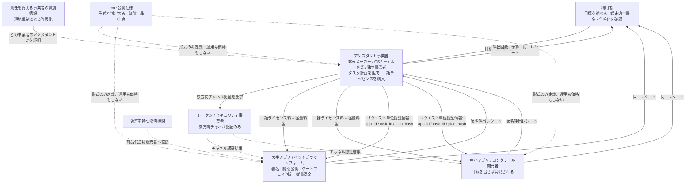
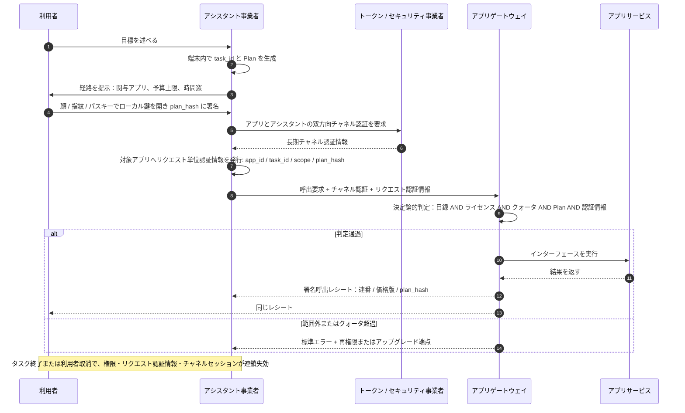
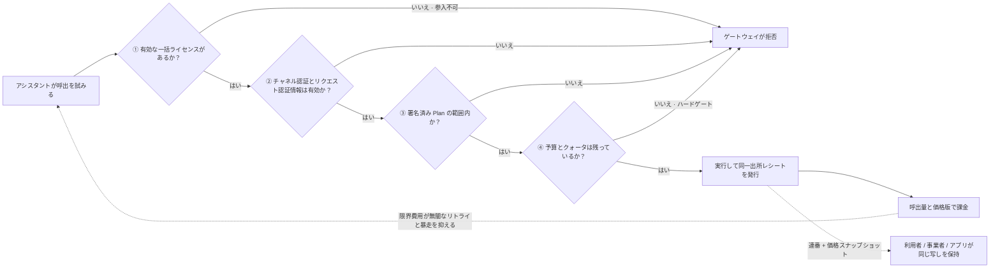

# PAP：パーソナルアシスタントとアプリの間の共通ルールについてのアイデア

> **一言で言えば**：あらゆる端末メーカー、OS、モデル企業がそれぞれ独自のパーソナルアシスタント生態系を築くなかで、すべてのアプリがすべてのアシスタントに合わせて作り直すより、「アシスタントがアプリを呼び出す」ことの**形式**を一度標準化する方が、はるかに安上がりである。

| | |
| --- | --- |
| **名称** | PAP — Personal Agent Protocol |
| **状態** | **ただのアイデアと提案です**。標準でも公式文書でもなく、どの機関も代表しません |
| **性質** | 興味を持った方が参照・改訂・議論できるよう、考えを書き留めたもの |
| **日付** | 2026 年 11 月 |
| **ライセンス方針** | 無償公開、非排他、特許権を主張しない。**名称の保持は不要** |

> ⚠️ 本文では **2026 年に公表された産業・規制の事実**と **PAP が提案する仕組み**を区別する。事業者登録、一括商用ライセンス、チャネル認証、署名付きタスク計画、呼出レシートはいずれも設計提案であり、すでに導入済みの標準ではない。また、いかなる企業・機関・標準化団体の立場も代表しない。
> 📄 他の言語：[简体中文](zh-CN.md) · [English](en.md) · [한국어](ko.md) · [Deutsch](de.md)

---

## 0. 要約

1. **ボトルネックはもはや「能力」ではない。** 2026 年のシステムレベルエージェントは、すでに複数ステップの作業を計画・実行できる。空いているのは、インターフェース目録・権限付与・計量・責任という**規則層**である。
2. **分断のコストは掛け算である。** アシスタント生態系 `M` 個とアプリ `N` 個があるとき、生態系ごとの私的連携は `M × N` 組の二者間適応を要するが、共通形式なら `M + N` 組の実装に減る。アプリは重複開発を、アシスタント事業者は反復交渉を、利用者は一貫性のない体験と不明確な責任を負う。
3. **解決策は新プラットフォームではなく、薄い仕様である。** PAP は形式と判定規則だけを定める。いかなるシステムも運用せず、価格を決めず、手数料を取らず、資金を預からず、新しい信頼のルートも作らない。
4. **オープンは無償を意味しない。** 仕様書は無償だが、**アプリが公開するインターフェースサービスは有償**である。一括商用ライセンスと従量の呼出料金がかかる。課金は単なる収益ではなく、参入・限界費用・ハードクォータによってエージェントの暴走と濫用を抑える**呼出制御の仕組み**である。
5. **四者の同時発展**。利用者、アシスタント事業者、アプリ事業者（大手と中小では得るものが異なる）、トークン／セキュリティ事業者が、同一の**新しい付加価値連鎖の異なる段階**でそれぞれ対価を得る。既存収益の奪い合いというゼロサムではない。

---

## 1. 課題：生態系が事業者の境界に沿って割れつつある

### 1.1 「アシスタント事業者」は開かれた範疇である

PAP は意図的に特定の主体に紐付かない。

| 類型 | 典型的な形態 |
| --- | --- |
| 端末メーカー | スマートフォン、PC、タブレット、車載、ウェアラブルに搭載されるシステムレベルアシスタント |
| OS 事業者 | アプリではなくシステムランタイムとして実装されたアシスタント |
| モデル／AI 企業 | モデルを中核とする汎用アシスタント、独立エージェント製品 |
| インターネットプラットフォーム | スーパーアプリから拡張されたアシスタント |
| 特化型・OSS アシスタント | 特定領域向け、あるいはコミュニティが維持するインスタンス |

**PAP は事業者を前提とせず、排他席を設けず、最初の発起者を指名しない。** 複数の生態系が併存することは前提であり、解決すべき課題ではない。しかし、まさにその併存によって以下の算術が効いてくる。

### 1.2 連携コストを計算する

主流のアシスタント生態系が 6 つあり、それぞれが利用者に常用アプリ 200 個を届けたいとする。

| 方式 | 構築・交渉が必要な連携数 | 負担する側 |
| --- | --- | --- |
| 生態系ごとの私的プロトコル | `6 × 200 = 1200` | アプリ 200 社が各 6 セット、事業者 6 社が各 200 回交渉 |
| 共通形式仕様 | `6 + 200 = 206` | アプリは 1 回、事業者は 1 回実装 |

現実は算式より悪い。アプリが向き合うのは 6 つの*プロトコル*ではなく、6 つの異なる**権限モデル・認証情報形式・計量慣行・責任条項・商務手続**である。技術アダプタは小部分にすぎず、ビジネスとコンプライアンスの交渉が大半を占める。しかも生態系数が増えるほどコストは掛け算で伸びる。今日の 6 社が来年は 10 社になり得る。

### 1.3 三つの代償

- **アプリ側：重複適応と「パイプ化」懸念。** *利用者がアプリを開く*ことが*エージェントがアプリを呼ぶ*ことに変わると、導線、レコメンド面、広告表示が迂回される。測定可能な対価と強制可能な境界がなければ、合理的な選択は**公開しない**こと、あるいはごく少数にだけ公開することである。
- **アシスタント事業者側：二者間交渉はロングテールに届かない。** ヘッドアプリは一社ずつ交渉できるが、ロングテールサービスには交渉価値がなく、アシスタントの実用範囲は「使える数十個」で止まる。
- **利用者側：体験の分断と制御不能な安全性。** 端末やアシスタントを替えると、権限・選好・記憶・請求履歴がすべて初期化される。あるタスクがどのアプリを通ったか、いくらかかったか、誰がデータを見たかを完全に述べることも、証明することもできない。

### 1.4 この空白はすでに公に指摘されている

| 日付 | 公開事実 | 示すもの |
| --- | --- | --- |
| 2026/10/8 | IETF が共通ベースラインのエージェント対話管理プロトコルと参照アーキテクチャを定める **agentproto** ワーキンググループを承認し、A2A と MCP を既存のアプリケーション層プロトコルとして明記 | 正式な標準化機関が共通ベースラインの必要性を認めた |
| 2026/10/1 | Airbnb CEO Brian Chesky が、エージェントの権限と信頼について "no consumer platform has yet settled those rules across every app" と述べ、新しいプラットフォーム層を求めた | 産業界が権限・信頼層の未整備を公に認めた |
| 2026/8/2 | **EU AI Act** の中核規定が適用開始、AI Office が GPAI 執行権限を取得、第 50 条の透明性義務が発効 | 追跡可能性と透明性が設計上の選択ではなく法的義務になった |
| 2026/4–8 | A2A v1.0 が 3 月に公開、8 月 17 日に MCP と共に Agentic AI Foundation（AAIF）へ移管、10 月 22 日時点で AAIF は 10 プロジェクトを擁する | 標準が中立機関へ集約されつつある |
| 2026/5–8 | Android **AppFunctions**（Android 16 以降、アプリがオンデバイス MCP サーバとして振る舞う。5 月 Gemini は限定プレビュー、8 月には人気アプリ 40 以上で実行可能）と Apple **App Intents**、Samsung の "conversational device agent" Bixby が併存 | 端末側のエージェント接続方式が収束ではなく分岐している |

同じシグナルが繰り返し現れる。**能力は整い、規則層が空いている。** 各事業者がこの層を別々に埋めれば、結果は相互に互換性のない複数の生態系として固まる。

### 1.5 算式中の `M` にはすでに名前がある

§1.1 の「アシスタント事業者」は架空の主体ではない。複数の事業者がすでに**端末、システムレベルアシスタント、流通チャネル、アカウント・決済体系、オンデバイスセキュリティ**からなる連鎖を丸ごと持ち、それぞれ「他人のアプリの中で行動するアシスタント」へと広げている。これが §1.2 の `M` である。以下の事実はすべて 2025〜2026 年の公開情報であり、どの企業も PAP を支持したわけではない。

| 生態系 | すでに持つ連鎖 | 2025〜2026 年の方向 | 共通形式が付け加えるもの |
| --- | --- | --- | --- |
| **Samsung** | Galaxy スマートフォン・タブレット・ウォッチ・テレビ・家電、One UI、SmartThings、Galaxy Store、Samsung Wallet、Samsung Account、Knox / Knox Vault | 2026 年 2 月発表の One UI 8.5 Bixby ベータが "conversational device agent" になり、Perplexity 経由のリアルタイム Web 回答を独・印・韓・ポーランド・英・米で提供。Galaxy S26 は Now Nudge、Now Brief、Personal Data Engine、アプリ別 KEEP 分離を追加。Samsung と Google は S26 を最初の基盤として Gemini ベースのエージェント型 Android 体験を Google Labs の初期プレビューとして先行公開 | 一つのライセンス、一つの予算、一つのレシートで第三者の商用サービスに届く端末エージェント |
| **Apple** | iPhone、iPad、Mac、Watch、Vision Pro、App Store、Apple Pay、iCloud、Apple Silicon | WWDC26（2026 年 6 月）が Apple Intelligence を Siri AI 中心に再構築。2026 年 11 月 3 日の開発者プレビューで、全アプリが App Intents 経由で Siri AI と連携可能になり、個人文脈の理解・画面認識・複数操作を束ねる「skills」を提供（開発者プレビューのみ、消費者への提供はまだ。iOS・iPadOS・watchOS では EU 未対応） | App Intents は「このアプリに何ができるか」に答えるだけで、「どのライセンスで、いくらで、誰の承認で、どのレシートで」には答えない |
| **Google / Android** | Android、Play、Google Wallet、Gemini、Android 16 の **AppFunctions**（アプリがオンデバイス MCP サーバとして振る舞う） | 2026 年 5 月に Gemini 限定プレビュー、8 月には人気アプリ 40 超を AppFunctions 経由で実行可能（事業者発表値） | 全アプリと再交渉せずに他事業者が実装できる目録・ライセンス形式 |
| **Microsoft** | Windows、Microsoft 365、Microsoft Store、Entra ID、Azure、Copilot | Build 2026：エージェントコネクタは Windows On-Device Registry に登録される MCP サーバ、エージェントワークスペース（プレビュー）はエージェントごとに別アカウントと範囲付き権限を与え、Windows 365 for Agents が正式提供。2026 年 10 月の "Hybrid Intelligence" はローカル文脈・ローカル操作（常に承認付き）・ローカルモデルを追加 | Microsoft 自身のセキュリティ原則は「すべての照会と操作に利用者の承認」を求める。PAP はその承認を OS 内の設定ではなく、持ち運べて検証可能なタスク単位のオブジェクトにする |
| **Amazon** | Echo、Fire TV、Fire タブレット、Alexa アプリと Alexa.com、Prime、Amazon の小売・決済 | Amazon は Alexa+ を米国の全顧客に提供すると明記（Prime 込み、それ以外は月 $19.99）。Alexa 対応端末・Alexa.com・Alexa アプリで飲食注文、飲食店予約、配車、住まいのサービス予約などを代行し、CES 2026 の報道では車載・ウェアラブルへの拡大が伝えられた | 提携先一つひとつが二者間連携である。共通形式があれば、また一巡の交渉をせずにロングテールへ届く |
| **Deutsche Telekom / Perplexity**（欧州） | T Phone / T Tablet 端末、Magenta AI、欧州 10 市場の通信料金請求・流通網 | Perplexity 搭載 AI フォンが 2025 年 8 月 14 日に発売。MWC 2026 の Magenta AI ファクトシートは、アシスタントと Comet ブラウザがサービスとプラットフォームを横断する作業の流れを編成する "app-less future" 構想を説明（例：対話から決済まで） | 入口がアプリからアシスタントへ移ることを最もはっきり公言した例 — まさにこの変化に商用アクセス規則が必要になる |

六つの連鎖、同じ問いへの六つの答え。**利用者ではなくアシスタントがアプリを開くとき、その呼出はどの規則で行われるのか。** どこもインターフェース目録、商用ライセンス、タスク単位の承認、呼出レシートの共通形式を公開していない。六つすべてが成功すれば、アプリは別々の六つの目録・認証情報形式・計量慣行・責任条項に向き合う。§1.2 の `M × N` の請求が図ではなく現実の請求書になる瞬間である。これは §1.1 も裏付ける。通信事業者、小売企業、OS 事業者がすでに端末メーカーと同じ範疇に並んでいる以上、PAP が最初の発起者を指名しないのは妥当である。

この節の出典区分は §13 にまとめた。事業者発表値と「報道」と記した拡大は、いかなる規範的主張の根拠にも用いない。ベータ・プレビュー・構想段階の機能は変更され得る。

---

## 2. PAP とは何か、何でないか

### 2.1 定義

> PAP は、パーソナル AI アシスタントが第三者アプリの公開インターフェースを呼び出す際の**サービス目録、商用ライセンス、チャネル認証、タスク権限、認証情報のライフサイクル、呼出レシート**の形式と判定規則を定める、**公開され、自由に実装でき、非排他な**インターフェース形式仕様である。

役割は一つだけである。二者間の振る舞いを、**双方がそれぞれ独立に実装し、オフラインで検証し、差し替えられる形式の取り決め**に変えることである。

### 2.2 である／でない

| PAP であるもの | PAP でないもの |
| --- | --- |
| 誰でも無償で読め、実装できる仕様書 | プラットフォーム、SaaS、運用主体 |
| 形式と判定規則（shall / should / shall not） | 価格表、清算所、決済レール |
| 各主体がローカルに実装し差し替えられる機能 | 中央集権的なレジストリ、認証局、台帳 |
| 高リスクインターフェースの最低基準 | 新しい信頼ルート、統合 ID センター |
| *誰が、誰に代わり、どこまで呼ぶか*の検証可能な制約 | 利用者権限の発行者 |
| 自由に改訂・分割・改名できるもの | 許可・料金・席を要するもの |

### 2.3 四つの原則

1. **プロトコルと商務の分離** — 仕様は無償で、仕様ライセンス料もレベニューシェアもない。商務条件はアプリと事業者が定める。
2. **仕様層は開放、運用層は責任追及可能** — 誰でも仕様を実装できるが、実際に利用者へアシスタントを提供する事業者は、現地規制に従い識別可能で責任を負える法主体であるべきである。両者は互いに代替しない。
3. **参加は任意** — いかなるアプリも公開を強制されず、いかなる事業者も特定アプリのライセンス購入を強制されない。
4. **最終権限は利用者に残る** — 商用ライセンス、チャネル認証、利用者権限は別々の三つであり、いずれも他を代替できない。

> PAP は既存の仕事を繰り返さない。ツール／データ接続、エージェント間協調、汎用認可フレームワーク、決済認可プロトコルには、すでにそれぞれの仕様がある。PAP が埋めるのは**その間の空白**、すなわちアシスタント事業者と第三者商用サービスの間のインターフェース目録・ライセンス・計量・責任境界である。

---

## 3. 仕様に何が含まれるか

| # | 対象 | 定めること | 解決すること |
| --- | --- | --- | --- |
| 1 | **署名付きサービス目録** | 機械可読でバージョン・署名付きのインターフェース ID、機能説明、レート制限、リスク等級、価格スケジュール版 | 「一括パッケージに何が入るか」を明確にし、事後の紛争を除く |
| 2 | **一括商用ライセンス** | 事業者が一アプリの公開インターフェース全体をライセンス。範囲・有効期間・クォータ・失効エンドポイントの形式 | 商用ライセンスをゲートウェイが判定できるオブジェクトに変える |
| 3 | **チャネル認証** | トークン／セキュリティ事業者がアプリとアシスタントの間に双方向セキュアチャネル認証を確立し、「どの事業者のどの正規インスタンスか」を証明 | なりすまし、暴走インスタンス、中間者を防ぐ |
| 4 | **タスクと計画（Plan）** | `task_id`、アプリ／インターフェース一覧、予算上限、時間窓、失敗時代替経路、`plan_hash`、版 | 利用者権限の対象は*経路*であり、クリックごとではない |
| 5 | **リクエスト単位認証情報とライフサイクル** | 各リクエストに `app_id + task_id + scope + plan_hash` を付与。トークン・権限・タスクのライフサイクルは**入れ子かつ連鎖失効** | アプリごとに別の鍵、タスク終了で全て失効 |
| 6 | **三者同一出所の呼出レシート** | `task_id / interface_id / 連番 / タイムスタンプ / 価格版 / plan_hash / アプリ署名` | 利用者・事業者・アプリが同じレシートを持ち、突合が不要 |
| 7 | **高リスクインターフェースの最低線** | 決済、送金、アカウントセキュリティ情報の変更、削除：当該回の確認、独立認証情報、取消可能、監査痕跡 | 製品等級や商務合意で引き下げられない |

見落とされやすいが重要な判定が二つある。

- **権限カバレッジ 100%**：すべての呼出は有効な利用者権限に紐付かねばならず、根拠のない呼出はゲートウェイが拒否する。ただし**呼出ごとに顔認証を求める意味ではない**。「日本旅行を手配して」の背後には数百回の照会があり得るが、利用者は経路に一度強認証すれば、経路内の照会は黙って実行される。再確認が必要なのは経路変更、予算・時間窓の超過、高リスク操作だけである。
- **生体情報は端末から出ない**：顔、指紋、パスキー、PIN はすべて同じローカル署名鍵のロック解除手段である。生体情報はローカル解除にのみ使われ、認証情報としてアプリへ送られることはない。

2026 年の有用な基準点がある。A2A v1.0 の署名付き Agent Card は*このエージェントが誰か*を証明するが、**識別は権限ではない（Identity is not permission）**。ハンドシェイク後に何に触れてよいかは、識別の証明では決まらない。まさにこの分離のため、PAP はチャネル認証・商用ライセンス・利用者権限を三つの独立したオブジェクトとして保つ。

---

### 3.1 参加主体の関係図



---

## 4. 一回の呼出はどう流れるか

1. 利用者が目標を述べると、アシスタントは端末内で `task_id` と Plan を生成し、ローカルに記録する。
2. アシスタントが経路（関与アプリ、予算上限、時間窓）を提示し、利用者は顔・指紋・パスキーでローカル署名鍵を開き `plan_hash` に署名する。
3. アシスタントはアプリの署名付き目録を照合し、インターフェースの存在、ライセンス有効、クォータ未消費を確認する。
4. トークン／セキュリティ事業者がアプリ ↔ アシスタントの双方向チャネル認証を完了する（長期チャネル認証情報）。
5. アシスタントは対象アプリへ**リクエスト単位認証情報**（`app_id / task_id / scope / plan_hash`）を発行する。一つのタスク内でも、アプリごとに独立で譲渡不能な認証情報を受け取る。
6. アプリのゲートウェイが決定論的判定を行う。

```
interface_id IN published_directory
  AND operator_licence_valid
  AND quota_not_exhausted
  AND request WITHIN signed_plan
  AND channel_attestation_valid AND request_credential_valid
→ 実行。それ以外の場合は標準エラーと機械可読なアップグレード／再権限エンドポイントを返す
```

7. アプリが**呼出レシート**を発行し、三者へ同じ写しを配る。利用者はこのタスクの呼出回数・残予算・呼ばれたインターフェースを見て、事業者はアプリ別コストを、アプリは当該インスタンスの呼出量と請求額を見る。
8. タスク終了／利用者取消／時間窓満了 → 権限、リクエスト認証情報、チャネルセッションが入れ子関係に従い**連鎖失効**する。

**連番**は欠番をただちに露呈させ、**価格版スナップショット**は呼出時点の価格を固定する。利用者のローカル写しはエクスポート・移行が可能で、`task_id` で一括取消できる。過大請求に異議を唱える際、誰にもログの提供を頼む必要がない。

---

### 4.1 一回の呼出のシーケンス



---

## 5. オープン ≠ 無償：課金を呼出制御の仕組みとして設計する

PAP で最も誤読されやすい部分である。「オープンプロトコル」はしばしば「呼出も無料」と読まれるが、まさにその読み方が生態系の立ち上がりを阻む。

### 5.1 まず三つを分ける

| | 有償か | 決める主体 | PAP の役割 |
| --- | --- | --- | --- |
| **仕様書**（形式、判定規則、スキーマ） | **無償**。誰でも閲覧・実装・配布可 | オープンコミュニティ／標準化機関 | 形式と適合性試験を公開。ライセンス料・手数料なし |
| **アプリが公開するインターフェースサービス** | **有償**：一括商用ライセンス＋従量呼出料 | アプリと事業者の二者間合意 | 目録・ライセンス・レシートの**形式と判定**のみ定め、価格は定めない |
| **利用者がアシスタントに払う料金** | 事業者が自主設定 | アシスタント事業者 | 関与しない |

つまり「オープン」が指すのは**参入権と実装権**である。誰でも、誰の承認も席の購入もなしに、アシスタントを作り、アプリインターフェースを公開し、トークンサービスを提供できる。決して「アプリがインターフェースを無償で譲る」という意味ではなく、これは §2.3 のプロトコル・商務分離と同じ原則であって例外ではない。

### 5.2 完全無償の呼出がなぜ危険か

呼出コストがゼロで摩擦がないとき、四つの帰結が生じる。

- **暴走インスタンスを抑止できない**。計画の拙い、あるいは乗っ取られたアシスタントが短時間に大量照会を浴びせ、コストはすべてアプリが負う。
- **濫用と正常利用を区別できない**。限界費用がゼロなら、正規タスクの呼出と偽装クローリングに経済的差がなく、アプリは一律遮断しか選択肢がない。
- **負荷を予測できない**。アプリが「エージェントトラフィック」に容量計画を立てられず、合理的な反応は公開を絞るか拒むことである。
- **責任に価格を付けられない**。ライセンスは商用契約であると同時に、*この呼出群に誰が責任を持つか*の証拠でもある。ライセンスがなければ、責任主体が消える。

直観に反する連鎖である。**無償呼出 → アプリが公開を躊躇 → 生態系そのものが成立しない。** 課金は公開の制限ではなく、持続可能な公開の前提条件である。

### 5.3 課金の四つの制御効果

| 仕組み | 作用 | 具体的な結果 |
| --- | --- | --- |
| **ライセンス料（参入）** | 責任を負えない主体を篩う | 識別され、約款に署名し、責任を引き受けた事業者だけが鍵を得る。濫用は失効させられる |
| **従量料金（限界費用）** | 呼出ごとにコストが発生 | 事業者は無闇なリトライではなく、計画・重複排除・キャッシュ・結果再利用に投資する。「検索 1 回」と「注文 1 回」を別価格にできる |
| **クォータ／予算（ハードゲート）** | 利用者予算がそのまま呼出上限 | ゲートウェイが超過を拒否し、経済問題が決定論的な技術制御へ変換される |
| **レシート（計量）** | 同一出所、連番、価格版固定 | 呼出回数とトラフィックが検証・立証可能になり、請求紛争が消え、同じ記録が監査根拠になる |

この四つはチャネル認証と Plan 署名と合わせて一つの系を成す。**トークンは*接続できるか*、権限は*利用者が同意したか*、課金とクォータは*何回、どこまでか*を司る。** これは当初の安全上の懸念、すなわちパーソナルアシスタントが制御を失ったり無闇にインターフェースを呼んだりしないようにする問題が、錠前一つでは解けず、コストとクォータという二つのゲートを要するという答えでもある。

### 5.4 PAP がお金について何をし、何をしないか

**すること**：目録フィールド（価格版を含む）、ライセンスオブジェクト形式、レシート項目と連番規則、クォータ枯渇・範囲超過の標準エラー、適合性試験の定義。

**しないこと**：価格設定、清算、資金預託、手数料徴収、特定ビジネスモデルの強要。商品代金は引き続き販売者へ直接渡り、資金と決済認可は既存規則に従い免許を持つ決済機関に残る。

これは一から作った概念ではない。**x402** は HTTP 402 を呼出ごとの決済として復活させ、2026 年 7 月から Linux Foundation 配下の x402 Foundation が所管する。**MPP**（Stripe / Tempo）と **AP2** mandate（Google、60 社以上の立ち上げパートナーと共に 2026 年 4 月 28 日 FIDO Alliance へ寄贈）は同じ問題の別の部分を扱い、**Visa TAP**（Cloudflare と共に、2025 年 10 月 14 日）は正規エージェントとスクレイパーを区別するために存在する。なお定義されていないのは**これらのレールの上にある商用アクセス層**である。誰がどの商用インターフェースを、どのライセンスで、どの計量と責任で呼べるのか。PAP はその層の形式を定めるのであって、決済にどのレールを使うかは規定しない。

> 一行で言えば：**PAP は課金を判定可能・検証可能・取消可能にする。ただし課金そのものは、常に二つの商用主体の間の事柄である。**

---

### 5.5 四つのゲート：課金がどう制御になるか



---

## 6. 各主体が得るもの

### 6.1 利用者

- 目標を一度述べれば、十数の画面を行き来せずに完了する。
- **権限は経路に付く**。一度の確認で経路全体を覆い、経路変更・予算超過・高リスク操作だけが再確認を求める。
- **完全に見え、立証できる**。呼出回数・インターフェース・予算消費を端末に保管し、レシートをエクスポート・移行でき、`task_id` で一括取消できる。
- プライバシー境界が明確。生体情報は端末に留まり、チャネル認証はインスタンスを証明するだけで同意を代替しない。
- 権限と選好を持ち運べ、単一の生態系に閉じ込められない。

### 6.2 アシスタント事業者（端末メーカー、OS 事業者、モデル企業、独立アシスタント）

- **1200 組の連携が 206 組へ**。一度実装すれば、準拠目録を出したすべてのアプリに届く。ロングテールサービスが「交渉対象」ではなく「目録により利用可能」になる。
- **等級は事業者が決める**。決済インターフェースのない初級等級、より多くを開く上級等級――等級は消費者向け製品判断であり、アプリは感知も関与もせず、インターフェース ID と呼出量だけを見る。
- ライセンス・利用コストが予測可能、予算はハードゲート、説明不能な請求書が消える。
- システムレベルの位置、インストールベース、オンデバイスセキュリティ、アカウント体系という既存資産に、統一された収益化経路が生まれる。
- **§1.5 の生態系連鎖にとって、これは譲歩ではなく追加である**。Samsung は Knox と SmartThings を、Apple は App Store と Apple Pay を、Microsoft は Entra ID を、Amazon は Prime をそのまま保つ。共通仕様が置き換えるのはアシスタントごとの商務交渉だけであり、連鎖の価値を支える資産ではない。
- オープン仕様ゆえに**誰の承認も待たず、席を買う必要もない**。先に動かした側が事実上の参照位置を得る。

### 6.3 大手アプリ／ヘッドプラットフォーム

- アシスタント生態系ごとに別々の権限・認証情報・計量・責任パイプラインを維持せず、**一度だけ実装**する。
- **迂回された導線に対価が付く**。ライセンス料と従量料金が、エージェントトラフィックを失ったレコメンド・広告面ではなく、測定可能な新規収益に変える。CPS 型の逆手数料も選択的に足せる。
- **公開できるようになる**。識別可能な事業者、失効可能なライセンス、ハードクォータ、同一出所レシートが、「インターフェース公開」をセキュリティ・コンプライアンスリスクから制御された事業へ変える。
- 価格設定、レート制限、目録公開、拒否権をすべて保持する。PAP は営業秘密の開示を求めず、機械可読で版と検証が付いた目録だけを求める。
- 負荷予測と濫用の価格化が可能になり、初めて容量計画を立てられる。

### 6.4 中小アプリ／ロングテール開発者

最も過小評価されやすく、共通仕様が私的生態系に勝る理由を最もよく示す主体である。

- **一度連携すれば、すべての準拠アシスタントに届く**。私的生態系では中小アプリはどの事業者の交渉リストにも載らない。共通目録は、ロングテール需要による発見を初めて可能にする。
- **エンジニアリング負荷ほぼゼロで開始**：署名付き機械可読目録を出し、第三者アダプタを認可すればよい。まだ存在しないトラフィックのために先にシステム改造する必要がない。
- **トラフィックがそのまま対価**：呼出と成立取引が従量または成果で課金され、事前の獲得費用が不要。
- **価格の根拠ができる**。公開価格表と同一出所レシートにより、中小アプリも大手と同じ計量基準で交渉できる。
- リスク：一括価格を規模の大きい事業者が主導し得る。**これは商務交渉の問題であり、プロトコルが解ける問題ではない**。本文は消えた振りをせず、明記するだけである。

### 6.5 トークン／セキュリティ事業者

- 狭く明確な役割：**アプリとアシスタントの間の双方向セキュアチャネル認証のみ**を行い、どの事業者のどの正規インスタンスか、チャネルが完全かを証明する。
- 業務ルーティング、業務データ、資金、利用者権限の内容、等級設計には触れない。役割が狭いほど、全主体が受け入れやすい。
- チャネル認証と呼出レシートが自然に同一の事実記録を残し、課金・監査・リスク制御に使える。複数事業者が併存・競争でき、単一支配点が生じない。
- **明示的に行わないこと**：権限主体にならず、資金を扱わず、誰が誰を呼べるかを決めない。最終の決済認可は利用者と免許を持つ決済機関に残る。

### 6.6 規制当局と産業界

- 主体の識別、行為の追跡、責任の帰属が可能になり、「主体が信頼でき、行為が制御でき、責任が遡れる」という方向に整合する。
- 権限と呼出の立証可能な記録が、紛争処理コストを下げる。
- 開放的で非排他な形式仕様が、重複構築と生態系の壁を減らす。

### 6.7 利益マトリクス

| 主体 | 主な利益 | 主な義務／コスト |
| --- | --- | --- |
| 利用者 | 利便、可視性、取消可能性、移行性 | 経路の確認が一度 |
| アシスタント事業者 | 適応コストが掛け算から足し算へ、能力の収益化 | ライセンス購入、利用者権限の真正性に責任 |
| 大手アプリ | 単一実装、新規収益、公開可能 | 署名目録の公開、計量の受入 |
| 中小アプリ | 単一連携、ロングテール発見、従量課金 | 目録維持、交渉力はなお弱い |
| トークン事業者 | 境界が明確な新サービス領域 | 三つの境界を厳守 |
| 規制／産業 | 追跡性、責任性、重複削減 | 等級化とコンプライアンス細則が必要 |

### 6.8 利益は再配分ではなく、新しい付加価値から来る

四者が同時に成立し得る理由である。価値は主に**従来存在しなかった「アプリ横断のタスク自動化」**から生じる。旅行一回、比較一回、アプリをまたぐ用事一回は、従来なら数十回の手操作を要した。四者は効率、導線、サービス配布、チャネルセキュリティという**異なる段階**で対価を得るのであり、一つの既存収益を奪い合うのではない。

したがって共栄は自動ではない。四つの制約が同時に必要である。

1. **等級化された責任主体**：高リスク等級には強い監査を課す一方、独立開発者や OSS アシスタントを排除する一律の高障壁は避ける。
2. **同一等級内の非差別**：同じ目録・価格表の下で自己優遇を禁じ、利用者が明示したアプリは事業者既定値より硬優先、推奨理由は監査可能なログに残す。
3. **権限カバレッジ 100% ＋ 同一出所レシート**：根拠のない呼出を許さず、いずれか一方だけが唯一の台帳を持たない。
4. **仕様の公開維持**：形式は完全実装・ミラー・差し替えが可能でなければならない。席が必要になった瞬間、前三項が機能しなくなる。

---

## 7. 2026 年の根拠

| 日付 | 事実 | 含意 |
| --- | --- | --- |
| 2025/12 | Anthropic が **MCP** を **Agentic AI Foundation（AAIF）**（Linux Foundation 配下、Block・OpenAI が共同設立、Google・Microsoft・AWS・Cloudflare・Bloomberg が支援）へ寄贈。稼働サーバ 10,000 超、月間 SDK ダウンロード約 9,700 万回を公表 | ツール接続層が中立ガバナンスを選び、当該層の M×N 問題を解消した |
| 2025/10/14 | **Visa TAP** が Cloudflare と共に開始。正規エージェントとスクレイパーを識別 | エージェントトラフィックには公開エンドポイントだけでなく識別と制御が要る |
| 2026/1 → 8 | Google が NRF 2026 で Shopify、Walmart、Target、Etsy、PayPal、Visa、Stripe、Amex と **UCP** を発表、仕様改訂 v2026-08-25。**ACP**（OpenAI / Stripe、Apache 2.0）が並走 | 商用ケイパビリティプロファイルが機械可読になったが、競合仕様が複数同時に現れた |
| 2026/3–4 | **A2A** v1.0 が 3 月に公開、Linux Foundation が 4 月の一周時点で 150 超の支援組織を報告 | エージェント間協調の標準化が進行 |
| 2026/4/28 | **AP2**（立上げパートナー 60 社超）が **FIDO Alliance** へ寄贈。利用者署名 mandate が「利用者は承認したか」と「決済手段は有効か」を分離 | 同意が改竄耐性のある署名オブジェクトになった |
| 2026/5–8 | Android **AppFunctions**（Android 16 以降、アプリがオンデバイス MCP サーバとして振る舞う。5 月 Gemini は限定プレビュー、8 月に人気アプリ 40 超で実行）と Apple **App Intents**（2026 年 11 月の開発者プレビューで Siri AI の複数操作「skills」へ拡張）、Samsung の対話型 Bixby が併存 | 端末側接続方式が分岐しており、アプリはそれぞれに適応せねばならない |
| 2026/2 → 11 | 端末・OS・小売・通信の各アシスタントがいずれも第三者サービスへ拡大。Samsung の One UI 8.5 Bixby（2 月）、Apple の Siri AI 開発者プレビュー（11 月 3 日）、Microsoft のエージェントコネクタ／エージェントワークスペース（Build 2026）、米国全顧客向け Amazon Alexa+（2026 年、CES 2026 の拡大は報道）、Deutsche Telekom の Magenta AI による "app-less" 構想（MWC 2026）— §1.5 参照 | 共通形式ができる前に、商用アクセス層が事業者ごとに私的に埋められつつある |
| 2026/7 | **x402 Foundation** が Linux Foundation 配下で稼働、Stripe / Tempo **MPP** が並行する HTTP-402 レールを提供 | 呼出ごとの決済がすでに実在するレールである |
| 2026/8/2 | **EU AI Act** 中核規定が適用、AI Office が GPAI 執行権限を取得、第 50 条透明性義務が発効 | 追跡性・透明性は設計嗜好ではなく法的義務 |
| 2026/8/17 → 10/22 | A2A が MCP と共に AAIF へ移管、AAIF のホストプロジェクトは 10 に到達 | 標準が一事業者ではなく中立機関へ集約 |
| 2026/10/8 | **IETF** が共通ベースラインのエージェント対話管理プロトコルと参照アーキテクチャのため **agentproto** ワーキンググループを承認 | 共通ベースラインの正式標準化が始まった |
| 2026/10/1 | Brian Chesky（Airbnb）："no consumer platform has yet settled those rules across every app" | 権限・信頼層の未整備が公に認められた |

**合わせて読めば**：端末側の能力、呼出ごとの決済レール、署名付き決済 mandate、エージェント間協調、中立ガバナンス、規制上の追跡性がすべて揃っている。共通規則がまだ無い区間は **アシスタント ↔ 第三者商用サービス**、すなわちサービス目録・商用ライセンス・タスク権限・呼出計量・責任境界だけである。産業界はすでに二者間契約と生態系別アダプタで埋め始めている。**いまが標準化の窓である。** 今なら安く埋められ、私的インターフェースが固まった後では、すでに敷かれた事実群に合わせるほかなくなる。

もう一つ付け加える。2026 年のプロトコルの数そのもの（MCP、A2A、AP2、UCP、ACP、x402、MPP、TAP）が、また別の形の分断である。それぞれ異なる層を解き、概ね良好に合成でき、主要事業者の複数が二つ以上に同時に賭けている。PAP はこれらと競合しない。**その上にある商用アクセス層だけは、八つの私的形式ではなく一つの形式であるべきだ**と主張するだけである。

---

## 8. なぜ共通オープン仕様が私的生態系に勝るか

| 次元 | 事業者別の私的生態系 | 共通オープン仕様 |
| --- | --- | --- |
| 適応コスト | `M × N`、生態系数に応じて掛け算 | `M + N`、一度実装し各所で再利用 |
| 中小アプリの参入 | 交渉リストに載らねば不可能 | 目録を出せば発見される |
| 利用者の移動 | 権限・選好・記憶が残置 | エクスポート・移行・取消可能 |
| 責任の規定 | プロトコルごとに別約款 | 一つの認証情報・レシート規約 |
| 請求紛争 | 各自が別のログ | 同一出所、連番、価格スナップショット |
| 革新速度 | ロングテールが選ばれるのを待つ | ロングテールが自律的に連携 |

直観に反するが重要な点：**オープン性は先行事業者の譲歩ではない。** 目録を完全にミラーでき、利用者権限をエクスポートでき、二人目のアシスタントを追加する限界費用がほぼゼロなら、排他性は不要なだけでなく割に合わない。先行者が得るのは**事実上の参照位置**である。目録形式、レシート項目、適合性試験、パイロットデータ、そして後の標準議論の席。生態系を築いた側が規則定義に早く関わるほど、後に他人の決めた規則に合わせる必要が減る。

---

## 9. リスクと正直な境界

1. **採用は不確実である**。本稿はひとつのアイデアであり、いかなる企業・標準化機関も拘束しない。より起こりやすい結果は、いくつかの概念が吸収・改訂され、出所を遡れない形で現れることである。
2. **仕様は価格を司らない**。一括価格と分配構造は商務交渉であり、PAP は形式と判定だけを定める。
3. **中小アプリの交渉力**。一括価格を規模の大きい側が主導し得る。構造的な交渉非対称はプロトコルでは除けない。
4. **等級は事業者の担当である**。PAP は高リスク最低線だけを守り、「初級／上級」の中身を定義しない。最低線の上では自由に分けてよいが、「確認なしの決済」はどの等級にも入れられない。
5. **コンプライアンスが重なる**。事業者の識別情報、生成 AI 関連義務、個人情報と越境移転、決済免許が重畳し、専用の章を要する。本稿は解決した振りをしない。
6. **越境主体**。Identity と信頼ポリシーの相互承認、国外アプリの適用規則は未解決である。本稿は新たなグローバルルートではなく、認証情報形式と信頼ポリシーを分離し、各アプリが目録で受容可能な発行者を宣言する方式を採る。
7. **GUI チャネル**。画面自動化は目録／アダプタ連携の下の過渡的な段になり得るが、商用ライセンスと利用者権限を迂回する裏口になってはならない。
8. **商用ライセンス ≠ 利用者権限**。最も混同されやすい。事業者 Identity は法人単位、呼出はインスタンス単位、同意はタスク単位であり、三者は互いに代替できない。
9. **プロトコルは競争法の問題を解けない**。排他、自己優遇、支配力は規制と商務交渉の領域であって、形式仕様の領域ではない。
10. **コールドスタート**。インストールベースとシステムレベルの位置を持つ事業者が先に実呼出量を作り、それがロングテールアプリを引き込むと想定する。これは産業仮説であり、確立した結論ではない。

---

## 10. ロードマップ

| 段階 | 内容 | 中央システムが必要か |
| --- | --- | --- |
| **P0** | テキストのみの仕様：署名サービス目録、Service Description、最小一括ライセンスプロファイル、呼出レシートスキーマ、エラーコード、適合性試験 | **不要**。ただちに文書化できる |
| **P1** | アダプタ・GUI チャネルのコンプライアンス境界と責任分割 | 不要 |
| **P2** | チャネル認証とリクエスト単位認証情報の形式、三層ライフサイクル、連鎖失効。既存 PKI・識別基盤を再利用し、新ルートを作らない | 不要 |
| **P3** | 突合・紛争処理フロー、非差別条項、高リスク最低線 | 不要 |
| **P4** | 垂直パイロット（旅行／チケット／地域サービス：シナリオ 1 つ＋アプリ 3〜5 社）で「一度の権限 → アプリ横断実行 → 三者同一請求」を検証し、標準化機関へ提出 | パイロットは参加者が運用 |

**P0〜P3 はすべてテキストである。** 開始にあたり、いかなる中央オンラインサービスも要らない。この薄さは意図的である。プラットフォームが出来る前にも前進できる仕様でなければ、コールドスタートに阻まれてしまう。

---

## 11. 参加方法

このアイデアはオープンに公開される。個人、企業、標準化機関を問わず、**名称を保持せずに**採用・改訂・分割・再発起できる。最も有用な貢献は次のとおりである。

- **穴を見つける**：判定連鎖、ライフサイクル、レシート項目のうち、特に「権限根拠のない呼出」や「宙吊りの認証情報」を許す箇所を Issue で指摘してほしい。
- **適合性試験を足す**：P0 の形式をオフラインで動く最小試験群にすることは、さらなる論証よりはるかに価値がある。
- **参照実装を作る**：最小の目録＋ゲートウェイ判定＋レシート発行例は、規則が実行可能であることを直接証明する。
- **事実を補う**：地域の規制・産業・標準化の動向、とりわけ分断コストの主張を補強または反証する公開データ。
- **課金の章を批判する**：ライセンス料と従量料金が参入・クォータ制御として働きながら、中小アプリの参入障壁にならないようにするにはどうすべきか。本稿で最も反証を要する部分である。

---

## 12. 用語

| 用語 | 意味 |
| --- | --- |
| **パーソナルアシスタント／事業者** | 利用者にシステムレベルエージェントを提供する、識別可能で責任を負える主体。端末メーカーは複数類型の一つ |
| **サービス目録** | アプリが公開する、署名・版付きの機械可読インターフェース一覧 |
| **一括商用ライセンス** | 事業者が一アプリの公開インターフェース全体をライセンス。**どのアプリを買うかは事業者の選択** |
| **チャネル認証** | トークン／セキュリティ事業者がアプリとアシスタント間に確立する双方向セキュアチャネル認証。業務データは関与しない |
| **Plan** | 一タスクのアプリ・インターフェース一覧、予算、時間窓、代替経路。利用者が署名するオブジェクト |
| **リクエスト単位認証情報** | 各呼出に載り、対象アプリごとに独立発行される短期認証情報 |
| **連鎖失効** | トークン・権限・タスクのライフサイクルが入れ子になり、一層の終了が配下すべてを無効化 |
| **呼出レシート** | アプリゲートウェイが発行し、三者が同じ写しを持つ署名付き計量・監査記録 |
| **権限カバレッジ 100%** | 全呼出が有効な利用者権限に紐付く必要があること。呼出ごとの対話確認とは別 |

---

## 13. 出典と検証

**A 区分（公式・機関）**：IETF agentproto ワーキンググループ charter（2026 年 10 月 8 日）、Linux Foundation / Agentic AI Foundation による MCP・A2A およびホストプロジェクトの発表、EU AI Act 実施タイムラインと AI Act Service Desk FAQ（2026 年 8 月 2 日の中核規定適用、第 50 条、GPAI 執行権限）、FIDO Alliance の AP2 資料、Google 開発者文書の AppFunctions・Android 16、Apple App Intents 文書、Google / UCP 公開仕様改訂版。 §1.5 の事業者資料：Samsung Newsroom（One UI 8.5 Bixby、2026 年 2 月、Galaxy Unpacked 2026 / S26）および Samsung Developer、Apple Developer News（2026 年 11 月 3 日 Siri AI 開発者プレビュー）と WWDC26 資料、Microsoft Learn・Windows Experience Blog と Build 2026 / Windows 365 for Agents の発表（エージェントコネクタ、On-Device Registry、エージェントワークスペース）、Amazon Alexa+ の製品・FAQ ページ、Deutsche Telekom の報道資料（2025 年 8 月 14 日）と MWC 2026 の Magenta AI ファクトシート、Amazon 自身による Alexa+ 全米提供の発表（全顧客対象、Prime 特典、月 $19.99、エージェントによるタスク実行）、Samsung の Galaxy S26 購入ガイド（2026 年 2 月 25 日発表）と Galaxy Unpacked 2026 回顧、Microsoft Windows Experience Blog の "Building Windows for hybrid intelligence"（2026 年 10 月 7 日）。

**B 区分（報道）**：A2A v1.0 と 150 超の支援組織に関する報道（Linux Foundation、2026 年 4 月）、NRF 2026 の UCP 発表と立上げパートナー、Agentic Commerce のプロトコル全体像、2026 年 10 月の Brian Chesky によるエージェント OS と未整備の権限規則に関するインタビュー、Visa TAP 関連報道（Cloudflare と共に、2025 年 10 月 14 日）。 CES 2026 における Alexa+ の車載・ウェアラブル拡大の報道は B 区分、§1.5 の AppFunctions アプリ 40 超など事業者公表のカバレッジ数は C 区分で方向を示すのみである。

**C 区分（事業者自身の公表、独立監査なし）**：MCP の稼働サーバ 10,000 超・月間 SDK ダウンロード約 9,700 万回、x402 の取引件数・取扱高、Gemini / AppFunctions のアプリカバレッジ数、AP2 のパートナー 60 社超。方向を示す目的にのみ用い、いかなる規範条文の技術根拠にも用いない。

**検証日**：2026 年 11 月 7 日。非公開情報は使用していない。本文はどの企業・機関・標準化団体の立場も代表せず、すべての仕組みは実装と検証を待つ提案である。

**商標と支持の有無**：上記の企業名・製品名は公開された事実を述べるためだけに用い、すべての商標は各権利者に帰属する。支持・提携・関係を意味しない。ベータ・プレビュー・構想と記した機能は変更され得る。

---

**この記事**：PAP についてのアイデア · 2026 年 11 月
**アイデア**：xiaoyangstudent
**ライセンス方針**：無償公開、非排他、特許権を主張しない。採用・改訂・独自再発起を歓迎する。
**参加**：本リポジトリの Issues / Discussions を利用されたい。
