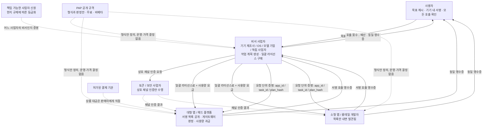
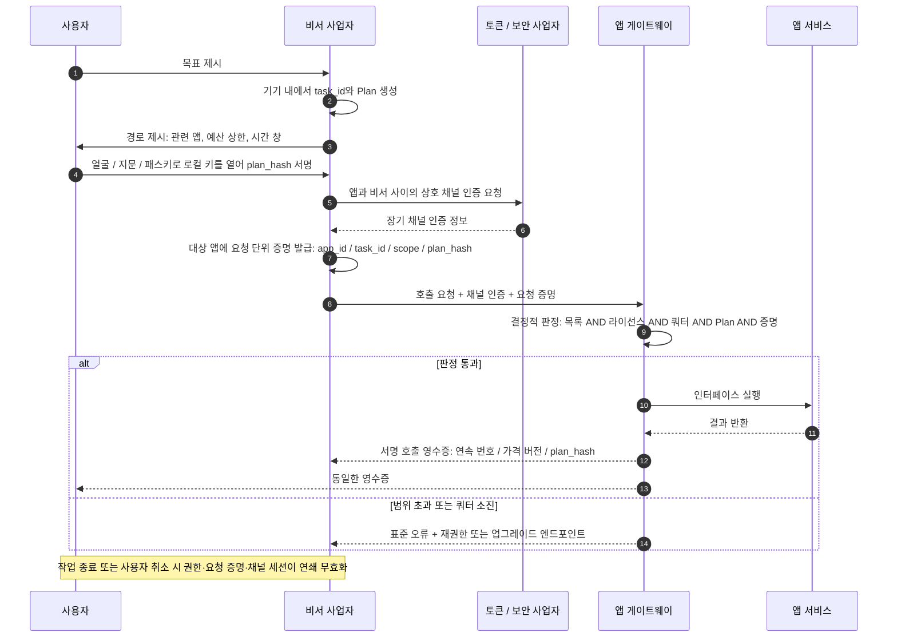
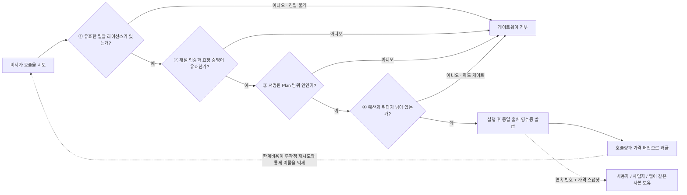

# PAP: 개인 AI 비서와 앱 사이의 공통 규칙에 관한 아이디어

> **한 문장으로**: 모든 기기 제조사, 운영체제, 모델 기업이 각자의 개인 비서 생태계를 만들고 있다면, 모든 앱이 모든 비서에 맞춰 다시 연동하는 것보다 "비서가 앱을 호출하는 방식"의 **형식**을 한 번 표준화하는 편이 훨씬 저렴합니다.

| | |
| --- | --- |
| **명칭** | PAP — Personal Agent Protocol |
| **상태** | **그저 하나의 아이디어이자 제안**; 표준도 아니고 어떤 기관을 대변하지도 않음 |
| **성격** | 관심 있는 분이 참고·수정·토론할 수 있도록 아이디어를 정리해 둔 글 |
| **일자** | 2026년 11월 |
| **라이선스 입장** | 무료 공개, 비배타적, 특권 주장 없음. **명칭 유지 불필요** |

> ⚠️ 본문은 **2026년에 공개적으로 확인된 산업·규제 사실**과 **PAP가 제안하는 메커니즘**을 구분합니다. 사업자 등록, 일괄 상업 라이선스, 채널 인증, 서명된 작업 계획, 호출 영수증 등은 설계 제안이며, 이미 시행 중인 표준이 아니고 어떤 기업·기관·표준화 기구의 입장도 대변하지 않습니다.
> 📄 다른 언어: [简体中文](zh-CN.md) · [English](en.md) · [日本語](ja.md) · [Deutsch](de.md)

---

## 0. 요약

1. **병목은 더 이상 '능력'이 아닙니다.** 2026년 시스템 수준 에이전트는 이미 다단계 작업을 계획하고 실행할 수 있습니다. 비어 있는 것은 인터페이스 목록, 권한 부여, 계량, 책임이라는 **규칙 계층**입니다.
2. **파편화 비용은 곱셈입니다.** 비서 생태계 `M`개와 앱 `N`개가 있을 때, 생태계별 사적 연동은 `M × N`개의 양자 적응을 요구하지만 공통 형식은 `M + N`개 구현으로 줄입니다. 앱은 중복 개발을, 비서 사업자는 반복 협상을, 사용자는 일관성 없는 경험과 불분명한 책임을 떠안습니다.
3. **해법은 새 플랫폼이 아니라 얇은 규격입니다.** PAP는 형식과 판정 규칙만 정의합니다. 어떤 시스템도 운영하지 않고, 가격을 정하지 않고, 수수료를 받지 않고, 자금을 보관하지 않으며, 새로운 신뢰 루트를 만들지 않습니다.
4. **개방은 무료를 뜻하지 않습니다.** 규격 문서는 무료이지만, **앱이 노출하는 인터페이스 서비스는 유료**입니다. 일괄 상업 라이선스와 사용량 기반 호출 요금이 붙습니다. 과금은 단순한 수익이 아니라 **호출 통제 메커니즘**이며, 진입·한계비용·하드 쿼터로 비서의 통제 이탈과 남용을 억제합니다.
5. **네 주체가 함께 성장합니다.** 소비자, 비서 사업자, 앱 사업자(대형과 소형은 얻는 것이 다릅니다), 토큰·보안 사업자가 **새 부가가치 사슬의 서로 다른 단계**에서 각자 이익을 얻습니다. 기존 수익을 나눠 갖는 제로섬이 아닙니다.

---

## 1. 문제: 생태계가 사업자 경계를 따라 갈라지고 있습니다

### 1.1 '비서 사업자'는 열린 범주입니다

PAP는 의도적으로 특정 주체에 묶이지 않습니다.

| 유형 | 전형적인 형태 |
| --- | --- |
| 기기 제조사 | 휴대전화, PC, 태블릿, 차량, 웨어러블에 탑재되는 시스템 수준 비서 |
| OS 사업자 | 앱이 아니라 시스템 런타임으로 구현된 비서 |
| 모델·AI 기업 | 모델을 중심으로 한 범용 비서 및 독립 에이전트 제품 |
| 인터넷 플랫폼 | 슈퍼앱에서 확장된 비서 |
| 수직형·오픈소스 비서 | 특정 도메인 또는 커뮤니티가 유지하는 인스턴스 |

**PAP는 사업자를 미리 정하지 않고, 배타적 자리를 만들지 않고, 최초 발기자를 지정하지 않습니다.** 여러 생태계가 공존하는 것이 전제이며, 해결해야 할 문제가 아닙니다. 다만 바로 그 공존 때문에 아래 산식이 성립합니다.

### 1.2 연동 비용을 계산해 보겠습니다

주류 비서 생태계 6개가 각각 자기 사용자에게 자주 쓰는 앱 200개를 제공하려 한다고 가정합니다.

| 방식 | 구축·협상해야 할 연동 수 | 부담 주체 |
| --- | --- | --- |
| 생태계별 사적 프로토콜 | `6 × 200 = 1200` | 앱 200곳이 각각 6세트, 사업자 6곳이 각각 200회 협상 |
| 공통 형식 규격 | `6 + 200 = 206` | 앱은 1회, 사업자는 1회 구현 |

현실은 산식보다 나쁩니다. 앱이 마주하는 것은 6개의 *프로토콜*이 아니라 6개의 서로 다른 **권한 모델, 증명 형식, 계량 관행, 책임 조항, 상업 절차**입니다. 기술 어댑터는 작은 부분이고, 비즈니스·컴플라이언스 협상이 대부분을 차지합니다. 게다가 생태계 수가 늘어날수록 비용은 계속 곱해집니다. 오늘 6곳이 내년에는 10곳일 수 있습니다.

### 1.3 세 가지 비용

- **앱: 중복 연동 + '파이프화' 우려.** *사용자가 앱을 여는 것*이 *에이전트가 앱을 호출하는 것*으로 바뀌면 진입점, 추천 지면, 광고 노출이 우회됩니다. 측정 가능한 대가와 강제 가능한 경계가 없으면 합리적 선택은 **개방하지 않는 것**, 혹은 소수에만 개방하는 것입니다.
- **비서 사업자: 일대일 협상은 롱테일에 닿지 못합니다.** 헤드 앱은 하나씩 협상할 수 있지만 롱테일 서비스에는 협상 가치가 없어, 비서의 실용 범위는 '되는 몇십 개'에서 멈춥니다.
- **사용자: 경험 단절과 통제 불가능한 안전.** 기기나 비서를 바꾸면 권한, 선호, 기억, 청구 내역이 모두 초기화됩니다. 한 작업이 어떤 앱을 거쳤는지, 얼마가 들었는지, 누가 데이터를 보았는지 완전히 말할 수도, 증명할 수도 없습니다.

### 1.4 이 공백은 이미 공개적으로 지적되고 있습니다

| 일자 | 공개 사실 | 시사점 |
| --- | --- | --- |
| 2026/10/8 | IETF가 공통 기준 에이전트 대화 관리 프로토콜과 참조 아키텍처를 정의하는 **agentproto** 워킹 그룹을 인가하고, A2A와 MCP를 기존 응용 계층 프로토콜로 명시 | 정식 표준 기구가 공통 기준의 필요성을 인정 |
| 2026/10/1 | Airbnb CEO Brian Chesky가 에이전트 권한과 신뢰에 대해 "no consumer platform has yet settled those rules across every app"라고 언급하며 새로운 플랫폼 계층을 요구 | 산업계가 권한·신뢰 계층의 미정립을 공개적으로 인정 |
| 2026/8/2 | **EU AI Act** 핵심 조항 적용 개시, AI Office의 GPAI 집행권 확보, 제50조 투명성 의무 발효 | 추적 가능성과 투명성이 설계 선택이 아닌 법적 의무가 됨 |
| 2026/4–8 | A2A v1.0이 3월에 출시되고 8월 17일 MCP와 함께 Agentic AI Foundation(AAIF)으로 이관, 10월 22일 기준 AAIF 프로젝트 10개 | 표준이 중립 기구로 결집 |
| 2026/5–8 | Android **AppFunctions**(Android 16+, 앱이 온디바이스 MCP 서버처럼 동작, 5월 Gemini 프라이빗 프리뷰, 8월 40여 개 인기 앱 실행 가능)와 Apple **App Intents**, Samsung의 "conversational device agent" Bixby가 병존 | 기기 측 에이전트 연결 방식이 수렴이 아니라 분기 중 |

같은 신호가 반복됩니다. **능력은 준비됐고 규칙 계층이 비어 있습니다.** 각 사업자가 이 계층을 따로 채우면 그 결과는 서로 호환되지 않는 몇 개의 생태계로 굳어집니다.

### 1.5 산식의 `M`에는 이미 이름이 있습니다

§1.1의 '비서 사업자'는 가상의 주체가 아닙니다. 여러 사업자가 이미 **기기, 시스템 수준 비서, 배포 채널, 계정·결제 체계, 온디바이스 보안**으로 이어지는 전체 사슬을 갖고 있으며, 각자 그 사슬을 '다른 회사의 앱 안에서 행동하는 비서'로 확장하고 있습니다. 이들이 바로 §1.2 산식의 `M`입니다. 아래 사실은 모두 공개된 2025~2026년 자료이며, 어느 기업도 PAP를 지지한 적이 없습니다.

| 생태계 | 이미 갖춘 사슬 | 2025~2026년 방향 | 공통 형식이 보태는 것 |
| --- | --- | --- | --- |
| **Samsung** | Galaxy 휴대전화·태블릿·워치·TV·가전, One UI, SmartThings, Galaxy Store, Samsung Wallet, Samsung Account, Knox / Knox Vault | 2026년 2월 발표된 One UI 8.5 Bixby 베타가 "conversational device agent"로 전환되고 Perplexity 기반 실시간 웹 답변을 독일·인도·한국·폴란드·영국·미국에 제공. Galaxy S26은 Now Nudge, Now Brief, Personal Data Engine, 앱별 KEEP 격리를 추가. Samsung과 Google은 S26을 첫 플랫폼으로 Gemini 기반 에이전트형 Android 경험을 Google Labs 초기 프리뷰로 미리 공개 | 하나의 라이선스, 하나의 예산, 하나의 영수증으로 제3자 상업 서비스에 닿는 기기 에이전트 |
| **Apple** | iPhone, iPad, Mac, Watch, Vision Pro, App Store, Apple Pay, iCloud, Apple Silicon | WWDC26(2026년 6월)이 Apple Intelligence를 Siri AI 중심으로 재구성. 2026년 11월 3일 개발자 프리뷰로 모든 앱이 App Intents를 통해 Siri AI와 연동 가능해지고, 개인 맥락 이해·화면 인식·여러 동작을 묶는 "skills" 제공(개발자 프리뷰이며 소비자 출시 전, iOS·iPadOS·watchOS의 EU 지역은 현재 미지원) | App Intents는 "이 앱이 무엇을 할 수 있는가"에 답할 뿐 "어떤 라이선스로, 어떤 가격에, 누구의 승인으로, 어떤 영수증으로"에는 답하지 않음 |
| **Google / Android** | Android, Play, Google Wallet, Gemini, Android 16 **AppFunctions**(앱이 온디바이스 MCP 서버처럼 동작) | 2026년 5월 Gemini 프라이빗 프리뷰, 8월에는 인기 앱 40여 개를 AppFunctions로 실행 가능(사업자 발표 수치) | 모든 앱과 다시 협상하지 않고도 다른 사업자가 구현할 수 있는 목록·라이선스 형식 |
| **Microsoft** | Windows, Microsoft 365, Microsoft Store, Entra ID, Azure, Copilot | Build 2026: 에이전트 커넥터는 Windows On-Device Registry에 등록되는 MCP 서버, 에이전트 워크스페이스(프리뷰)는 에이전트마다 별도 계정과 범위가 지정된 권한을 부여, Windows 365 for Agents 정식 제공. 2026년 10월 "Hybrid Intelligence"는 로컬 맥락·로컬 동작(항상 승인 필요)·로컬 모델을 추가 | Microsoft의 자체 보안 원칙은 모든 조회와 동작에 사용자 승인을 요구합니다. PAP는 그 승인을 OS 안의 설정이 아니라 이동 가능하고 검증 가능한 작업 단위 객체로 만듦 |
| **Amazon** | Echo, Fire TV, Fire 태블릿, Alexa 앱과 Alexa.com, Prime, Amazon 리테일·결제 | Amazon은 Alexa+가 미국 전 고객에게 제공된다고 밝힙니다(Prime 포함, 그 외 월 $19.99). Alexa 지원 기기·Alexa.com·Alexa 앱에서 음식 주문, 식당 예약, 차량 호출, 가정 서비스 예약 등을 대행하며, CES 2026 보도에서는 자동차·웨어러블 확장이 언급됨 | 파트너 하나하나가 일대일 연동입니다. 공통 형식이 있으면 또 한 번의 협상 없이 롱테일 서비스에 닿을 수 있음 |
| **Deutsche Telekom / Perplexity**(유럽) | T Phone / T Tablet 기기, Magenta AI, 유럽 10개국 통신사 요금·유통망 | Perplexity 기반 AI 폰이 2025년 8월 14일 출시. MWC 2026 Magenta AI 팩트시트는 비서와 Comet 브라우저가 서비스와 플랫폼을 넘나드는 작업 흐름을 조율하는 "app-less future" 구상을 설명(예: 대화에서 결제까지) | 진입점이 앱에서 비서로 옮겨간다는 가장 분명한 공개 선언 — 바로 이 변화에 상업적 접근 규칙이 필요함 |

여섯 개의 사슬, 같은 질문에 대한 여섯 개의 답입니다. **사용자가 아니라 비서가 앱을 열 때, 그 호출은 어떤 규칙에 따라 일어나는가?** 어느 쪽도 인터페이스 목록, 상업 라이선스, 작업 단위 승인, 호출 영수증의 공통 형식을 공개하지 않았습니다. 여섯 곳이 모두 성공하면 앱은 서로 다른 여섯 개의 목록·증명 형식·계량 관행·책임 조항을 마주합니다. §1.2의 `M × N` 청구서가 그림이 아니라 실제 청구서가 되는 순간입니다. 이는 §1.1도 확인해 줍니다. 통신사, 리테일 기업, OS 사업자가 이미 기기 제조사와 같은 범주에 있으므로 PAP가 최초 발기자를 지정하지 않는 것은 타당합니다.

이 절의 출처 등급은 §13에 정리했습니다. 사업자 발표 수치와 보도로 표시한 확장 사항은 어떤 규범 주장의 근거로도 쓰지 않으며, 베타·프리뷰·구상 단계의 기능은 변경될 수 있습니다.

---

## 2. PAP란 무엇이고, 무엇이 아닌가

### 2.1 정의

> PAP는 개인 AI 비서가 제3자 앱이 노출한 인터페이스를 호출할 때의 **서비스 목록, 상업 라이선스, 채널 인증, 작업 권한, 증명 수명주기, 호출 영수증**의 형식과 판정 규칙을 정하는 **공개적이고 자유롭게 구현 가능하며 비배타적인** 인터페이스 형식 규격입니다.

하는 일은 하나입니다. 쌍방향 행위를 **양쪽이 각자 독립적으로 구현하고, 오프라인에서 검증하며, 교체할 수 있는 형식 약속**으로 바꾸는 것입니다.

### 2.2 맞다 / 아니다

| PAP인 것 | PAP가 아닌 것 |
| --- | --- |
| 누구나 무료로 읽고 구현할 수 있는 규격 문서 | 플랫폼, SaaS, 운영 주체 |
| 형식과 판정 규칙(shall / should / shall not) | 가격표, 청산소, 결제 레일 |
| 각 주체가 로컬에 구현하고 교체 가능한 기능 | 중앙 집중형 레지스트리, 인증 기관, 원장 |
| 고위험 인터페이스의 최저 기준 | 새로운 신뢰 루트 또는 통합 신원 센터 |
| *누가, 누구를 대신해, 어디까지 호출하는가*에 대한 검증 가능한 제약 | 사용자 권한의 발급 주체 |
| 자유롭게 수정·분할·개명 가능 | 허가, 요금, 좌석이 필요한 것 |

### 2.3 네 가지 원칙

1. **프로토콜과 상업의 분리** — 규격은 무료이며 규격 라이선스료나 매출 분배가 없습니다. 상업 조건은 앱과 사업자가 정합니다.
2. **규격 계층은 개방, 운영 계층은 책임 가능** — 누구나 규격을 구현할 수 있지만, 실제로 사용자에게 비서를 제공하는 사업자는 현지 규제에 따라 식별 가능하고 책임질 수 있는 법적 주체여야 합니다. 둘은 서로를 대체하지 않습니다.
3. **참여는 자발적** — 어떤 앱도 개방을 강제받지 않고, 어떤 사업자도 특정 앱의 라이선스 구매를 강제받지 않습니다.
4. **최종 권한은 사용자에게** — 상업 라이선스, 채널 인증, 사용자 권한은 서로 다른 세 가지이며 그 어느 것도 다른 것을 대신할 수 없습니다.

> PAP는 기존 작업을 반복하지 않습니다. 도구·데이터 접근, 에이전트 간 협업, 범용 인가 프레임워크, 결제 권한에는 이미 각각의 규격이 있습니다. PAP가 메우는 것은 **그 사이의 공백**, 곧 비서 사업자와 제3자 상업 서비스 사이의 인터페이스 목록·라이선스·계량·책임 경계입니다.

---

## 3. 규격에 무엇이 담기는가

| # | 대상 | 정의하는 것 | 해결하는 것 |
| --- | --- | --- | --- |
| 1 | **서명된 서비스 목록** | 기계 판독 가능하고 버전·서명이 붙은 인터페이스 ID, 기능 설명, 레이트 리밋, 위험 등급, 가격 스케줄 버전 | '일괄 패키지에 무엇이 들어 있는가'를 명확히 하여 사후 분쟁 제거 |
| 2 | **일괄 상업 라이선스** | 사업자가 한 앱의 노출 인터페이스 전체를 라이선스. 범위·유효기간·쿼터·철회 엔드포인트 형식 | 상업 라이선스를 게이트웨이가 판정 가능한 객체로 전환 |
| 3 | **채널 인증** | 토큰·보안 사업자가 앱과 비서 사이에 상호 보안 채널 인증을 수립해 "어느 사업자의 어느 적법 인스턴스인가"를 증명 | 위조, 통제 이탈 인스턴스, 중간자 차단 |
| 4 | **작업과 계획(Plan)** | `task_id`, 앱·인터페이스 목록, 예산 상한, 시간 창, 실패 시 대체 경로, `plan_hash`, 버전 | 사용자 권한의 대상은 *경로*이지 클릭마다가 아님 |
| 5 | **요청 단위 증명과 수명주기** | 매 요청에 `app_id + task_id + scope + plan_hash` 포함, 토큰·권한·작업 수명주기는 **중첩되며 연쇄 무효화** | 앱마다 별도 열쇠, 작업 종료 시 전부 폐기 |
| 6 | **3자 동일 출처 호출 영수증** | `task_id / interface_id / 연속 일련번호 / 타임스탬프 / 가격 버전 / plan_hash / 앱 서명` | 사용자·사업자·앱이 같은 영수증을 보유, 대조 불필요 |
| 7 | **고위험 인터페이스 최저선** | 결제, 송금, 계정 보안 정보 변경, 삭제: 해당 회차 확인, 독립 증명, 취소 가능, 감사 기록 | 제품 등급이나 상업 합의로 기준을 낮출 수 없음 |

놓치기 쉽지만 중요한 두 판정이 있습니다.

- **권한 커버리지 100%**: 모든 호출은 유효한 사용자 권한에 연결되어야 하며, 근거가 없는 호출은 게이트웨이가 거부합니다. 그러나 **호출마다 얼굴 인식을 요구한다는 뜻은 아닙니다.** "일본 여행을 준비해 줘" 한마디에 수백 번 조회가 따를 수 있는데, 사용자는 경로에 한 번 강인증하고 경로 내부 조회는 조용히 실행됩니다. 경로 변경, 예산·시간 창 초과, 고위험 작업만 재확인합니다.
- **생체정보는 기기를 떠나지 않습니다**: 얼굴, 지문, 패스키, PIN은 모두 같은 로컬 서명 키를 잠금 해제하는 수단입니다. 생체정보는 로컬 잠금 해제에만 쓰이며 앱에 증명으로 전송되지 않습니다.

2026년의 유용한 기준점이 있습니다. A2A v1.0의 서명된 Agent Card는 *이 에이전트가 누구인가*를 증명하지만, **신원은 권한이 아닙니다(Identity is not permission)**. 핸드셰이크 이후 무엇에 접근할 수 있는지는 신원 증명으로 결정되지 않습니다. 바로 이 분리 때문에 PAP는 채널 인증, 상업 라이선스, 사용자 권한을 세 개의 독립 객체로 유지합니다.

---

### 3.1 참여자 관계도



---

## 4. 호출 한 번은 어떻게 진행되는가

1. 사용자가 목표를 말하면 비서가 기기 내에서 `task_id`와 Plan을 생성하고 로컬에 기록합니다.
2. 비서가 경로(관련 앱, 예산 상한, 시간 창)를 보여주고, 사용자가 얼굴·지문·패스키로 로컬 서명 키를 열어 `plan_hash`에 서명합니다.
3. 비서가 앱의 서명된 목록을 대조해 인터페이스 존재, 라이선스 유효, 쿼터 미소진을 확인합니다.
4. 토큰·보안 사업자가 앱 ↔ 비서 상호 채널 인증을 완료합니다(장기 채널 증명).
5. 비서가 대상 앱에 **요청 단위 증명**(`app_id / task_id / scope / plan_hash`)을 발급합니다. 한 작업 안에서도 앱마다 서로 독립적이고 양도 불가능한 증명을 받습니다.
6. 앱 게이트웨이가 결정적 판정을 수행합니다.

```
interface_id IN published_directory
  AND operator_licence_valid
  AND quota_not_exhausted
  AND request WITHIN signed_plan
  AND channel_attestation_valid AND request_credential_valid
→ 실행, 그렇지 않으면 표준 오류와 기계 판독 가능한 업그레이드·재권한 엔드포인트 반환
```

7. 앱이 **호출 영수증**을 발급해 세 주체에 같은 사본을 전달합니다. 사용자는 이 작업의 호출 횟수·잔여 예산·호출된 인터페이스를 보고, 사업자는 앱별 비용을, 앱은 해당 인스턴스의 호출량과 청구액을 봅니다.
8. 작업 종료 / 사용자 취소 / 시간 창 만료 → 권한, 요청 증명, 채널 세션이 중첩 관계에 따라 **연쇄 무효화**됩니다.

**연속 일련번호**는 누락을 즉시 드러내고, **가격 버전 스냅샷**은 호출 시점의 가격을 고정합니다. 사용자의 로컬 사본은 내보내기와 이전이 가능하며 `task_id`로 한 번에 취소할 수 있습니다. 과다 청구에 이의를 제기할 때 누구에게도 로그를 요청할 필요가 없습니다.

---

### 4.1 호출 한 번의 시퀀스



---

## 5. 개방 ≠ 무료: 과금을 호출 통제 메커니즘으로 설계하기

PAP에서 가장 자주 오해되는 부분입니다. "개방형 프로토콜"이 흔히 "호출도 무료"로 읽히지만, 바로 그 해석이 생태계의 출발을 막습니다.

### 5.1 먼저 세 가지를 구분합니다

| | 유료인가 | 결정 주체 | PAP의 역할 |
| --- | --- | --- | --- |
| **규격 문서**(형식, 판정 규칙, 스키마) | **무료**, 누구나 열람·구현·배포 가능 | 공개 커뮤니티 / 표준 기관 | 형식과 적합성 시험 공개, 라이선스료·수수료 없음 |
| **앱이 노출하는 인터페이스 서비스** | **유료**: 일괄 상업 라이선스 + 사용량 기반 호출 요금 | 앱과 사업자의 양자 합의 | 목록·라이선스·영수증의 **형식과 판정**만 정의, 가격은 정하지 않음 |
| **사용자가 비서에 내는 요금** | 사업자가 자율 결정 | 비서 사업자 | 관여하지 않음 |

따라서 '개방'이란 **진입권과 구현권**을 뜻합니다. 누구나 승인이나 좌석 구매 없이 비서를 만들고, 앱 인터페이스를 노출하고, 토큰 서비스를 제공할 수 있습니다. 결코 "앱이 인터페이스를 공짜로 넘긴다"는 뜻이 아니며, 이는 §2.3의 프로토콜·상업 분리와 같은 원칙이지 예외가 아닙니다.

### 5.2 완전 무료 호출이 왜 위험한가

호출 비용이 0이고 마찰이 없으면 네 가지 결과가 따릅니다.

- **통제 이탈 인스턴스를 억제할 수 없습니다.** 계획이 부실하거나 탈취된 비서가 짧은 시간에 대량 조회를 쏟아내고 비용은 전부 앱이 부담합니다.
- **남용과 정상 이용을 구분할 수 없습니다.** 한계비용이 0이면 정상 작업 호출과 위장된 크롤링에 경제적 차이가 없어, 앱은 일괄 차단 외에 선택지가 없습니다.
- **부하를 예측할 수 없습니다.** 앱이 '에이전트 트래픽'에 대해 용량 계획을 세울 수 없으므로 합리적 반응은 인터페이스를 더 조이거나 거부하는 것입니다.
- **책임에 가격을 붙일 수 없습니다.** 라이선스는 상업 계약인 동시에 *이 호출들에 누가 책임지는가*의 증거입니다. 라이선스가 없으면 책임 주체가 사라집니다.

직관에 반하는 사슬입니다. **무료 호출 → 앱이 개방을 꺼림 → 생태계 자체가 성립하지 않음.** 과금은 개방의 제약이 아니라 지속 가능한 개방의 전제 조건입니다.

### 5.3 과금의 네 가지 통제 효과

| 메커니즘 | 작용 | 구체적 결과 |
| --- | --- | --- |
| **라이선스료(진입)** | 책임질 수 없는 주체를 걸러냄 | 신원이 확인되고 약관에 서명하고 책임을 인수한 사업자만 열쇠를 받으며, 남용 시 철회 가능 |
| **사용량 요금(한계비용)** | 호출마다 비용 발생 | 사업자가 무작정 재시도 대신 계획·중복 제거·캐싱·결과 재사용에 투자, "검색 1회"와 "주문 1회"를 다르게 가격 책정 가능 |
| **쿼터·예산(하드 게이트)** | 사용자 예산이 곧 호출 상한 | 게이트웨이가 초과분을 거부, 경제 문제가 결정적 기술 통제로 전환 |
| **영수증(계량)** | 동일 출처, 연속 번호, 가격 버전 고정 | 호출 횟수와 트래픽이 검증·입증 가능, 청구 분쟁이 사라지고 동일 기록이 감사 근거가 됨 |

이 네 가지는 채널 인증과 Plan 서명과 함께 하나의 시스템을 이룹니다. **토큰은 *연결 가능한가*, 권한은 *사용자가 동의했는가*, 과금과 쿼터는 *몇 번, 어디까지인가*를 관장합니다.** 이는 원래의 안전 우려, 곧 개인 비서가 통제를 벗어나거나 인터페이스를 마음대로 호출하지 못하게 하는 문제가 자물쇠 하나로는 풀리지 않고 비용과 쿼터라는 두 개의 게이트가 더 필요하다는 답이기도 합니다.

### 5.4 PAP가 돈에 대해 하는 일, 하지 않는 일

**하는 일**: 목록 필드(가격 버전 포함), 라이선스 객체 형식, 영수증 필드와 연속 번호 규칙, 쿼터 소진·범위 초과의 표준 오류, 적합성 시험 정의.

**하지 않는 일**: 가격 설정, 청산, 자금 보관, 수수료, 특정 비즈니스 모델 강요. 상품 대금은 여전히 판매자에게 직접 전달되며 자금과 결제 권한은 기존 규정에 따라 허가된 결제 기관에 남습니다.

이는 처음 만드는 개념이 아닙니다. **x402**는 HTTP 402를 호출당 결제로 되살렸고 2026년 7월부터 Linux Foundation 산하 x402 Foundation이 관할합니다. **MPP**(Stripe / Tempo)와 **AP2** mandate(Google, 60여 개 파트너와 함께 2026년 4월 28일 FIDO Alliance에 기증)는 같은 문제의 다른 부분을 다루며, **Visa TAP**(Cloudflare와 함께, 2025년 10월 14일)은 정당한 에이전트와 스크래퍼를 구분하기 위해 존재합니다. 아직 정의되지 않은 것은 **이 레일들 위의 상업 접근 계층**입니다. 누가 어떤 상업 인터페이스를, 어떤 라이선스로, 어떤 계량과 책임으로 호출할 수 있는가. PAP는 그 계층의 형식을 정의하며, 정산에 어떤 레일을 쓰는지는 규정하지 않습니다.

> 한 줄로: **PAP는 과금을 판정 가능하고, 검증 가능하며, 취소 가능하게 만듭니다. 그러나 과금 자체는 언제나 두 상업 주체 사이의 일입니다.**

---

### 5.5 네 개의 관문: 과금이 어떻게 통제가 되는가



---

## 6. 각 주체가 얻는 것

### 6.1 소비자

- 목표를 한 번 말하면 앱 사이를 오가지 않고 완료됩니다.
- **권한은 경로에 붙습니다.** 한 번 확인으로 경로 전체를 덮고, 경로 변경·예산 초과·고위험 작업만 다시 묻습니다.
- **완전히 보이고 입증 가능합니다.** 호출 횟수, 인터페이스, 예산 소진을 기기에 보관하고, 영수증을 내보내고 이전할 수 있으며 `task_id`로 한 번에 취소할 수 있습니다.
- 개인정보 경계가 명확합니다. 생체정보는 기기에 남고, 채널 인증은 인스턴스만 증명하며 동의를 대체하지 않습니다.
- 권한과 선호를 옮길 수 있어 한 생태계에 갇히지 않습니다.

### 6.2 비서 사업자(기기 제조사, OS 사업자, 모델 기업, 독립 비서)

- **1200개 연동이 206개로**: 한 번 구현하면 규격에 맞는 목록을 낸 모든 앱에 닿습니다. 롱테일 서비스가 '협상 대상'이 아니라 '목록으로 사용 가능'해집니다.
- **등급은 사업자가 정합니다.** 결제 인터페이스가 없는 기본 등급, 더 많은 기능을 연 고급 등급 — 등급은 소비자 제품 결정이며 앱은 보지도 신경 쓰지도 않고 인터페이스 ID와 호출량만 봅니다.
- 라이선스·사용 비용 예측 가능, 예산은 하드 게이트, 설명할 수 없는 청구서가 사라집니다.
- 시스템 수준 위치, 설치 기반, 온디바이스 보안, 계정 체계라는 기존 자산에 통합된 수익화 경로가 생깁니다.
- **§1.5의 생태계 사슬에 이는 양보가 아니라 추가입니다.** Samsung은 Knox와 SmartThings를, Apple은 App Store와 Apple Pay를, Microsoft는 Entra ID를, Amazon은 Prime을 그대로 유지합니다. 공통 규격이 대체하는 것은 비서별 상업 협상뿐이며, 각 사슬을 가치 있게 만드는 자산은 그대로입니다.
- 개방 규격이므로 **누구의 승인도 기다릴 필요가 없고 좌석을 살 필요도 없습니다.** 먼저 동작시킨 쪽이 사실상의 참조점이 됩니다.

### 6.3 대형 앱 / 헤드 플랫폼

- 비서 생태계마다 별도의 권한·증명·계량·책임 파이프라인을 유지하지 않고 **한 번만 구현**합니다.
- **우회된 진입점에 대가가 붙습니다.** 라이선스료와 사용량 요금이 에이전트 트래픽을 잃어버린 추천·광고 지면이 아니라 측정 가능한 새 수익으로 바꿉니다. CPS형 역분배도 선택적으로 더할 수 있습니다.
- **개방할 수 있게 됩니다.** 식별 가능한 사업자, 철회 가능한 라이선스, 하드 쿼터, 동일 출처 영수증이 '인터페이스 노출'을 보안·컴플라이언스 리스크에서 통제된 사업으로 바꿉니다.
- 가격, 레이트 리밋, 목록 공개, 거부권을 전부 유지합니다. PAP는 영업비밀 공개를 요구하지 않고 기계 판독 가능하고 버전·검증이 붙은 목록만 요구합니다.
- 부하 예측과 남용 가격화가 가능해져 처음으로 용량 계획을 세울 수 있습니다.

### 6.4 소형 앱 / 롱테일 개발자

가장 과소평가되는 주체이며, 공통 규격이 사적 생태계보다 나은 이유를 가장 잘 보여줍니다.

- **한 번 연동하면 모든 적합 비서에 닿습니다.** 사적 생태계에서 소형 앱은 어느 사업자의 협상 목록에도 오르지 못합니다. 공통 목록은 롱테일 수요에 의한 발견을 처음으로 가능하게 합니다.
- **엔지니어링 부담 거의 0으로 시작**: 서명된 기계 판독 목록을 내고 제3자 어댑터를 인가하면 됩니다. 아직 없는 트래픽을 위해 시스템을 먼저 개조할 필요가 없습니다.
- **트래픽이 곧 대가**: 호출과 성사된 거래가 사용량 또는 성과로 청구되므로 선투입 획득 비용이 없습니다.
- **가격 근거가 생깁니다.** 공개 가격표와 동일 출처 영수증 덕분에 소형 앱도 대형 앱과 같은 계량 기준으로 협상할 수 있습니다.
- 리스크: 일괄 가격을 규모가 큰 사업자가 주도할 수 있습니다. **이는 상업 협상 문제이지 프로토콜이 해결할 수 있는 문제가 아니며**, 본문은 이를 없애는 척하지 않고 표시만 합니다.

### 6.5 토큰·보안 사업자

- 좁고 명확한 역할: **앱과 비서 사이의 상호 보안 채널 인증만** 수행해, 어느 사업자의 어느 적법 인스턴스인지와 채널 무결성을 증명합니다.
- 비즈니스 라우팅, 업무 데이터, 자금, 사용자 권한 내용, 등급 설계에 관여하지 않습니다. 역할이 좁을수록 모든 쪽이 받아들이기 쉽습니다.
- 채널 인증과 호출 영수증이 자연스럽게 동일한 사실 기록을 남겨 과금·감사·리스크 통제에 쓰입니다. 여러 사업자가 병존·경쟁할 수 있어 단일 통제점이 생기지 않습니다.
- **명시적으로 하지 않는 일**: 권한 주체가 되지 않고, 자금을 다루지 않고, 누가 누구를 호출할지 결정하지 않습니다. 최종 결제 권한은 사용자와 허가된 결제 기관에 남습니다.

### 6.6 규제 기관과 산업계

- 주체 식별, 행위 추적, 책임 귀속이 가능해져 "신뢰할 수 있는 주체, 통제 가능한 행위, 추적 가능한 책임"과 같은 방향에 부합합니다.
- 권한과 호출의 입증 가능한 기록이 분쟁 처리 비용을 낮춥니다.
- 개방적·비배타적 형식 규격이 중복 구축과 생태계 장벽을 줄입니다.

### 6.7 이익 매트릭스

| 주체 | 주요 이익 | 주요 의무 / 비용 |
| --- | --- | --- |
| 소비자 | 편의, 가시성, 취소 가능, 이전 가능 | 경로 한 번 확인 |
| 비서 사업자 | 적응 비용이 곱셈에서 덧셈으로, 능력 수익화 | 라이선스 구매, 사용자 권한 진정성 책임 |
| 대형 앱 | 단일 구현, 새 수익, 개방 가능 | 서명 목록 공개, 계량 수용 |
| 소형 앱 | 단일 연동, 롱테일 발견, 사용량 과금 | 목록 유지, 협상력은 여전히 약함 |
| 토큰 사업자 | 경계가 명확한 새 서비스 범주 | 세 가지 경계 엄수 |
| 규제 / 산업 | 추적성, 책임성, 중복 감소 | 등급화·컴플라이언스 세부 필요 |

### 6.8 이익은 재분배가 아니라 새 부가가치에서 나옵니다

네 주체가 동시에 성립할 수 있는 이유입니다. 가치는 주로 **과거에는 존재하지 않았던 '앱 간 작업 자동화'**에서 나옵니다. 여행 한 번, 비교 한 번, 앱을 넘나드는 용무 한 번은 원래 수십 번의 수동 조작을 요구했습니다. 네 주체는 효율, 진입점, 서비스 분배, 채널 보안이라는 **서로 다른 단계**에서 대가를 받으며, 기존 수익 하나를 두고 다투지 않습니다.

따라서 상생은 자동으로 성립하지 않습니다. 네 가지 제약이 함께 있어야 합니다.

1. **등급화된 책임 주체**: 고위험 등급에 강한 감사를 두되, 독립 개발자와 오픈소스 비서를 막는 일괄 고장벽은 피합니다.
2. **동일 등급 내 비차별**: 같은 목록·가격표 아래 자기우대 금지, 사용자가 명시한 앱은 사업자 기본값보다 우선, 추천 근거는 감사 가능한 기록으로 남깁니다.
3. **권한 커버리지 100% + 동일 출처 영수증**: 근거 없는 호출을 허용하지 않고, 어느 한쪽이 유일한 원장을 쥐지 않습니다.
4. **규격의 개방 유지**: 형식은 완전 구현, 미러링, 교체가 가능해야 합니다. 좌석이 필요한 순간 앞의 세 가지가 모두 작동을 멈춥니다.

---

## 7. 2026년의 근거

| 일자 | 사실 | 함의 |
| --- | --- | --- |
| 2025/12 | Anthropic이 **MCP**를 **Agentic AI Foundation(AAIF)**(Linux Foundation 산하, Block·OpenAI 공동 설립, Google·Microsoft·AWS·Cloudflare·Bloomberg 지원)에 기증. 프로젝트는 활성 서버 10,000개 이상, 월 SDK 다운로드 약 9,700만 회 보고 | 도구 접근 계층이 중립 거버넌스를 택해 해당 계층의 M×N 문제를 해소 |
| 2025/10/14 | **Visa TAP**이 Cloudflare와 함께 출범, 정당한 에이전트와 스크래퍼 구분 | 에이전트 트래픽에는 개방된 엔드포인트만이 아니라 식별과 통제가 필요 |
| 2026/1 → 8 | Google이 NRF 2026에서 Shopify, Walmart, Target, Etsy, PayPal, Visa, Stripe, Amex와 **UCP** 발표, 규격 개정 v2026-08-25. **ACP**(OpenAI / Stripe, Apache 2.0) 병행 | 상업 기능 프로필이 기계 판독 가능해졌지만 복수의 경쟁 규격이 동시 등장 |
| 2026/3–4 | **A2A** v1.0이 3월 출시, Linux Foundation이 4월 1주년 기준 150개 이상 지원 기관 보고 | 에이전트 간 협업의 표준화 진행 |
| 2026/4/28 | **AP2**(출범 파트너 60여 곳)가 **FIDO Alliance**에 기증. 사용자 서명 mandate가 "사용자가 승인했는가"와 "결제 수단이 유효한가"를 분리 | 동의가 위변조 방지 서명 객체가 됨 |
| 2026/5–8 | Android **AppFunctions**(Android 16+, 앱이 온디바이스 MCP 서버처럼 동작, 5월 Gemini 프라이빗 프리뷰, 8월 인기 앱 40여 개 실행)와 Apple **App Intents**(2026년 11월 개발자 프리뷰에서 Siri AI 다단계 skills로 확장), Samsung의 대화형 Bixby 병존 | 기기 측 연결 방식이 분기 중이며 앱이 각각 적응해야 함 |
| 2026/2 → 11 | 기기·OS·리테일·통신사 비서가 모두 제3자 서비스로 확장됩니다. Samsung의 One UI 8.5 Bixby(2월), Apple의 Siri AI 개발자 프리뷰(11월 3일), Microsoft의 에이전트 커넥터·에이전트 워크스페이스(Build 2026), 미국 전 고객 대상 Amazon Alexa+(2026년, CES 2026 확장은 보도), Deutsche Telekom Magenta AI의 "app-less" 구상(MWC 2026) — §1.5 참조 | 공통 형식이 생기기 전에 상업적 접근 계층이 사업자별로 사적으로 채워지고 있음 |
| 2026/7 | **x402 Foundation**이 Linux Foundation 산하에서 가동, Stripe / Tempo **MPP**가 병렬 HTTP-402 레일 제공 | 호출당 결제 정산이 이미 실제 레일로 존재 |
| 2026/8/2 | **EU AI Act** 핵심 조항 적용, AI Office의 GPAI 집행권 확보, 제50조 투명성 의무 발효 | 추적성·투명성이 설계 취향이 아닌 법적 의무 |
| 2026/8/17 → 10/22 | A2A가 MCP와 함께 AAIF로 이관, AAIF 호스팅 프로젝트 10개 도달 | 표준이 한 사업자가 아닌 중립 기구로 결집 |
| 2026/10/8 | **IETF**가 공통 기준 에이전트 대화 관리 프로토콜·참조 아키텍처를 위한 **agentproto** 워킹 그룹 인가 | 공통 기준의 정식 표준화 착수 |
| 2026/10/1 | Brian Chesky(Airbnb): "no consumer platform has yet settled those rules across every app" | 권한·신뢰 계층의 미정립이 공개적으로 인정됨 |

**함께 보면**: 기기 측 능력, 호출당 결제 레일, 서명된 결제 mandate, 에이전트 간 협업, 중립 거버넌스, 규제상 추적성이 모두 갖춰졌습니다. 공통 규칙이 아직 없는 구간은 **비서 ↔ 제3자 상업 서비스**, 곧 서비스 목록·상업 라이선스·작업 권한·호출 계량·책임 경계뿐입니다. 산업계는 이미 이를 양자 계약과 생태계별 어댑터로 메우고 있습니다. **지금이 표준화 창구입니다.** 지금 메우는 값이 가장 싸고, 사적 인터페이스가 굳은 뒤에는 이미 깔린 사실들에 맞춰야 합니다.

덧붙여 하나 더: 2026년 프로토콜의 수 자체(MCP, A2A, AP2, UCP, ACP, x402, MPP, TAP)가 또 다른 형태의 파편화입니다. 각각 다른 계층을 풀고 대체로 잘 조합되며, 주요 사업자 여러 곳이 둘 이상에 동시 베팅합니다. PAP는 이들과 경쟁하지 않고, **그 위의 상업 접근 계층만은 여덟 개의 사적 형식이 아니라 하나의 형식이어야 한다**고 주장합니다.

---

## 8. 왜 공통 개방 규격이 사적 생태계보다 나은가

| 차원 | 사업자별 사적 생태계 | 공통 개방 규격 |
| --- | --- | --- |
| 적응 비용 | `M × N`, 생태계 수만큼 곱해짐 | `M + N`, 한 번 구현해 여러 곳 재사용 |
| 소형 앱 진입 | 협상 목록에 올라야 가능 | 목록을 공개하면 발견됨 |
| 사용자 이동 | 권한·선호·기억이 남음 | 내보내기·이전·취소 가능 |
| 책임 규정 | 프로토콜마다 다른 약관 | 하나의 증명·영수증 관행 |
| 청구 분쟁 | 각자 다른 로그 | 동일 출처, 연속 번호, 가격 스냅샷 |
| 혁신 속도 | 롱테일이 선택받기를 기다림 | 롱테일이 스스로 연동 |

직관에 반하지만 중요한 점: **개방성은 선발 사업자의 양보가 아닙니다.** 목록을 완전히 미러링할 수 있고, 사용자 권한을 내보낼 수 있고, 두 번째 비서를 추가하는 한계비용이 0에 가까우면 배타성은 불필요할 뿐 아니라 이득도 되지 않습니다. 선발자가 얻는 것은 **사실상의 참조 위치**입니다. 목록 형식, 영수증 필드, 적합성 시험, 파일럿 데이터, 이후 표준 논의의 자리. 생태계를 만든 쪽이 규칙 정의에 일찍 참여할수록, 나중에 남이 정한 규칙에 맞춰야 할 일이 줄어듭니다.

---

## 9. 리스크와 솔직한 경계

1. **채택은 불확실합니다.** 이는 하나의 아이디어이며 어떤 기업이나 표준 기관도 구속하지 않습니다. 더 흔한 결과는 몇몇 아이디어가 흡수·재작성되어 출처 추적 없이 등장하는 것입니다.
2. **규격은 가격을 관장하지 않습니다.** 일괄 가격과 분배 구조는 상업 협상이며 PAP는 형식과 판정만 정의합니다.
3. **소형 앱의 협상력.** 일괄 가격을 규모가 큰 쪽이 주도할 수 있습니다. 구조적 협상 비대칭은 프로토콜로 없앨 수 없습니다.
4. **등급은 사업자 몫입니다.** PAP는 고위험 최저선만 지키고 '기본/고급'의 내용을 정의하지 않습니다. 최저선 위에서는 자유롭게 나눌 수 있지만 "확인 없는 결제"는 어떤 등급에도 넣을 수 없습니다.
5. **컴플라이언스가 겹칩니다.** 사업자 신원, 생성형 AI 의무, 개인정보·국경 간 이전, 결제 라이선스가 중첩되며 별도 장이 필요하고 본문이 해결했다고 하지 않습니다.
6. **국경 간 주체.** 신원·신뢰 정책의 상호 인정과 외국 앱 적용 규칙은 미해결입니다. 본문은 새 글로벌 루트 대신, 증명 형식과 신뢰 정책을 분리하고 각 앱이 목록에 수용 가능한 발급자를 선언하는 쪽을 선호합니다.
7. **GUI 채널.** 화면 자동화는 목록/어댑터 연동 아래의 과도기 단계가 될 수 있으나, 상업 라이선스와 사용자 권한을 우회하는 뒷문이 되어서는 안 됩니다.
8. **상업 라이선스 ≠ 사용자 권한.** 가장 쉽게 흐려집니다. 사업자 신원은 법인 단위, 호출은 인스턴스 단위, 동의는 작업 단위이며 셋은 서로 대체 불가입니다.
9. **프로토콜은 경쟁법 문제를 풀지 못합니다.** 배타, 자기우대, 지배력은 규제와 상업 협상의 영역이지 형식 규격의 영역이 아닙니다.
10. **콜드 스타트.** 설치 기반과 시스템 수준 위치를 가진 사업자가 먼저 실제 호출량을 만들고, 그것이 롱테일 앱을 끌어들인다고 가정합니다. 이는 산업 가설이지 검증된 결론이 아닙니다.

---

## 10. 로드맵

| 단계 | 내용 | 중앙 시스템 필요한가 |
| --- | --- | --- |
| **P0** | 텍스트 전용 규격: 서명 서비스 목록, Service Description, 최소 일괄 라이선스 프로파일, 호출 영수증 스키마, 오류 코드, 적합성 시험 | **불필요**, 즉시 문서화 가능 |
| **P1** | 어댑터·GUI 채널의 컴플라이언스 경계와 책임 분할 | 불필요 |
| **P2** | 채널 인증·요청 단위 증명 형식, 3계층 수명주기, 연쇄 무효화. 기존 PKI·신원 체계 재사용, 새 루트 없음 | 불필요 |
| **P3** | 대조·분쟁 처리 흐름, 비차별 조항, 고위험 최저선 | 불필요 |
| **P4** | 수직 파일럿(여행 / 티켓 / 로컬 서비스: 시나리오 1개 + 앱 3~5곳)로 "한 번 권한 → 앱 간 실행 → 3자 동일 청구" 검증 후 표준 기관 제출 | 파일럿은 참여자가 운영 |

**P0~P3는 모두 텍스트입니다.** 시작하는 데 어떤 중앙 온라인 서비스도 필요하지 않습니다. 이 얇음은 의도적입니다. 플랫폼을 만들기 전에도 진전할 수 있는 규격이어야 콜드 스타트에 막히지 않습니다.

---

## 11. 참여 방법

이 아이디어는 공개적으로 배포됩니다. 개인, 기업, 표준 기관 누구나 **명칭을 유지하지 않고** 채택·수정·분할·재발기할 수 있습니다. 가장 유용한 기여는 다음과 같습니다.

- **허점 찾기**: 판정 사슬, 수명주기, 영수증 필드에서 특히 '권한 근거 없는 호출'이나 '떠다니는 증명'을 허용하는 부분을 Issue로 올려 주십시오.
- **적합성 시험 추가**: P0 형식을 오프라인에서 돌아가는 최소 시험 모음으로 만들면, 추가 논증보다 훨씬 값어치가 있습니다.
- **참조 구현**: 최소 목록 + 게이트웨이 판정 + 영수증 발급 예제는 규칙이 실행 가능함을 직접 증명합니다.
- **사실 보충**: 지역 규제·산업·표준화 동향, 특히 파편화 비용 주장을 뒷받침하거나 반박하는 공개 데이터.
- **과금 장을 비판하기**: 라이선스료·사용량 요금이 진입·쿼터 통제 역할을 하면서도 소형 앱의 진입 장벽이 되지 않게 하려면 어떻게 해야 하는가. 본문에서 가장 논박이 필요한 부분입니다.

---

## 12. 용어

| 용어 | 의미 |
| --- | --- |
| **개인 비서 / 사업자** | 사용자에게 시스템 수준 에이전트를 제공하는 식별 가능·책임 가능 주체. 기기 제조사는 여러 범주 중 하나 |
| **서비스 목록** | 앱이 공개하는 서명·버전이 붙은 기계 판독 인터페이스 목록 |
| **일괄 상업 라이선스** | 사업자가 한 앱의 노출 인터페이스 전체를 라이선스. **어느 앱을 살지는 사업자 선택** |
| **채널 인증** | 토큰·보안 사업자가 앱과 비서 사이에 수립하는 상호 보안 채널 인증, 업무 데이터 미관여 |
| **Plan** | 한 작업의 앱·인터페이스 목록, 예산, 시간 창, 대체 경로. 사용자가 서명하는 객체 |
| **요청 단위 증명** | 매 호출에 실리며 대상 앱별로 독립 발급되는 단기 증명 |
| **연쇄 무효화** | 토큰·권한·작업 수명주기가 중첩되어, 한 계층 종료 시 그 아래 전부 무효 |
| **호출 영수증** | 앱 게이트웨이가 발급하고 세 주체가 동일 사본을 보유하는 서명된 계량·감사 기록 |
| **권한 커버리지 100%** | 모든 호출이 유효한 사용자 권한에 연결되어야 함. 호출마다 대화형 확인과는 다름 |

---

## 13. 출처 및 검증

**A등급(공식·기관)**: IETF agentproto 워킹 그룹 charter(2026년 10월 8일), Linux Foundation / Agentic AI Foundation의 MCP·A2A 및 호스팅 프로젝트 발표, EU AI Act 시행 일정 및 AI Act Service Desk FAQ(2026년 8월 2일 핵심 조항 적용, 제50조, GPAI 집행권), FIDO Alliance의 AP2 자료, Google 개발자 문서의 AppFunctions·Android 16, Apple App Intents 문서, Google / UCP 공개 규격 개정판. §1.5 관련 사업자 자료: Samsung Newsroom(One UI 8.5 Bixby, 2026년 2월, Galaxy Unpacked 2026 / S26) 및 Samsung Developer, Apple Developer News(2026년 11월 3일 Siri AI 개발자 프리뷰)와 WWDC26 자료, Microsoft Learn·Windows Experience Blog 및 Build 2026 / Windows 365 for Agents 발표(에이전트 커넥터, On-Device Registry, 에이전트 워크스페이스), Amazon Alexa+ 제품·FAQ 페이지, Deutsche Telekom 보도자료(2025년 8월 14일)와 MWC 2026 Magenta AI 팩트시트, Amazon의 Alexa+ 전미 제공 발표(전 고객 대상, Prime 혜택, 월 $19.99, 에이전트 작업), Samsung Galaxy S26 구매 가이드(2026년 2월 25일 발표)와 Galaxy Unpacked 2026 회고, Microsoft Windows Experience Blog "Building Windows for hybrid intelligence"(2026년 10월 7일).

**B등급(언론 보도)**: A2A v1.0 및 150개 이상 지원 기관 관련 보도(Linux Foundation, 2026년 4월), NRF 2026 UCP 발표와 출범 파트너, Agentic Commerce 프로토콜 구도, 2026년 10월 Brian Chesky의 에이전트 OS·미정립 권한 규칙 인터뷰, Visa TAP 관련 보도(Cloudflare와 함께, 2025년 10월 14일). CES 2026의 Alexa+ 자동차·웨어러블 확장 보도는 B등급이며, §1.5의 AppFunctions 앱 40여 개 등 사업자 자체 공개 커버리지 수치는 C등급으로 방향만 보여 줍니다.

**C등급(사업자 자체 공개, 독립 감사 없음)**: MCP의 활성 서버 10,000개 이상 및 월 SDK 다운로드 약 9,700만 회, x402 거래·거래액 수치, Gemini / AppFunctions 앱 커버리지 수치, AP2 파트너 60여 곳. 방향을 보여 주는 용도로만 쓰이며 어떤 규범 조항의 기술 근거로도 쓰지 않습니다.

**검증일**: 2026년 11월 7일. 비공개 정보는 사용하지 않았습니다. 본문은 어떤 기업·기관·표준화 기구의 입장도 대변하지 않으며, 모든 메커니즘은 구현과 검증을 기다리는 제안입니다.

**상표 및 지지 여부**: 위 기업명·제품명은 공개된 사실을 설명하기 위해서만 쓰였고 모든 상표는 각 권리자에게 있습니다. 지지·제휴·관계를 뜻하지 않습니다. 베타·프리뷰·구상으로 표시된 기능은 변경될 수 있습니다.

---

**이 글**: PAP에 관한 아이디어 · 2026년 11월
**아이디어**: xiaoyangstudent
**라이선스 입장**: 무료 공개, 비배타적, 특권 주장 없음. 채택·수정·독자적 재발기를 환영합니다.
**참여**: 이 저장소의 Issues / Discussions를 이용해 주십시오.
