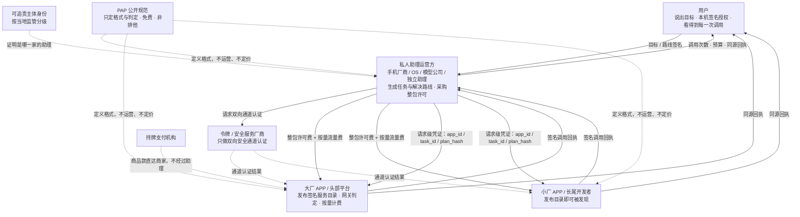
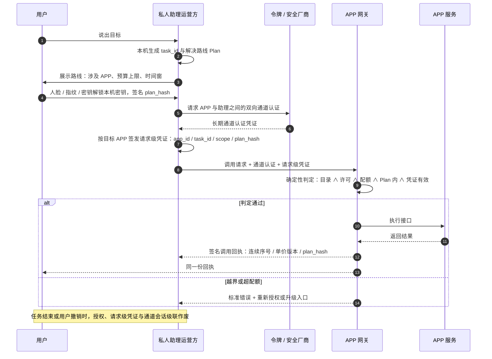
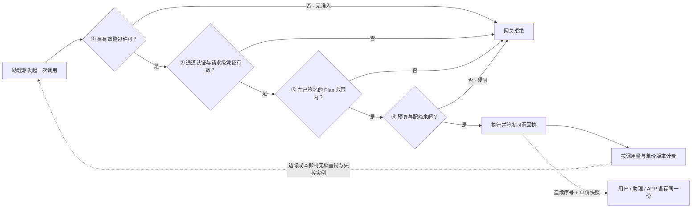

# PAP：关于私人助理与 APP 之间一套共同规则的一点想法

> **一句话**：当每一个终端、每一个操作系统、每一家模型公司都在做自己的私人助理生态时，与其让每个 APP 为每种助理重复适配一遍，不如把「助理调用 APP」这件事做成一份统一、公开、非排他的接口格式规范。

| | |
| --- | --- |
| **名称** | PAP — Personal Agent Protocol（个人智能代理接口协议） |
| **状态** | **只是一个想法与一条建议**；不是标准，不代表任何机构 |
| **性质** | 把想法写清楚，供有兴趣的人参考、改写或一起讨论 |
| **日期** | 2026 年 11 月 |
| **许可态度** | 规范免费公开、非排他、不主张专利；**无需保留原名称** |

> ⚠️ 本文区分两类内容：**2026 年已经发生的产业与监管事实**，以及 **PAP 建议采用的机制**。备案、整包许可、通道认证、任务路线、调用回执等均为设计建议，不代表任何企业、机构或现行标准已经实施。
> 📄 其他语言：[English](en.md) · [한국어](ko.md) · [日本語](ja.md) · [Deutsch](de.md)

---

## 0. 摘要

1. **问题不是「助理能不能做事」，而是「每家都要重谈一遍」。** 系统级智能体的能力在 2026 年已经不是瓶颈；瓶颈在接口、授权、计费、责任这层规则。
2. **碎片化的成本是乘法的。** 若有 `M` 个助理生态、`N` 个 APP，逐家私有适配需要 `M × N` 套对接；统一格式规范后降为 `M + N` 套实现。APP 侧重复适配、助理侧逐家谈判、用户侧体验割裂，三种代价同时出现。
3. **解法是一份薄协议，不是新平台。** PAP 只规定「格式与判定」，不运营任何系统、不定价、不抽成、不托管资金、不新建根信任。
4. **开放不等于免费。** 规范文本免费，但 **APP 开放的接口调用是收费服务**：整包商业许可 + 按量流量费。收费不只是商业回报，更是一套**调用调控机制**——用准入、边际成本、配额硬闸抑制助理失控与滥用。
5. **四方共同发展**：消费者、私人助理运营方、APP 厂商（大厂与小厂各有不同收益）、令牌／安全服务厂商，从同一条增量价值链的不同环节取酬，不是零和再分配。

---

## 1. 问题：生态正在沿厂商边界分裂

### 1.1 参与者远不止手机厂商

「私人助理」在 PAP 里是一个**开放类别**，不绑定任何一家主体：

| 类型 | 典型形态 |
| --- | --- |
| 终端厂商 | 手机、PC、平板、车机、可穿戴设备自带的系统级助理 |
| 操作系统厂商 | 把助理做成系统运行时，而非一个 App |
| 模型 / AI 公司 | 以模型能力为入口的通用助理、独立 Agent 产品 |
| 互联网平台 | 由超级 App 反向延伸出的助理 |
| 垂直与开源助理 | 面向特定场景或由社区维护的助理实例 |

**PAP 不预设谁来运营、不设排他席位、不指定首发方。** 多家并存是前提，不是待解决的问题。

这也不是设想：2026 年 8–10 月，小米澎湃 OS 4 的超级小爱、华为 HarmonyOS 7 的小艺、荣耀 MagicOS 11 的 YOYO、vivo OriginOS 7 的蓝心小 V、OPPO 新一代 ColorOS 的小布先后升级为系统级智能体，各自建立任务编排框架；中兴努比亚把豆包手机助手做进整机，阶跃星辰 STEPX Neo 以智能体手机形态进入同一赛道。同一时期，中国移动灵犀在手机与家庭两端铺开，阿里千问、腾讯元宝、字节豆包各自把集团内的电商、出行、社交、内容与支付服务接进助理，联想天禧把个人助理贯穿 AI PC、平板、手机与智能设备四类终端，蔚来、理想、小鹏、吉利等则在座舱里各自建起整车级助理生态。每一家都在把设备、账户、模型与生态做成助理的护城河，而这些护城河彼此并不通用。正因为多家并存，下面的算术才会成立。

### 1.2 算一笔适配账

假设有 6 个主流助理生态，每个助理要让自己的用户能用到 200 个常用 APP：

| 方案 | 需要实现 / 谈判的对接数量 | 谁承担 |
| --- | --- | --- |
| 各家私有协议 | `6 × 200 = 1200` 套 | APP 侧 200 家各做 6 套；助理侧 6 家各谈 200 次 |
| 统一格式规范 | `6 + 200 = 206` 套 | 每家 APP 实现 1 次，每个助理实现 1 次 |

现实比公式更糟：同一家 APP 面对的往往不是 6 套「协议」，而是 6 套**不同的授权模型、凭证格式、计量口径、责任条款和商务流程**。各家把「能被助理调用的服务」抽象成各自的一套工具与技能目录——有的按系统原子能力组织，有的按意图框架组织，有的按场景卡片组织，接入路径、鉴权与结算方式都不相同；技术适配只占一小部分，商务与合规谈判才是主要成本。生态还在同时扩张：荣耀公布 YOYO 已累计接入上万项第三方 AI 服务，中国移动灵犀家庭智能体公布覆盖全国 31 个省份、服务超 1 亿家庭并以「一次接入、多端适配」向第三方应用开放，小米、华为、vivo、OPPO 及各大平台的助理也在持续增加可调用服务；每增加一家 APP，都要在每一套生态里重新做一遍。这套成本会随着生态数量**继续相乘**——今天 6 家，明年可能是 10 家。

更根本的一层是：即便技术上连得上，也不等于对方愿意被调用。2026 年的公开实测反复出现同一句结论——**用户同意不等于平台许可**。几家平台分别尝试了把屏幕操作做成可授权的执行协议、把规划能力做成模组交给手机厂商、以及用卡片把用户交回服务方页面完成最终选择与支付；三条路线都绕不开同一道闸门：服务的接入权、商业条款与责任划分没有共同规则。已有的通用互联规范解决的是「能不能连」，PAP 补的是「连了之后，凭什么被允许用、怎么计价、出事谁负责」。

### 1.3 三个代价

- **APP 侧：重复适配 + 被管道化的担忧。** 当「用户主动打开」变成「AI 主动调用」，入口、推荐位与广告流量被绕过，APP 若得不到可计量的回报与可控的边界，理性选择就是**不开放**，或只向少数几家开放。
- **助理侧：逐家谈判，长尾永远谈不完。** 头部 APP 可以一家家谈，长尾服务没有谈判价值，于是助理的能力永远停留在「能用的那几十个」。
- **用户侧：体验割裂，安全不可控。** 换一台设备、换一个助理，授权、偏好、记忆与账单全部重来；一次任务调用了哪些 APP、花了多少钱、谁看过数据，用户说不完整，也说不清。

### 1.4 这个问题已被公开点名

| 时间 | 公开事实 | 指向 |
| --- | --- | --- |
| 2026/6/26 | 市场监管总局在智能体互联标准化新闻发布会上指出：不同厂商智能体间接口、协议不统一，形成「**智能体孤岛**」，严重制约规模化协同应用 | 碎片化已是监管层面确认的问题 |
| 2026 年内 | 相关主管部门与行业机构反复提示：身份可信、授权边界、数据安全、责任追溯是智能体交互的主要缺口；若各厂商自建封闭协议体系，将造成新的生态壁垒与重复建设 | 规则层而非能力层是瓶颈 |
| 2026/7 | GB/Z 177—2026《人工智能终端智能化分级》相关分级工作推进，终端智能化已有可依据的分级框架 | 能力侧已有尺子 |
| 2026/11/4 | 乌镇峰会发布《智能互联网创新发展合作倡议》，提出开放、非歧视、透明的智能体互操作方向，强调「主体可信、行为可控、责任可溯」 | 治理方向与本文一致 |
| 2026/11/6 | 新华社报道荣耀提出「智能体网络」，并指出其「相互调用还是各自为战，取决于接口标准、数据授权与利益分配能否对齐」 | 产业界已把规则层点名为决定性变量 |
| 2026/5/8 | 国家网信办、国家发展改革委、工业和信息化部联合印发《智能体规范应用与创新发展实施意见》，提出建立智能体标准体系以降低研发与适配门槛，并研究智能体身份标识、可信互联、合规支付、安全防护，以及能力声明、接口协议等信息查询管理 | 官方已把「接口协议 + 可信互联 + 合规支付」列为待建的基础能力 |
| 2026/11/5 | 中国移动在移动网络大会展示灵犀家庭智能体，公布其家庭 AI 入口覆盖全国 31 个省份、服务超 1 亿家庭，并以「一次接入、多端适配」向第三方应用开放；中国电信、中国联通同期各自推出跨终端智能体与编排平台（厂商公布） | 需要共同规则的早已不止「手机 ↔ APP」这一段 |

同一个信号反复出现：**能力已经就绪，规则层还空着。** 各家助理都已能规划上百步任务，却仍要靠自己逐家去谈接口、授权与结算；而规则层如果由各家分别补齐，就会固化成若干个互不兼容的生态。

---

## 2. PAP 是什么，不是什么

### 2.1 定义

> PAP 是一套**公开、可自由实现、非排他**的接口格式规范，规定个人智能助理调用第三方 APP 开放接口时，服务目录、商业许可、通道认证、任务授权、凭证生命周期与调用回执的格式与判定规则。

它只做一件事：把「助理调用 APP」这件双边行为，变成**双方各自可以独立实现、独立验证、离线可判定**的格式约定。

### 2.2 是 / 不是

| PAP 是 | PAP 不是 |
| --- | --- |
| 一份可免费读取与实现的规范文本 | 一个平台、一套 SaaS、一个运营主体 |
| 格式与判定规则（应／宜／不应） | 定价表、清算所、资金通道 |
| 双方各自实现、可替换的本地能力 | 中心化的目录服务、认证中心、账本 |
| 对高风险接口的底线要求 | 新的根信任体系或统一身份中心 |
| 对「谁在调用、代表谁、到什么范围」的可验约束 | 用户授权本身的签发方 |
| 可自由改写、拆分、另起名称 | 需要授权、缴费或取得席位才能使用 |

### 2.3 四条基本原则

1. **协议与商业分离** — 规范免费公开，不收协议许可费、不抽成；商业条款由 APP 与助理运营方自行约定。
2. **规范层开放，运营层可追责** — 任何人可以实现规范；实际面向用户提供助理服务的运营方，应按当地监管要求具备可识别、可追责的主体身份。两者互不替代。
3. **接入自愿** — 没有任何 APP 被要求开放，也没有任何助理被要求采购某家 APP 的许可。
4. **用户保留最终授权** — 商业许可、通道认证、用户授权是三件不同的事，任何一者都不能代替另外两者。

> PAP 不重复现有协议的工作：模型与工具的对接、智能体之间的协同、通用授权框架、支付授权协议，都有各自的规范可用。PAP 补的是它们之间**尚未覆盖的那一段**——助理运营方与第三方商业服务之间的接口目录、许可、计量与责任边界。

---

## 3. 协议包含什么

| # | 规范对象 | 规定什么 | 解决什么 |
| --- | --- | --- | --- |
| 1 | **签名服务目录** | APP 以机器可读、带版本号与签名的形式公布接口 ID、能力描述、限流、风险等级、单价版本 | 说清「整包里到底有什么」，避免事后扯皮 |
| 2 | **整包商业许可** | 助理运营方向单家 APP 采购该 APP 开放接口的整包许可；许可对象、有效期、配额、撤销端点的格式 | 把商业许可变成网关可判定的对象 |
| 3 | **通道认证** | 由令牌／安全服务厂商为 APP 与助理之间建立双向安全通道认证，证明「这是哪家运营方的哪个合法实例」 | 防止伪造、失控实例与中间人 |
| 4 | **任务与解决路线（Plan）** | `task_id`、涉及的 APP 与接口清单、预算上限、时间窗、失败备选路线、`plan_hash`、版本 | 用户授权的对象是「这条路线」，不是每一次点击 |
| 5 | **请求级凭证与生命周期** | 每次请求携带 `app_id + task_id + scope + plan_hash`；令牌、授权、任务三层生命周期**嵌套且级联失效** | 每个 APP 独立钥匙，任务结束即全部作废 |
| 6 | **三方同源调用回执** | `task_id / interface_id / 连续序号 / 时间戳 / 单价版本 / plan_hash / APP 签名` | 用户、助理、APP 存同一张回执，计费无需争议 |
| 7 | **高风险接口底线** | 支付、转账、改账户安全信息、删除数据等：当次确认、独立凭证、可撤销、审计留痕 | 底线不因档位或商务约定下放 |

两个容易被忽略但很关键的判定：

- **授权覆盖率 100%**：任何一次调用都必须能挂到一条有效用户授权之下，无授权依据的调用网关直接拒。但**不等于每次调用都要用户刷脸**——「帮我安排一次旅行」背后可能有上百次查询，用户在路线做一次强认证即可，路线内静默执行。只有路线变更、越出预算或时间窗、以及高风险操作才需要重新确认。
- **生物特征不上送**：人脸、指纹、密钥等多种授权形式，统一为解锁本机同一把签名密钥；生物特征只用于本机解锁，绝不作为凭证传给 APP。

---

### 3.1 参与方关系总图



---

## 4. 一次调用怎么走

1. 用户说出目标，助理在本机生成 `task_id` 与解决路线 Plan，本机留存记录。
2. 助理向用户展示路线（涉及哪些 APP、预算上限、时间窗），用户以人脸／指纹／密钥等方式解锁本机密钥，对 `plan_hash` 签名授权。
3. 助理比对 APP 的签名服务目录，确认所需接口在目录内、许可有效、配额未耗尽。
4. 令牌／安全服务厂商完成 APP ↔ 助理的双向通道认证（长期通道凭证）。
5. 助理按目标 APP 签发**请求级凭证**（含 `app_id / task_id / scope / plan_hash`），一次任务中不同 APP 拿到彼此独立、不可串用的凭证。
6. APP 网关执行确定性判定：

```
interface_id ∈ 已公布目录
  ∧ 该运营方许可有效
  ∧ 配额未超
  ∧ 请求在已签名的 Plan 范围内
  ∧ 通道认证与请求级凭证均有效
→ 执行；否则返回标准错误并附可机读的升级／重新授权入口
```

7. APP 执行后签发**调用回执**，同一份回执分发三方：用户看到「这个任务调了多少次、还剩多少预算、哪些接口被调过」；助理运营方看到各 APP 成本；APP 看到该实例的调用量与应结金额。
8. 任务结束 / 用户撤销 / 超出时间窗 → 授权、请求级凭证、通道会话按嵌套关系**级联作废**。

**连续序号**保证缺号即漏记，**单价版本快照**锁死调用发生那一刻的价目。用户本机那份回执可导出、可迁移、可按 `task_id` 一键撤销——真出现多计费，用户不需要求任何一方调日志。

---

### 4.1 一次调用的时序



---

## 5. 开放 ≠ 免费：把收费设计成调用调控机制

这一节是 PAP 最容易被误读的地方。「开放协议」常被理解成「调用也不要钱」，但那恰恰会让生态起不来。

### 5.1 先分清三件事

| | 是否收费 | 由谁决定 | PAP 的角色 |
| --- | --- | --- | --- |
| **规范文本**（格式、判定规则、schema） | **免费**，任何人都可读取、实现、部署 | 公开社区 / 标准组织 | 发布格式与一致性测试，不收许可费、不抽成 |
| **APP 开放的接口调用服务** | **收费**：整包商业许可 + 按调用量的流量费 | APP 与助理运营方自行协商 | 规定目录、许可、回执的**格式与判定**，不定价 |
| **用户为助理付的套餐** | 由助理运营方自定 | 助理运营方 | 不介入 |

所以「开放」说的是**准入与实现权**：谁都可以按规范做助理、做 APP 接口、做令牌服务，不需要谁批准、不需要买席位。它从来不意味着「APP 把接口白送给别人用」。这与第 2.3 节的「协议与商业分离」是同一条原则，不是例外。

### 5.2 为什么「完全免费开放」反而危险

如果调用零成本、无摩擦，会出现四个必然结果：

- **失控实例无法被抑制**：一个规划糟糕或遭劫持的助理可以在短时间内发起海量查询，成本全由 APP 承担。
- **爬取与滥用难以区分**：正常任务调用与变相的数据抓取，在零成本条件下没有经济差异，APP 只能一刀切封禁。
- **负载不可预测**：APP 无法为「Agent 流量」做容量规划，理性反应是把接口收得更紧，甚至拒绝开放。
- **责任无法定价**：许可既是商业合同，也是「谁对这批调用负责」的凭证。没有许可，追责对象就消失了。

结果就是一条反直觉的链：**免费开放 → APP 不敢开放 → 生态根本起不来。** 收费不是对开放的限制，而是让开放可持续的前提。

### 5.3 收费的四重调控作用

| 机制 | 作用 | 具体效果 |
| --- | --- | --- |
| **许可费（准入门槛）** | 筛掉不可追责的主体 | 只有完成身份识别、签署条款、承诺承担责任的运营方才拿得到钥匙；滥用可撤销许可 |
| **流量费（边际成本）** | 每次调用都有成本 | 助理运营方有动力做任务规划、去重、缓存与结果复用，而不是无脑重试；「搜索 1 次」与「下单 1 次」可差异化计价 |
| **配额 / 预算（硬闸）** | 用户预算直接翻译成调用上限 | 网关超额即拒，商业问题变成确定性的技术控制，从根本上防费用失控 |
| **回执（可计量）** | 三方同源、连续序号、单价版本快照 | 调用次数与流量可核对、可举证，收费争议归零；同时是可追溯的审计依据 |

这四者与通道认证、Plan 签名是一套东西：**令牌管「能不能连上」，授权管「用户同不同意」，收费与配额管「能连多少次、到什么范围」。** 这也正好回应了最初那个担忧——防止私人助理失控或者随意调用接口，不能只靠一把锁，还得靠成本与配额这两道闸。

### 5.4 PAP 在收费里做什么、不做什么

**做**：定义服务目录的字段（含单价版本）、许可对象的格式、调用回执的字段与连续序号规则、配额耗尽与超范围的标准错误码、一致性测试。

**不做**：不设价格、不做清算、不托管资金、不抽成、不要求任何 APP 采用某种商业模式。商品款仍直达商家，资金与支付授权由持牌机构按现行规则处理。

> 一句话：**PAP 让「收费」变得可判定、可核对、可撤销，但收费本身始终是两个商业主体之间的事。**

---

### 5.5 四道闸：收费如何变成控制



---

## 6. 各方获得什么

### 6.1 消费者

- 一次说清目标，跨 APP 自动完成；不必在十几个应用之间来回切换。
- **授权对象是路线**：一次确认覆盖整条路线，不必每查一次就刷一次脸；路线变更、超预算、高风险操作才再确认。
- **完全可见、可举证**：本机留存每次调用的次数、接口、预算消耗；回执可导出、可迁移，支持按 `task_id` 一键撤销。
- 隐私边界明确：生物特征不上送，通道认证只证明实例身份，不代替用户同意。
- 换设备、换助理时可带走授权记录与偏好，不被单一生态锁住。

### 6.2 私人助理运营方（含手机厂商、OS 厂商、模型公司、独立助理）

- **从 1200 套对接降到 206 套**：一次实现，可对接所有按规范发布目录的 APP；长尾服务首次变成「按目录可用」而不是「按商务可谈」。
- **能力分层自己定**：初级档不含支付接口、高级档开放更多能力——档位是运营方对 C 端用户的产品分层，APP 侧不感知、不关心，只看接口 ID 与调用量。
- 采购成本与调用成本可预测，预算可硬闸，不会出现无法解释的账单。
- 系统级位置、装机量、设备侧安全能力、账户体系这些既有资产，第一次有了统一的变现出口；PAP 不要求运营方交出这些资产，目录、凭证与回执都在各方自己手里实现。
- 规范开放意味着**不需要等谁批准、不需要买席位**，谁先跑通谁先形成事实参照。

**对已经建起生态的运营方，PAP 放大的不是同一项能力，而是各自不同的那一项。** 小米的「人车家全生态」与自研模型，让同一条已签名的任务路线可以在手机、车机与家居设备间接力，而调用与计费仍落在同一张回执上；华为的全栈自主链条与把自研技术做成产业公共标准的经验，使「设备互联」自然延伸为「服务互联」，小艺「意图即服务」的调度能力不必再为每家服务重写一套鉴权；荣耀已把跨品牌互传做成共同技术标准、并把上万项第三方服务接进系统级调度框架，一份签名服务目录能让这些服务从「逐家接入」变成「按目录可用」；vivo 把系统原子能力封装成可调用工具、强调端侧「透明、可控、可信」，与本机签名授权、生物特征不上送是同一套前提；OPPO 的小布已能一句话串起支付、地图与社交等跨应用操作，标准化之后这些现成能力可直接带上许可、配额与回执；联想天禧的「四端一体」与技能共创计划、中兴努比亚与模型公司合作的整机形态，让 PC、平板与新型终端不必各自再谈一遍服务接入；STEPX Neo 这类新进入者更不必逐家谈完上百个 APP，靠公开目录就能把长尾服务接进来。

**生态链更长的一方，收益落在另外的环节。** 运营商握着号码、套餐、计费与家庭入口——中国移动灵犀已把家庭终端与第三方应用按「一次接入、多端适配」组织起来，若再加上统一的签名目录与同源回执，跨端任务就能直接在既有计费体系里结算；互联网平台的优势是集团内品类纵深，阿里千问把电商、出行与支付接成一条服务链，腾讯元宝与美团、京东的服务互通，字节豆包把地图、出行与票务聚合进同一个任务界面，都说明「能被助理调用的服务清单」本身就是资产——统一格式让这份清单可以被别家合规调用，而不必每家平台都自建一套对外授权与计量；支付宝、微信这类超级入口以及蚂蚁公布的可信智能体身份服务，正好落在 PAP 的通道认证与可追责主体身份这两层；蔚来、理想、小鹏、吉利等车企的座舱助理，则能把「通勤顺路订餐、到家前开空调」这类跨设备任务接进同一条已授权的路线。**PAP 不抹平这些差异**，恰恰让每一家的独特资产都能对接到同一批 APP，而不必各自再建一套商务、鉴权与计量体系——竞争回到「谁把助理做得更好」，而不是「谁谈下了更多家 APP」。

### 6.3 大厂 APP / 头部平台

- **接口只实现一次**，不必为每个助理生态维护一套授权、凭证、计量与责任流程。
- **入口被绕过的问题有了对价**：许可费 + 按量流量费把「Agent 流量」变成可计量的新收入，而不是白丢的推荐位与广告位；CPS 等反向分成也可作为可选补充。
- **敢开放**：可识别的运营方身份、可撤销的许可、配额硬闸、同源回执，把「开放接口」从安全与合规风险变成可控业务。
- 保留完整的定价权、限流权、目录发布权与拒绝权；PAP 不要求公开商业秘密，只要求目录机器可读、带版本、可校验。
- 负载可预测、滥用可定价，容量规划第一次有了依据。

### 6.4 小厂 APP / 长尾开发者

这一方的收益最容易被低估，也最能说明为什么统一协议优于私有生态：

- **接入一次，触达所有合规助理**。在私有生态里，小厂根本排不进任何一家的商务谈判名单；统一目录让「被长尾需求发现」第一次成为可能。
- **零改造起步**：发布一份机器可读的签名目录 + 授权第三方适配器，即可被发现和调用，不必为还没出现的流量先立项改造系统。
- **流量即报酬**：助理带来的成交与调用，按量计费或按效果分成，小厂不必先付投流成本。
- **叫价有依据**：公开价目表 + 同源回执，让小厂第一次能和大厂在同一套计量口径下谈价，而不是单独面对每家平台的议价。
- 风险：整包价可能由规模较大的助理运营方主导。**这是商业谈判问题，不是协议能解决的**，文中只如实标注，不假装消除。

### 6.5 令牌 / 安全服务厂商

- 职责清晰且边界窄：**只为 APP 与私人助理之间建立双向安全通道认证**，证明「这是谁家的哪个合法实例、通道是否完整」。
- 不碰业务路由、业务数据、资金、用户授权内容、档位设计——职责越窄，越容易被各方同时接受。
- 通道认证与调用回执天然留痕，为计费、审计、风控提供同一份事实来源；多家可并存、可竞争，不形成单点。
- **明确不做的**：不成为用户授权主体、不经手资金、不决定谁能调谁。支付安全的最终授权主体仍是用户与持牌支付机构。

### 6.6 监管与产业

- 主体可识别、行为可追溯、责任可界定，与「主体可信、行为可控、责任可溯」的治理方向同向；《智能体规范应用与创新发展实施意见》要求做好智能体权限管理与行为管控、将安全可控列为底线，与 PAP 的授权覆盖率 100%、高风险接口当次确认正好对齐。
- 授权与调用留痕、回执可举证，降低纠纷处理成本。
- 开放非排他的格式规范，减少重复建设与生态壁垒。

### 6.7 收益矩阵

| 参与方 | 主要收益 | 主要代价 / 义务 |
| --- | --- | --- |
| 消费者 | 省事、可见、可撤销、可迁移 | 一次路线确认 |
| 助理运营方 | 适配成本从乘法降为加法、能力变现 | 采购许可、承担授权真实性责任 |
| 大厂 APP | 一次实现、新收入、敢开放 | 发布签名目录、接受计量 |
| 小厂 APP | 一次接入、长尾获客、按量收费 | 目录维护，议价权仍偏弱 |
| 令牌厂商 | 明确的新服务品类 | 严守三条边界，不加戏 |
| 监管 / 产业 | 可追溯、可追责、少重复建设 | 需补充分级与合规细则 |

### 6.8 收益来自增量，不是再分配

这是四方能否同时成立的关键：价值主要来自**过去不存在的「跨平台任务自动化」**——一次旅行、一次比价、一次跨应用办事，原本需要用户手动完成几十步。四方分别从效率、入口、服务分发、通道安全这四个**不同环节**取酬，不是在同一笔既有收入里互相争抢。

也因此，三赢／五赢不是自动成立的，需要四项约束同时具备：

1. **主体分级可追责**：按风险等级区分登记与强审计，不设一刀切的高门槛，避免把独立开发者与开源助理挡在门外。
2. **同档位非歧视**：同一目录、同一价目表下不自我优待；用户明确指定的 APP 硬优先，不能被运营方默认值覆盖；推荐理由留可审计日志。
3. **授权覆盖率 100% + 回执同源**：不允许「无授权依据的调用」，不允许某一方独占账本。
4. **规范保持公开**：格式可完整实现、可镜像、可替换。规范一旦变成需要席位才能用的东西，前面三条都会失效。

---

## 7. 2026 年事实

| 时间 | 事实 | 含义 |
| --- | --- | --- |
| 2026/6/26 | 市场监管总局点名「智能体孤岛」，指出接口与协议不统一制约规模化协同 | 碎片化已被官方确认 |
| 2026/7 | GB/Z 177—2026《人工智能终端智能化分级》相关分级工作推进，首批多款产品获 L3 级评价；L4「协同级」仍留白 | 能力侧有尺子，协同侧仍空白 |
| 2026/9/30 → 10/16 | 阶跃星辰 STEPX Neo 智能体手机获入网许可、10/13 发布、10/16 开售；Step AOS 1.0 + 个人智能体 Amoo，提出「可信、可见、可控、可逆」，兼容主流智能体互联协议，已对接近百家应用 | 系统级智能体已成可售产品，且已开始逐家对接 |
| 2026/8–9 | 小米澎湃 OS 4、华为 HarmonyOS 7、荣耀 MagicOS 11、vivo OriginOS 7、OPPO 新一代 ColorOS 先后把语音助手升级为系统级智能体，各自推出任务编排框架与开发者接入方式（厂商公布） | 同一个季度出现多套并行的助理生态 |
| 2026 年内 | 荣耀公布 YOYO 月活约 1.6 亿、累计接入上万项第三方 AI 服务；华为公布小艺可调用 2100 余项系统能力、连接 2000 余个生态智能体；小米超级小爱 2.0 已接入支付宝、高德等 10 余家三方服务（厂商自报，未经独立审计） | 每家都在逐家扩服务，APP 侧适配重复发生 |
| 2026 年内 | 中国移动灵犀公布家庭 AI 入口覆盖 31 个省份、超 1 亿家庭；阿里千问、腾讯元宝、字节豆包各自把集团内电商、出行、支付与内容服务接进助理；联想天禧以「一次上架、多端分发」向开发者开放技能；车载智能体装配率据行业统计由 2025 年一季度 10.4% 升至 2026 年一季度 35.3%（行业口径，未经独立审计） | 生态边界早已超出手机，运营商、平台、PC 与车机同时在做入口 |
| 2026 年内 | 支付宝公布 AI 支付相关能力落地，并称过去 5 个月智能体代买任务量增长 7 倍（厂商自报，未经独立审计） | 真实调用流量已出现，计量与结算成为现实问题 |
| 2026/10/8 | T/ISC 0145—2026《系统智能体权限管理技术要求》实施 | 「智能体↔本机／系统资源」已有规范 |
| 2026/11/4 | 乌镇峰会《智能互联网创新发展合作倡议》及同期智能体互信相关公开成果 | 互信与互操作成为公开议题 |

**把这些放在一起看**：终端侧能力、支付侧流量、权限侧标准、治理侧倡议都已就位，唯独「智能体 ↔ 第三方商业服务」这一段——服务目录、商业许可、任务授权、调用计量与责任边界——还没有共同规则。而产业里已经在用「逐家谈、逐家适配」的方式自己填这个洞：同一家出行或票务服务，要分别适配几套不同的调度框架、凭证与结算口径；平台侧三种不同的绕行路线，最终也都停在「对方愿不愿意被调、怎么计价、谁担责」这同一道闸门前。**这正是标准窗口：现在填，成本最低；等各家私有接口固化后再填，就要兼容一堆既成事实。**

---

## 8. 为什么统一开放协议优于各家私有生态

| 维度 | 各家私有生态 | 统一开放协议 |
| --- | --- | --- |
| 适配成本 | `M × N`，随生态数量相乘 | `M + N`，一次实现多方复用 |
| 小厂能否进入 | 排不进商务名单 | 发布目录即可被发现 |
| 用户迁移 | 授权、偏好、记忆留在原生态 | 可导出、可迁移、可撤销 |
| 责任界定 | 每套协议一套条款，纠纷难判 | 同一套凭证与回执口径 |
| 计费争议 | 各方各记一套账 | 三方同源、连续序号、单价快照 |
| 创新速度 | 长尾服务等待被挑选 | 长尾服务自主接入 |

一个反直觉但重要的点：**开放非排他，对先发者并不是让利。** 目录可完整镜像、用户授权可导出、同一份声明对接 N 个助理的边际成本接近零——这三件事让「排他」既没必要也不划算；而率先跑通的一方拿到的是**事实参照位置**：目录格式、回执字段、一致性测试、试点数据、以及参与后续标准讨论的资格。规则越早由把生态真正跑起来的一方参与定义，越不需要日后兼容别人定的规则。

---

## 9. 风险与诚实边界

1. **采纳不确定**：本文只是一个想法，不承诺被任何企业或标准组织采纳；更可能的结果是若干概念被吸收、改写，且不以可追溯的方式出现。
2. **规范不管定价**：整包许可与流量费的具体金额、分成结构属于商业谈判，PAP 只规定格式与判定，不介入。
3. **小厂议价权**：整包价可能由规模较大的一方主导，协议无法消除结构性议价差距。
4. **档位由运营方自定**：PAP 只守高风险接口底线，不统一定义「初级／高级」里装什么；运营方可以在底线之上自由分层，但不得把「无需确认的支付」放进任何一档。
5. **合规叠加**：主体身份、生成式 AI 相关备案、个人信息与数据跨境、支付牌照等会叠加，需要专门章节处理，本文不假装解决。
6. **境外主体**：跨域身份与信任策略的互认、境外 APP 接入的适用规则，是开放问题；本文倾向凭证格式与信任策略解耦、由 APP 在目录中声明可接受签发方，而不是新建统一根。
7. **GUI 通道**：屏幕自动化可作为目录 / 适配器之外的过渡阶梯，但不得成为绕过商业许可与用户授权的后门。
8. **商业许可 ≠ 用户授权**：这条最容易被混淆。身份备案是法人级的，接口调用是实例级的，用户同意是任务级的，三层不可互相替代。
9. **协议不能解决竞争法问题**：排他、自我优待、垄断属于监管与商业谈判范畴，不应写进格式规范里假装能解决。
10. **冷启动**：本文倾向由具备装机量与系统级位置的运营方先行形成真实调用量，再带动长尾 APP 接入；这一判断是产业推测，不是既成结论。
11. **与注册平台类安排的关系**：《智能体规范应用与创新发展实施意见》提出探索建立智能体注册平台，提供数字身份管理、检索发现与能力声明等查询管理服务；PAP 只规定接口目录、凭证与回执的格式与判定，主张目录由各方自行发布、可完整镜像，不预设任何中心化注册或身份服务。两者分处格式层与治理层，本文不对监管安排作判断。

---

## 10. 路线图

| 阶段 | 内容 | 是否需要中心系统 |
| --- | --- | --- |
| **P0** | 纯文本规范：签名服务目录、Service Description、整包许可最小 profile、调用回执 schema、错误码与一致性测试 | **不需要**，可直接写成规范文本 |
| **P1** | 适配器与 GUI 通道的合规边界、责任划分 | 不需要 |
| **P2** | 通道认证与请求级凭证格式、三层生命周期与级联失效规则；复用现有 PKI 与身份体系，不新建根 | 不需要 |
| **P3** | 对账与争议处理流程、非歧视条款、高风险接口底线 | 不需要 |
| **P4** | 垂直试点（建议从出行／票务／本地生活切入，1 个场景 + 3–5 家 APP），跑通「一次授权 → 跨 APP 执行 → 三方同源账单」，再向标准组织提交 | 试点由参与方自行运营 |

**P0 到 P3 都是文本，不需要任何中心化在线服务即可开始。** 这是 PAP 刻意保持「薄」的原因：一份只需要写清楚、不需要先建平台就能推进的规范，才不会被冷启动卡住。

---

## 11. 如何参与

这点想法以开放方式发布，欢迎任何个人、企业、标准组织采用、改写、拆分或另行发起，**无需保留原名称**。最有用的几种参与方式：

- **挑错**：在 Issues 里指出判定链、生命周期或回执字段里的漏洞，尤其是会导致「无授权依据的调用」或「悬空凭证」的情况。
- **补一致性测试**：把 P0 的格式规范变成可离线运行的最小测试样例，比再多论证都管用。
- **实现参考版本**：一个最小可用的服务目录 + 网关判定 + 回执签发样例，可直接证明这套规则能跑。
- **提供区域事实**：补充本地监管、产业与标准进展，特别是能证明或证伪「碎片化成本」的公开数据。
- **讨论收费调控**：许可费与流量费如何既起到准入与配额作用、又不变成小厂的准入壁垒，是本文最需要被挑战的一节。

---

## 12. 术语

| 术语 | 含义 |
| --- | --- |
| **私人助理 / 运营方** | 面向用户提供系统级智能体服务、可被识别与追责的主体；手机厂商只是其中一类 |
| **服务目录** | APP 发布的带签名、带版本的机器可读接口清单 |
| **整包商业许可** | 运营方向单家 APP 采购其开放接口整体的商业授权；**哪些 APP 采购由运营方自主选择** |
| **通道认证** | 令牌／安全服务厂商为 APP 与助理之间建立的双向安全通道认证，不涉业务数据 |
| **Plan（解决路线）** | 一次任务的 APP 与接口清单、预算、时间窗、备选路线；用户签名授权的对象 |
| **请求级凭证** | 每次调用携带、按目标 APP 独立签发的短期凭证 |
| **级联失效** | 令牌／授权／任务三层生命周期嵌套，任一层终止时其下凭证一并作废 |
| **调用回执** | APP 网关签发、三方各存同一份的签名计费与审计记录 |
| **授权覆盖率 100%** | 任何调用都必须挂到有效用户授权下；不等于逐次交互确认 |

---

## 13. 资料来源与核查说明

**A 类（官方 / 监管来源）**：市场监管总局 2026/6/26 智能体互联标准化新闻发布会相关公开报道；GB/Z 177—2026《人工智能终端智能化分级》及配套分级工作公开信息；中国网信网 2026/11/4《智能互联网创新发展合作倡议》及专家解读；全国团体标准信息平台 T/ISC 0145—2026《系统智能体权限管理技术要求》；中国互联网协会「智能体互联网治理」系列团体标准公开通知与征求意见稿；国家网信办、国家发展改革委、工业和信息化部 2026/5/8 联合印发《智能体规范应用与创新发展实施意见》（中央网信办官网、新华网、人民日报）。

**B 类（权威媒体转述）**：科技日报、新华网、人民日报、经济日报、中国新闻周刊、中国日报网等对 2026 年智能体产业与标准化进展的报道；2026 年 9 月各终端厂商开发者大会、2026 移动网络大会与各运营商智能体发布的公开报道；券商行业点评与行业媒体对同期多家系统级智能体、个人智能体生态接入实测的整理；2026 年世界互联网大会乌镇峰会相关公开报道。

**C 类（厂商自行公布或行业口径，未经独立审计）**：STEPX Neo 产品发布与生态对接数量、支付宝智能体代买任务量增长数据；小米、华为、荣耀、vivo、OPPO、联想、中兴努比亚等公布的助理月活、可调用系统能力数量、已接入第三方服务数量与任务闭环率；中国移动、中国电信、中国联通公布的入口覆盖与生态接入规模；阿里、腾讯、字节等平台公布的服务互通与订单数据；车载智能体装配率等行业统计。此类数据仅用于说明「产业现状与方向」，不作为规范条文的技术依据。

**核查日期**：2026 年 11 月 7 日。本文未引用任何未公开信息，不代表任何企业、机构或标准组织立场；文中机制均为建议，尚待实现与验证。

---

**这篇文字**：关于 PAP 的一点想法 · 2026 年 11 月
**想法来自**：小洋同学
**许可态度**：规范免费公开、非排他、不主张专利；欢迎采用、改写与另行发起。
**参与方式**：通过本仓库 Issues / Discussions 提出意见、补充测试与参考实现。
